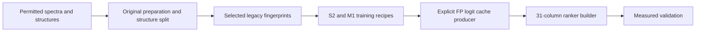

# Enveda CASMI 2026: experiments and public notebook

## V9 complementary checkpoint held-out validation · 20 October

The 3,000-update V9 complementary FPNet checkpoint did not improve on the selected V6 baseline in a paired, fixed-draw 2,048-structure CPU-FP32 proxy: **0.702585 vs 0.706274**, paired change **−0.003689** (95% query-bootstrap interval **[−0.008241, +0.000569]**). This is neither CUDA-FP16 parity nor an official score, and the checkpoint is not adopted into the scorer. The [R3 report, exact receipt, evaluator source and limits](experiments/2026-10-20-v9-complementary-heldout-r3/README.md) retain the full hash binding.

## PubChem growth supplement V10 input binding · 20 October

The [manifest fingerprints and held-out evaluation plan](reproduction/pubchem-growth-supplement-v10/README.md) record the 13 growth-file sizes and SHA-256 claims visible in the public V10 manifest, with no independent payload readback. The note documents row alignment, scorer-identity mismatches, component-specific rights, and a candidate-recall/MRR experiment to run after V43 reaches terminal status. The supplement remains untested; no score gain is claimed.

## Fixed synonym prior replay · 20 October

The [V14 PubChem synonym-prior replay](experiments/2026-10-20-v14-synonym-prior-replay/README.md) reproduces the public author's fixed `0.5 * log1p(synonym count)` panel experiment using hash-pinned cached inputs. The 250-molecule panel changes from MRR@25 **0.96467 to 0.97033**, with top-1 **0.960 to 0.968**; this is a labelled development-panel result, not a hidden-test or official score. The package credits the original method, includes a CPU-only replay and figure, and records an unresolved per-query cache/tie discrepancy.

## Fold-safe top-identity gate · 20 October

A deterministic 64-query canary and the full 250-molecule cached panel replay support a small top-1-preserving fold-safe FPNet blend: gated MRR@25 **0.51443 vs 0.51198 baseline** (paired 95% interval for the gain: **+0.00009 to +0.00534**), with top-1 unchanged. This is public development-panel evidence, not an official score; the [recipe, runnable script, exact hashes, and limits](experiments/2026-10-20-fold0-identity-gate/README.md) are recorded separately. The current panel dataset’s embedded manifests have several mismatched file pins; the release binds the exact Kaggle version 7 inputs by hash.

As of the dated **2026-10-20 16:00 UTC** public leaderboard snapshot, the top score was **0.495** and the prvsiyan row was **0.345** (rank 1,954 of 3,670). That row is not evidence for this cached panel experiment or the current notebook source. See the [dated snapshot](experiments/2026-10-20-fold0-identity-gate/leaderboard_snapshot.json) and [live leaderboard](https://www.kaggle.com/competitions/enveda-CASMI26-molecule-id-mass-spectra/leaderboard).

## Checkpoint and ranker reproducibility audit · 20 October

The [source-pinned historical audit](reproduction/legacy-v2/public-reproducibility-audit/2026-10-20/README.md) records the original preparation and S2/M1 trainer commands. The [updated public asset audit](reproduction/legacy-v2/PUBLIC_REPRODUCIBILITY_AUDIT_2026-10-20.md) now inventories the versioned `casmi26-spec-fp` and `casmi26-pool` inputs, including the retained split, and distinguishes them from the separate 10,395-bit full-fingerprint bank. It also identifies the remaining historical FP-logit cache/checkpoint and ChEBI/LIPID MAPS ingestion provenance gaps. This is a reproducibility update, not a new score claim.

## Verified ChEBI fingerprint shard · 20 October

The [producer, numerical checks and runnable retrieval demo](reproduction/chebi3-fullfp-shard/2026-10-20/README.md) cover 4,096 ChEBI three-star records absent by raw key and exact SMILES from our older candidate bank. All 45 producer outputs passed their hash and numerical checks; the shard contains 4,092 canonical groups. [The pipeline diagram](reproduction/chebi3-fullfp-shard/2026-10-20/assets/pipeline.png) shows the row and fingerprint contracts. Kaggle packaging is pending; score improvement and canonical novelty against the entire old bank remain unmeasured.

## Verified public split · 19 October

The [public V1 dataset](https://www.kaggle.com/datasets/prvsiyan/casmi26-v6-checkpoint-disjoint-ranker-split/versions/1) excludes 67 checkpoint-overlapping queries and retains 10,859 training / 2,653 development queries with zero canonical-group overlap. A full public-input rebuild reproduced all eight arrays in 954.258 seconds. Anonymous downloads matched every one of the 26 published files (71,960,601 bytes).

[Run the rebuild and NumPy demo](reproduction/v6-checkpoint-disjoint-ranker-split/2026-10-19/README.md), or [audit the downloaded files and joins](reproduction/v6-checkpoint-disjoint-ranker-split/2026-10-19/publication-verification/README.md). Source, split rules, measured proof and component licenses are included. This release claims no new model accuracy or official score.

## Completed complementary training · 20 October

The [V9 reproducibility release](reproduction/v9-complementary-training/2026-10-20/README.md) records 3,000 completed role-0 FPNet updates after a 64-update canary, with the exact source, public V1 inputs, recipe, runtime and independent CPU artifact checks. Its 197.7 MB checkpoint and 395.5 MB optimizer state remain in [the exact public V9 Output](https://www.kaggle.com/code/prvsiyan/casmi-fp-trainer-merged-spectra?scriptVersionId=360180749); version-specific download instructions and hashes prevent a silent latest-version substitution. Serving remains unmeasured. A fixed-draw CPU-FP32 held-out R3 comparison found no candidate gain (paired Δ MRR@25 −0.003689; 95% query-bootstrap interval [−0.008241, +0.000569]); this is local proxy evidence, not a competition score. See the [R3 report](experiments/2026-10-20-v9-complementary-heldout-r3/README.md). Historical S2/M1/ranker-cache provenance gaps are still stated explicitly.

## Recovered training and preparation sources · 18 October

The [reproducibility release](reproduction/legacy-v2/README.md) publishes the original spectrum preparation, FPNet, S2/M1 training recipes and `make_ranker3.py`, with checkpoint hashes, all 31 ranker feature definitions and runnable invented-data examples. Configured training limits and selected checkpoint steps are documented separately. Historical initialization was seeded late, and the exact producer of the retained ranker FP caches remains unresolved; this is a transparent source release with stated gaps, not a claim of complete historical weight reproduction.

The [dataset cards and license scope](reproduction/dataset-cards/2026-10-18/README.md) separate uploader contributions from upstream rights and identify private inputs and unresolved provenance. The [fingerprint contract checker](tools/fingerprint-contract/README.md) runs with the Python standard library and includes reproducible invented 6,930-bit and 10,395-bit fixtures; all eight adversarial controls passed. Layout checks do not certify chemical parity or model quality.

The [V37 incident analysis and portable supervisor tests](incidents/2026-10-18-v37-wrapper/README.md) reproduce sixteen process-observation boundary cases. The proposed observer fix preserves all original limits; its effect on the actual native incident remains unverified.

The [selected V6 serving sources](reproduction/selected-v6-serving/README.md) are pinned to the actual public V37 source. V37's driver reported completion for 400 molecules, but its process/RSS supervisor failed: the notebook is **ERROR and ineligible for submission**. No official V6 score is claimed. Legacy 6,930-bit and later 10,395-bit fingerprint coordinates are distinct.

Four [public conceptual illustrations](https://www.kaggle.com/datasets/prvsiyan/four-campaign-notebook-illustrations) include full prompts, alt text, file hashes and a Kaggle display helper. They make no scientific or score claim. Existing notebook opening artwork is preserved.

## Latest runnable utility · 14 October

[Packed Window Lab](tools/packed-window-lab/2026-10-14/README.md) checks inclusive mass windows, aligned candidate rows, explicit bit packing, dummy-bit masks and exact-score ties. The original NumPy package passed **all 14 synthetic controls** in one completed, bounded run. It includes portable source, examples, integration notes and two diagrams. No model was fitted; real producer eligibility and competition performance remain unmeasured.

## Earlier measured experiment · 12 October

[Four-group fallback pilot](experiments/2026-10-12-v25-negative-fallback/README.md): **0 gains, 1 loss and 3 ties**, with MRR@25 changing from **1.000 to 0.875**. These four exposed development groups were deliberately selected for poor library coverage; this negative result supports holding the fallback and reproducing the stronger public baseline before more tuning.

## Earlier gate diagnosis · 12 October

[Native gate activation](native-gate-activation-2026-10-12/README.md) explains a completed negative result: **0 of 400 query groups activated the new ranking path**. Read the diagnosis, regenerate the figure, or reuse the original structural capture auditor. Ranking efficacy remains unmeasured; the next reference-library holdout is a separate experiment.

## Earlier experiments worth reading

Existing public campaign notebook: [Analog Propagation - CASMI 2026 baseline](https://www.kaggle.com/code/prvsiyan/analog-propagation-casmi-2026-baseline). This stable identity was observed public in the retained 11 October snapshot; the guide makes no current run-status or score claim.

The permanent archive includes [Energy-balanced projection](https://github.com/cubres/enveda-casmi-2026/blob/0c5cf4615cf1de050e7e3dc769630c5b760f284b/tools/energy-balanced-projection/2026-10-05/README.md) and [Protected candidate/control comparison](https://github.com/cubres/enveda-casmi-2026/blob/1832b0157cc151f8e1afe3ac363763348a9ec784/protected-candidate-control-2026-10-09/README.md). Read their original claim limits and provenance before a fork. Failures and unexecuted ideas remain part of the record; invented controls are separate from native qualification and official scores.

The shared [Static notebook execution map](https://github.com/cubres/gemma-4-developer-agent/blob/4b21f05ee4542c9f0c5a9dfd2a6d7081385af6d7/tools/notebook-execution-map/2026-10-05/README.md) provides a read-only first look at direct configuration bindings. It does not execute notebooks or infer effective runtime.

## Strongest public notebook source audit · 20 October

The public [V465 notebook version](https://www.kaggle.com/code/guhongbin/casmi26-v465-v15-pop015?scriptVersionId=359783615) displays **0.456**; the live competition leaderboard at 16:43 UTC showed a top score of **0.495** and a prvsiyan best of **0.345**. The new [source audit package](tools/casmi-public-notebook-audit/2026-10-20/README.md) binds V465's exact 35-cell source hash and 15 listed input slugs, with three supporting public README hashes and an original diagram. It explicitly leaves the input-version and license checks open; this is source evidence, not a reproduced score or a notebook update.

## V43 PubChem growth integration audit · 20 October

A source-only audit binds V43 to its exact 35-cell source and finds that its code uses the SID/PMID prior but no synonym term or `growth_pc_*` supplement. The public V15 data notebook reports a synonym-panel gain; versions 13 and 14 both display 0.456, while version 15 is unscored. The V10 manifest's novelty count and file hashes remain publisher claims, and component-specific rights require review. The [audit and gated four-arm held-out test plan](research/v43-pubchem-growth-source-audit/2026-10-20/README.md) records the limits; V43 was still running when checked, so no follow-up inference has started.

## Public scoring strategy review · 20 October

A source-attributed [review of the strongest visible public methods and a proposed cross-fitted evidence-calibration experiment](research/public-code-strategy-audit/2026-10-20/README.md) distinguishes leaderboard scores, scored notebook versions, unscored ideas, input-rights limits, and V43’s pending status. No new inference or score claim is made.
