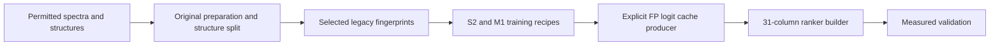

# Enveda CASMI 2026: experiments and public notebook

## Recovered training and preparation sources · 18 October

The [reproducibility release](reproduction/legacy-v2/README.md) publishes the original spectrum preparation, FPNet, S2/M1 training recipes and `make_ranker3.py`, with checkpoint hashes, all 31 ranker feature definitions and runnable invented-data examples. Configured training limits and selected checkpoint steps are documented separately. Historical initialization was seeded late, and the exact producer of the retained ranker FP caches remains unresolved; this is a transparent source release with stated gaps, not a claim of complete historical weight reproduction.

The [dataset cards and license scope](reproduction/dataset-cards/2026-10-18/README.md) separate uploader contributions from upstream rights and identify private inputs and unresolved provenance. The [fingerprint contract checker](tools/fingerprint-contract/README.md) runs with the Python standard library and includes reproducible invented 6,930-bit and 10,395-bit fixtures; all eight adversarial controls passed. Layout checks do not certify chemical parity or model quality.

The [selected V6 serving sources](reproduction/selected-v6-serving/README.md) are pinned to the actual public V37 source. V37's driver reported completion for 400 molecules, but its process/RSS supervisor failed: the notebook is **ERROR and ineligible for submission**. No official V6 score is claimed. Legacy 6,930-bit and later 10,395-bit fingerprint coordinates are distinct.

Four [public conceptual illustrations](https://www.kaggle.com/datasets/prvsiyan/four-campaign-notebook-illustrations) include full prompts, alt text, file hashes and a Kaggle display helper. They make no scientific or score claim. Existing notebook opening artwork is preserved.

## Latest runnable utility · 14 October

[Packed Window Lab](tools/packed-window-lab/2026-10-14/README.md) checks inclusive mass windows, aligned candidate rows, explicit bit packing, dummy-bit masks and exact-score ties. The original NumPy package passed **all 14 synthetic controls** in one completed, bounded run. It includes portable source, examples, integration notes and two diagrams. No model was fitted; real producer eligibility and competition performance remain unmeasured.

## Earlier measured experiment · 12 October

[Four-group fallback pilot](experiments/2026-10-12-v25-negative-fallback/README.md): **0 gains, 1 loss and 3 ties**, with MRR@25 changing from **1.000 to 0.875**. These four exposed development groups were deliberately selected for poor library coverage; this negative result supports holding the fallback and reproducing the stronger public baseline before more tuning.

## Earlier gate diagnosis · 12 October

[Native gate activation](native-gate-activation-2026-10-12/README.md) explains a completed negative result: **0 of 400 query groups activated the new ranking path**. Read the diagnosis, regenerate the figure, or reuse the original structural capture auditor. Ranking efficacy remains unmeasured; the next reference-library holdout is a separate experiment.

## Earlier experiments worth reading

Existing public campaign notebook: [Analog Propagation - CASMI 2026 baseline](https://www.kaggle.com/code/prvsiyan/analog-propagation-casmi-2026-baseline). This stable identity was observed public in the retained 11 October snapshot; the guide makes no current run-status or score claim.

The permanent archive includes [Energy-balanced projection](https://github.com/cubres/enveda-casmi-2026/blob/0c5cf4615cf1de050e7e3dc769630c5b760f284b/tools/energy-balanced-projection/2026-10-05/README.md) and [Protected candidate/control comparison](https://github.com/cubres/enveda-casmi-2026/blob/1832b0157cc151f8e1afe3ac363763348a9ec784/protected-candidate-control-2026-10-09/README.md). Read their original claim limits and provenance before a fork. Failures and unexecuted ideas remain part of the record; invented controls are separate from native qualification and official scores.

The shared [Static notebook execution map](https://github.com/cubres/gemma-4-developer-agent/blob/4b21f05ee4542c9f0c5a9dfd2a6d7081385af6d7/tools/notebook-execution-map/2026-10-05/README.md) provides a read-only first look at direct configuration bindings. It does not execute notebooks or infer effective runtime.
