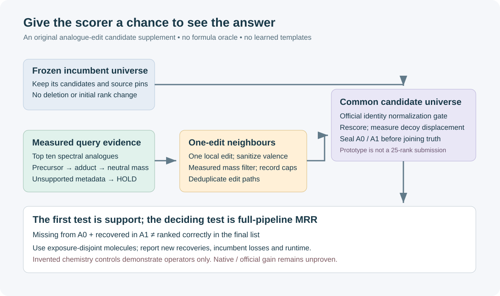

# When the answer is missing from the candidate list

A better scorer cannot recover a structure that never enters its candidate universe. This small original component explores a different lever: generate a bounded set of chemical neighbours of the closest measured spectral analogues, then apply the observed neutral-mass window.

The prototype preserves the supplied incumbent list and returns a separate supplement. It **does not rank a final submission**. It uses RDKit graph edits, a measured neutral mass and caller-supplied analogues. It does not use truth formulae, checkpoint downloads, external dataset code or learned reaction templates.

```python
from analogue_edits import generate
result = generate(
    ["CO"],              # an illustrative analogue, not a competition example
    46.041864812,        # illustrative measured neutral mass
    incumbent=["CO"],
)
print([(c.smiles, c.edit) for c in result.additions])
```



The deliberately small edit family covers terminal carbon/oxygen additions and removals, non-aromatic C/N/O/S substitutions, and acyclic single/double bond changes. Sanitization rejects invalid valence. Charged, isotopic, radical and disconnected seeds are outside this prototype. Each addition carries its canonical seed, edit location, exact mass and mass residual; duplicate edit paths carry no extra votes. Canonical seeds are reparsed before edits, making recorded indices reproducible across alternate seed SMILES.

Default budgets are ten supplied analogue entries, 2,000 attempted edits, 256 unique returned additions and 64 atoms. Invalid/duplicate seed entries do not pull deeper analogues. Attempt and returned-candidate truncation are reported explicitly. A mass-compatible candidate is chemically admissible under these checks, not necessarily stable, plausible or correct.

## What has been measured

Twenty invented public chemistry controls cover hydroxylation, homologation, oxidation, deletion, deterministic provenance, incumbent preservation, exact budget handling and unsupported chemistry. They pass with Python optimization enabled as well as disabled. See the dated CPU receipt; these are operator and boundary tests, **not** candidate-recall or MRR evidence.

Run the controls with your own RDKit environment:

```bash
python -B test_analogue_edits.py
python -O -B test_analogue_edits.py
```

No native Kaggle qualification or official-score gain is claimed. The graph generator has not been evaluated on a sealed spectrum panel. Most natural products require more than one simple edit; a correct seed may be absent, and mass-compatible decoys may displace correct catalogued candidates after ranking. The low-cost test in [PROTOCOL.md](PROTOCOL.md) measures those failure modes before any submission experiment.

## Integration contracts

Neutral mass must come from measured precursor, adduct multiplicity, charge and carrier metadata, with the approved adapter recording unsupported or inconsistent rows. Exact target mass calculated from a truth structure is forbidden in an evaluation run. The illustrative examples above use known masses only to test edit reachability.

The prototype's canonical non-stereo SMILES is **not the official tautomer identity**. Bind the organizer's identity implementation and RDKit version before merging candidates. A connectivity-key or tautomer alias must not earn multiple ranks or extra evidence votes. Keep the incumbent universe intact before the prospective common-universe ranker recomputes candidate-relative features. Rank preservation applies only to this component's returned incumbent tuple; it is not a guarantee about a later rescored top-25 list.

The source here is independently written and MIT-licensed; RDKit is a BSD-licensed dependency. No upstream notebook code, checkpoint or competition rows are included. A rights decision for an existing model or library remains a separate prerequisite for using that component in a full campaign.

Research context: the [MassSpecGym benchmark](https://proceedings.neurips.cc/paper_files/paper/2024/hash/c6c31413d5c53b7d1c343c1498734b0f-Abstract-Datasets_and_Benchmarks_Track.html) separates retrieval, generation and spectrum simulation. [MSNovelist](https://www.nature.com/articles/s41592-022-01486-3) provides a prior demonstration of structure generation outside catalogues. We have not reused its code, weights or formula predictor, and this small analogue-edit prototype is not a reproduction of that model.

