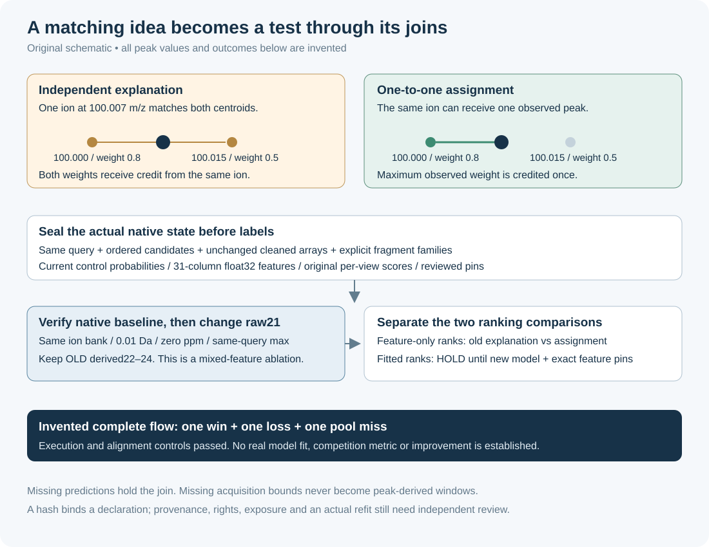

# From native fragments to an honest paired ranking test

This original MIT packet closes the gap between a fragment-matching idea and an executable experiment. It seals a native export, checks every candidate/query/view join, verifies the old explanation score, replaces the raw fragment feature and evaluates paired ranks. It performs no candidate generation, model loading, fitting or competition action.



The included flow is entirely invented. It has a matching win, a loss and a candidate-pool miss. None of its spectra, probabilities, model pins, refit receipts or labels comes from a competition or a trained model.

## Run the code

Python 3.9+ is sufficient for the pure standard-library tools. The private CPU consumer's priority/CPU envelope uses POSIX facilities, as on macOS/Linux.

```bash
python3 -B -m unittest -v test_assignment_join.py
python3 -O -B -m unittest -v test_assignment_join.py
python3 -B invented_flow.py
```

The final 39 controls passed in normal and optimized Python. The complete file-backed private consumer also passed on the invented inputs. [CONTROL_RESULTS.json](CONTROL_RESULTS.json) binds those observations; [INVENTED_FLOW_RESULT.json](INVENTED_FLOW_RESULT.json) retains the clearly labelled invented result.

To exercise the same file-backed consumer in a fresh directory, create its invented inputs first:

```python
from pathlib import Path
from assignment_join import canonical
from invented_flow import fixture

folder = Path("fresh-invented-flow")
folder.mkdir(exist_ok=False)
(folder / "attempts").mkdir()
export, protocol, joined, labels, intervention = fixture(fitted=True)
for name, value in (("export", export), ("protocol", protocol),
                    ("labels", labels), ("intervention", intervention)):
    with (folder / (name + ".json")).open("xb") as handle:
        handle.write(canonical(value))
```

```bash
python3 -B execute_private_join.py \
  --export fresh-invented-flow/export.json \
  --protocol fresh-invented-flow/protocol.json \
  --labels fresh-invented-flow/labels.json \
  --intervention fresh-invented-flow/intervention.json \
  --attempt-ledger fresh-invented-flow/attempts \
  --out fresh-invented-flow/private-result.json
```

The consumer preserves an exclusive attempt marker keyed by the frozen export. It reads labels only after the label-blind join and baseline checks pass. Results and failures use new files. The coordinator must keep one shared ledger for an actual experiment; choosing a different ledger would defeat cross-run duplicate coordination.

Protocol input hashes use `digest(parsed_value)`, the sorted compact canonical JSON bytes, rather than arbitrary file formatting. The example writes those exact bytes. For before-label sealing, a label custodian must write `canonical(labels)` without extra whitespace/newlines and supply its raw SHA; hashing an arbitrary pretty-printed file is insufficient. Source/helper pins use their actual file bytes.

## What is held fixed

Every spectrum and prediction carries the same query token. Candidate IDs and their exact order are sealed; the prediction table must cover every candidate/view pair in row-major order. Native arrays are not cleaned again, sorted, truncated or replaced. The current fitted-control probabilities, original 31-column float32 features, model/runtime pins and original per-view explanation scores are bound to the same candidate ordering.

Fragment inputs declare `neutral` or already charged `ion_mz`, an explicit singly charged family, H shifts and generator provenance. Neutral inputs pass through the exact-pinned chemistry adapter. Already charged inputs cannot receive another H shift. A valid empty bank is explicit; missing/failed predictions cannot silently become zero. Each view's recomputed independent explanation must match the native exported value within the fixed 1e-8 bound. Its native float32 max must match feature column 21 exactly.

The comparison uses the same ion bank, fixed absolute 0.01 Da/zero ppm and the original max across the same query's views. That max is preserved baseline aggregation, **not** a compatible-view consensus claim. Instrument and declared eV metadata are retained; shared metadata never substitutes for query identity. Acquisition bounds, when present, must cover the peaks and carry a source pin. This experiment computes no density/window-excess features, so missing bounds do not create an invented window.

## A deliberate raw-column ablation

Only raw fragment column **21** changes. The old independent-score-derived columns **22–24** remain frozen, along with all other columns. This is a mixed-feature **31-column raw-score ablation**, not a fully recomputed assignment fragment branch. It preserves native float32 feature precision and requires a separately refitted ranker even though the width stays 31.

The join emits the changed matrix and its hash. A fitted comparison accepts only separately supplied predictions tied to that exact matrix, candidate order, frozen model/probability pins, a refit receipt and a declared fit cohort disjoint from evaluation query bindings. Without those inputs the fitted comparison returns `HOLD_NO_REFITTED_PREDICTIONS`. It never runs the old model on changed semantics or pads 31 columns to 40.

Recomputing rank/max-difference/z columns, adding the nine earlier consensus features, changing fragment families, expanding candidates or changing view aggregation are separate future interventions with their own fitting and before-label protocol.

## Read the result at the right level

`evaluate_paired` reports same-pool old/new fragment-feature expected reciprocal rank at 25 with exact uniform tie-order expectation. It also reports pool recall; a truth absent from the frozen pool contributes zero. A fitted control-versus-intervention comparison is separate and appears only when the refitted prediction contract is satisfied.

The invented example lets a single ion explain two nearby peaks under independent matching. One-to-one assignment credits that ion once. Changing the answer between two otherwise identical invented queries produces one win and one loss; a third query's answer is outside the pool. This tests the entire join/evaluator path and prevents a favorable toy outcome from becoming a claimed score improvement.

For real inputs the only supported mode is private exposed development. Opaque query IDs and disjoint fitting IDs do not prove chemical independence, deduplication or all-component non-exposure. Hashes bind declarations and data; they do not authenticate acquisition records, licenses, model fitting or historical access. An actual experiment needs independent review of those records before execution. See [COORDINATOR_REQUEST.md](COORDINATOR_REQUEST.md).

## Bounds

The reader rejects duplicate JSON keys, nonfinite values and JSON files over 2 MiB. A sealed export has at most 64 queries, 128 candidates/query, eight native views/query, 256 cleaned peaks/view, 2,048 resulting ion hypotheses per prediction and 16,777,216 total matching cells. Oversized banks/pools are held, never cropped. The private consumer runs at nice +5 and at most 90 CPU seconds, honoring stricter inherited limits.

The adapter and assignment helpers are exact-pinned original MIT source copies. No weights, raw/derived competition data, saved probabilities, compounds or private result metrics are bundled. [PROVENANCE.md](PROVENANCE.md) records the source and execution boundaries.
