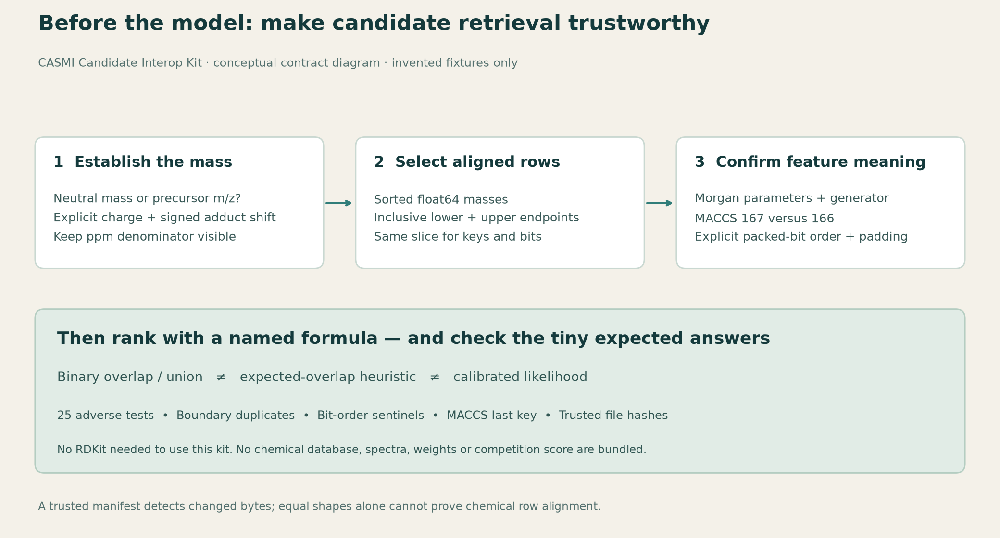

# CASMI Candidate Interop Kit

**A small, runnable dataset for catching candidate-retrieval mistakes before an expensive spectrum model run.** You get invented mass/fingerprint arrays, explicit expected answers, NumPy-only helpers, 25 adverse tests, and a diagram. There are no chemical structures, spectra, learned weights, or competition records in this package.

The motivation is practical: a perfectly good spectrum-to-fingerprint model can rank the wrong candidates if m/z is mistaken for neutral mass, a ppm endpoint disappears, packed bits are reversed, or MACCS columns shift by one. These problems are easy to reproduce with a tiny fixture rather than a 436k-row chemical database.

## Run the complete example

Requires Python 3.10+ and NumPy. RDKit is **not** needed to use this kit. The release was exercised with the NumPy version recorded in `VALIDATION.json`; this is not a claim of testing every NumPy version.

```bash
python -m pip install numpy
python quickstart.py
python test_candidate_interop.py --work-dir my-new-test-results
```

The quick start returns seven invented candidates in an inclusive 10 ppm neutral-mass window. `SYN004` ranks first because the invented query is its own invented bit vector. This is a reproducibility check, not a chemical identification result. The test runner preserves its outputs and refuses an existing work directory.

On Kaggle, add this dataset as an input and run `quickstart.py` directly from its full input path. Alternatively, copy the **whole flat package**, including its arrays and manifest, into a working directory and run it there. Copying just the Python helpers leaves the demonstration without its data. The published payload is flat: the four `.npy` files and `MANIFEST.json` sit beside `quickstart.py`. In the source tree, the same demo also supports a `fixtures/` directory.



## What is inside

| File | Meaning |
|---|---|
| `masses.npy` | 12 invented ascending neutral masses, `float64` |
| `keys.npy` | 12 unique invented row IDs `SYN000`–`SYN011`, Unicode; not InChIKeys |
| `morgan_sized.npy` | `(12, 2048)` invented binary patterns, `uint8`; **not molecular fingerprints** |
| `maccs_sized.npy` | `(12, 166)` invented binary patterns, `uint8`; **not chemical MACCS keys** |
| `MANIFEST.json`, `MANIFEST.sha256` | Exact fixture file hashes, byte sizes, shapes and dtypes |
| `EXPECTED.json` | Explicit 10 ppm interval, row slice and expected keys |
| `mass-window-edge-cases.csv` | Invented boundary, duplicate and adjacent-float cases with expected inclusion |
| `ion-conversion-cases.csv` | Invented neutral masses, protonation/deprotonation, charge and expected m/z |
| `candidate_interop.py` | Mass conversion/search, bit checks, similarity formulas, contract checks and no-pickle loader |
| `quickstart.py`, `test_candidate_interop.py` | Runnable demonstration and adverse controls |
| `build_fixtures.py` | Recreate exactly the four fixture arrays and their manifest in a new empty directory |
| `draw_contract.py`, `retrieval-contract-v2.svg/.png` | Original conceptual diagram and regeneration source |
| `VALIDATION.json`, `SOURCES.md`, `LICENSE` | Actual local result, provenance and MIT terms |

## Two mass conventions, two explicit functions

```python
from candidate_interop import mass_window, precursor_window, protonated_ion

# Already a neutral mass: tolerance denominator is this query neutral mass.
lo, hi = mass_window(masses, neutral_mass_da=100.0, ppm=10.0)

# Measured precursor m/z: propagate its tolerance through the ion equation.
lo, hi = precursor_window(
    masses, precursor_mz=101.0072764665789,
    precursor_ppm=10.0, ion=protonated_ion(+1),
)
# Apply the same lo:hi to every aligned key/fingerprint/metadata array.
```

`mass_window` uses `[q − q×ppm/10⁶, q + q×ppm/10⁶]`, with NumPy `side='left'` below and `side='right'` above. Both endpoints and every duplicate at them are included. It does not implement a candidate-denominator ppm formula.

The ion equation is `m/z = (molecule_count×neutral_mass + signed_shift_da)/abs(charge)`. Positive protonation and negative deprotonation are predefined. Other adducts require your own checked `IonSpec`; no adduct, charge or polarity is inferred. The fixed proton mass is the NIST 2022 CODATA value **1.0072764665789 Da**. Do not substitute a neutral hydrogen atom mass.

For repeated queries, call `validate_masses` once and use `validated=True` only while that array stays unchanged. Validation is O(n); the subsequent interval search is O(log n). The loader uses read-only memory mapping and `allow_pickle=False`. It does not inspect SMILES or validate chemistry.

## Fingerprints: width is only the beginning

“Morgan-2048” does not establish radius, chirality, bond handling, atom invariants, count simulation, preprocessing, or generator version. `require_matching_feature_contracts` requires these declarations and rejects mismatches. This version supports binary Morgan contracts with **count simulation disabled**; count-simulated fingerprints need explicit count thresholds and are rejected. Matching declarations still need trusted provenance and exact tensor files; the helper does not certify their truth.

`unpack_fingerprints` requires an explicit `bit_count` and `bitorder`, verifies byte width, and rejects nonzero padding. NumPy's default bit order is big; RDKit binary text uses little. Verify the actual producer instead of guessing from a filename.

RDKit's MACCS representation has 167 positions for keys numbered 1–166. `maccs_keys_1_to_166` explicitly checks unused bit zero and selects positions 1–166. Never silently drop a column from a model output. The linked candidate/model pair below advertises **Morgan-2048 + MACCS-167 + one padding bit = 2216 outputs**; that publisher-declared format is different from this kit's separate 166-bit invented array.

## Scores have names and formulas

`binary_tanimoto` is binary intersection divided by union. Empty/empty deliberately returns zero. Wide integer sums prevent 2048-bit popcount overflow.

`expected_overlap_score` uses `dot(p,b)/(sum(p)+sum(b)−dot(p,b))`. It is a retrieval heuristic, **not** the expectation of Jaccard similarity, a calibrated probability, or squared-norm algebraic Tanimoto. For `p=[0.5,0.5]` and `b=[1,0]`, it gives `1/3`; the squared-norm formula gives `1/2`. Establish which formula a reference notebook actually uses before substituting one for the other. Deterministic ranking sorts ties by the invented row key; chemical-identity deduplication remains a separate task.

## Use with real candidate banks

The [COCONUT Morgan + MACCS dataset](https://www.kaggle.com/datasets/aryanawasthiteykik/casmi26-coconut-morgan-maccs-fingerprints) offers a promising plain Parquet/NumPy alternative to pickle. Its publisher describes a mass-sorted 436,389-row bank and links a [spectrum-to-fingerprint MLP](https://www.kaggle.com/datasets/aryanawasthiteykik/casmi26-spectrum-to-fingerprint-mlp). Credit also belongs to [prvsiyan's COCONUT candidates](https://www.kaggle.com/datasets/prvsiyan/coconut-casmi26-candidates) and the [COCONUT team](https://coconut.naturalproducts.net/).

These are links and publisher-reported formats, not bundled data or independently qualified tensor compatibility. Fetch your chosen dataset under its own terms, inspect the exact version and feature convention, then adapt your local reader. Apply one row permutation to masses, keys, fingerprints and metadata together. Equal shapes alone cannot prove alignment; byte hashes detect drift only when the manifest is externally trusted.

Keep competition training structures, spectra and labels in your private local experiment. This kit contains no training-data redistribution code or promise that training-derived artifacts may be published.

## Validation and limits

The actual local run passed **25 adverse tests** on invented data. It covers inclusive endpoints and duplicates, adjacent floats, neutral-versus-precursor tolerances, charge/dimer conversion, MACCS indexing, both bit orders, padding, dtype/value rejection, 2048-bit overflow, formula distinctions, object-array rejection, feature-contract mismatch, and a shape-preserving shuffled-row hash failure.

No chemical fingerprint generator, third-party payload, trained model, leaderboard submission or official score was evaluated. This is a small interoperability dataset and tool kit, not a candidate bank or a benchmark of chemical identification accuracy. `allow_pickle=False` prevents object loading; it does not make arbitrarily large or hostile files harmless.

All code, documentation, invented fixtures and diagrams here are original and MIT licensed. Linked resources retain their own terms. Reproducible campaign history belongs in [cubres/enveda-casmi-2026](https://github.com/cubres/enveda-casmi-2026).
