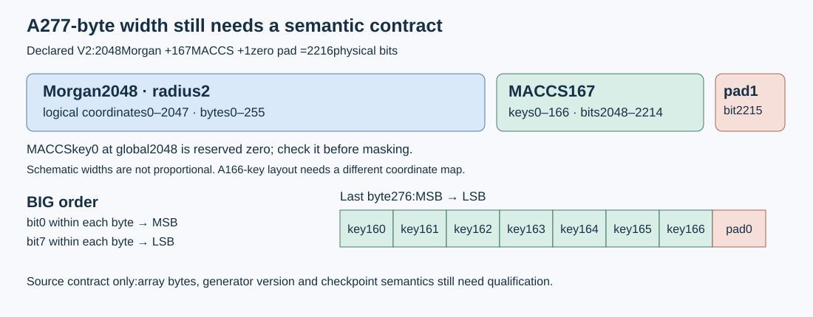
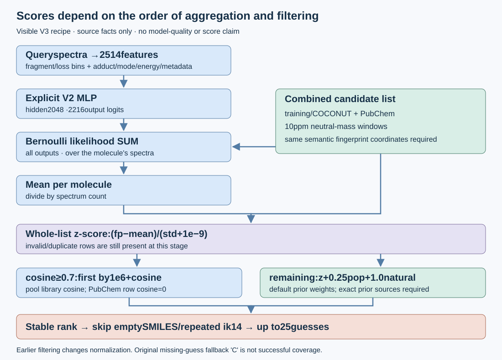

# CASMI fingerprint integration: a source contract before an experiment

This original guide explains the public Morgan/MACCS recipe observed on 12 October 2026. It ships bounded mathematical references and their existing invented-fixture checks. Real bank alignment, checkpoint tensors, native inference and model quality remain unqualified here. No official score is claimed.

Primary sources are the [COCONUT fingerprint bank, V1](https://www.kaggle.com/datasets/aryanawasthiteykik/casmi26-coconut-morgan-maccs-fingerprints) and [MLP package, V3](https://www.kaggle.com/datasets/aryanawasthiteykik/casmi26-spectrum-to-fingerprint-mlp), including visible [fingerprints.py](https://www.kaggle.com/datasets/aryanawasthiteykik/casmi26-spectrum-to-fingerprint-mlp?select=fingerprints.py), [fpmodel.py](https://www.kaggle.com/datasets/aryanawasthiteykik/casmi26-spectrum-to-fingerprint-mlp?select=fpmodel.py) and [pipeline.py](https://www.kaggle.com/datasets/aryanawasthiteykik/casmi26-spectrum-to-fingerprint-mlp?select=pipeline.py). These are page/source-text observations, not verified third-party file or weight bytes.

## Width is not a fingerprint schema



The visible V2 producer concatenates radius-2 Morgan 2048, all 167 RDKit MACCS coordinates and a zero pad: 2216 physical bits in 277 bytes. Its packbits call uses **big** order by default, as [NumPy documents](https://numpy.org/doc/stable/reference/generated/numpy.packbits.html). MACCS key 0 is at global coordinate 2048; padding is at 2215. Check both are zero before masking.

A layout omitting MACCS key 0 also fits 277 bytes, but its real first key is at 2048 and its padding is at 2214/2215. Bind coordinate meanings, generator version/options, bit order and row order to model outputs. Width alone cannot select a mapping. The visible producer's CLI still builds Morgan-only V1 fingerprints of 256 bytes; it is not a V2 rebuild command.

## Aggregation and filtering are part of the recipe



The visible model takes 2514 features: 2000 fragment bins, 500 loss bins, and 14 metadata coordinates. V2 needs explicit hidden size 2048 and 2216 output logits. The older constructor/CLI default is 1536; changing output width alone cannot establish checkpoint compatibility.

The pipeline uses 10 ppm neutral-mass windows and combines training/COCONUT with PubChem candidates. It sums Bernoulli likelihood across each molecule's spectra, divides by spectrum count, then standardizes the **whole combined list** with `(fp-mean)/(std+1e-9)`. Remaining candidates receive default priors of `0.25*popularity + 1.0*natural`. Pool candidates with library cosine at least 0.7 come first; PubChem rows receive zero cosine.

Stable sorting precedes skipping empty repaired SMILES and duplicate InChIKey14 rows. It then takes up to 25 guesses. Earlier filtering changes the normalization population and potentially the prior blend. The original missing-guess fallback `'C'` is not successful coverage. Full reproduction needs the exact PubChem repair, popularity sources, row alignment and rights. Held-out validation also requires excluding query structures from both the model and every same-key reference spectrum.

## Original tools and reproducible arithmetic

[packed_bernoulli_reference.py](packed_bernoulli_reference.py) implements the identity

`weighted mean log-likelihood = candidate bits · mean logits − common softplus term`.

It checks explicit schema labels, bit order, zero excluded coordinates and bounded finite inputs, and includes an independent stable dense formula. Schema labels still require external source/tensor verification. [packed_v2_sum_bridge.py](packed_v2_sum_bridge.py) restores the spectrum sum and constant-zero dummy/pad terms. Mathematical rank equivalence does not authorize probability pooling, different masks or an unqualified absolute-score blend. NumPy float32/effective-logit and near-tie behavior need separate qualification.

Keep the eight files together. The Python tools use the standard library; the existing check harnesses run on Python 3 on macOS/Linux without datasets or weights:

```sh
python3 qualify_invented_fixtures.py --invented-fixtures-only
python3 qualify_sum_bridge_invented.py --invented-fixtures-only
```

Two separate local runs passed all 25 reference checks and all 7 bridge checks using only invented bitfields/logits. The bridge run measured 0.118855417 seconds wall, 0.112587 seconds CPU and 22,544,384 bytes process peak RSS. This is one bounded correctness run, not model inference, a speed comparison, Kaggle compatibility or a score. No chemistry, scientific queries, weights or network services were read. The scalar reference accepts at most 64 candidate rows and 8 spectra; it is not a claimed faster production backend.

## Next experiment preflight

Pin the exact bank/source versions and checkpoint. A bounded public-only CPU check can inspect NPY with mmap and `allow_pickle=False`, compare header/schema/row counts, and recompute a few distributed public rows using the admitted generator. Check jointly aligned keys, neutral masses, fingerprints and zero coordinates. Sampled agreement is not full-bank correctness.

Inspect checkpoint tensor metadata with an installed-version-supported restricted `torch.load(weights_only=True, map_location='meta')`. Require the visible V2 architecture and matching input/hidden/output dimensions. Unsupported restricted loading is a stop, not permission for unrestricted deserialization. Metadata proves neither finite values nor inference behavior. Model forward passes, structure-disjoint evaluation and native runs remain separate admitted steps. This folder supplies no inference launcher, weights or chemical data.

## Credits and copying boundaries

Credit **Aryan Awasthi** for the published bank/model recipe, **prvsiyan** for its upstream CASMI COCONUT candidate bank, the **COCONUT team** for the natural-product collection, and **RDKit/NumPy** for their implementations. No publisher implementation is copied here.

Both publisher cards display **CC BY-NC-SA 4.0**. Covered copying requires attribution, noncommercial use and share-alike treatment where applicable; see the [license](https://creativecommons.org/licenses/by-nc-sa/4.0/). The model card attributes its weights to competition data under CC BY-NC 4.0. Verify exact training-data terms, intended use and competition code-sharing requirements before use or redistribution. Credit is not permission to republish training structures or relicense package code.

The official [COCONUT download page](https://coconut.naturalproducts.net/download) currently states CC0 for curated data, while the derivative card describes an earlier CC BY 4.0 source. Pin the actual snapshot and preserve derivative notices; current upstream terms do not relicense someone else's derivative bank or weights. The [COCONUT 2.0 paper](https://doi.org/10.1093/nar/gkae1063) provides collection provenance.

Only the original guide, diagrams and Python tools here carry the accompanying MIT license. It grants no rights to linked datasets, code, weights or competition data. NC-restricted borrowed code and an unrestricted public-code release have different permissions; check the applicable requirements before combining them.
