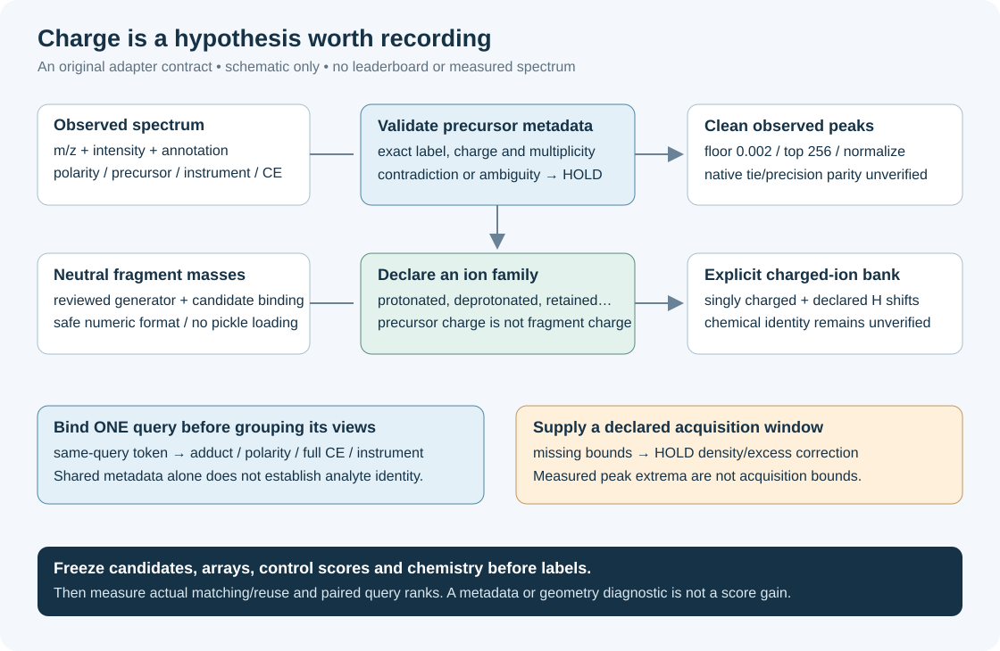

# Charged fragments need explicit assumptions

This small adapter turns a spectrum's declared precursor annotation into a checked metadata contract, then converts an explicitly chosen fragment-ion family into singly charged m/z hypotheses. It is original MIT-licensed Python with no model, chemistry-library or dataset dependency.



A multiply charged precursor does not make every fragment multiply charged. A sodium precursor does not establish that every fragment retains sodium. The code keeps those decisions visible so an experiment can distinguish an intended hypothesis from an accidental conversion.

## Run the controls

```bash
python3 -B -m unittest -v test_charged_ion_adapter.py
python3 -O -B -m unittest -v test_charged_ion_adapter.py
```

The 25 controls cover positive and negative ions, double charge, multimers, retained carriers, unsupported annotations, finite values, cleaning, acquisition bounds, energy separation and caller-established query binding. Both normal and optimized Python passed before the private development run. They establish code behavior; they do not establish physical fragmentation accuracy or a leaderboard gain.

## A runnable, invented example

```python
from charged_ion_adapter import adapt_spectrum, compatible_groups, fragment_ions

# All values here are invented for a contract example, not measured spectra.
record = {
    "adduct": "[M+2H]2+",
    "ionization_mode": "positive",
    "precursor_mz": 251.00727645217,
    "ms2_mzs": [101.00727645217, 125.0],
    "ms2_normalized_intensities": [4.0, 1.0],
    "instrument_type": "illustrative-instrument",
    "collision_energy_ev": [20.0],
    "collision_energy_orig_units": "eV",
    "acquisition_mz_min": 50.0,
    "acquisition_mz_max": 300.0,
}
view = adapt_spectrum(
    record, window_source="invented-example",
    query_binding="invented-query-one",
)
ions = fragment_ions(
    [100.0], view["metadata"],
    family="protonated", h_shifts=(0,), mass_kind="neutral",
)
assert view["metadata"]["precursor_abs_charge"] == 2
assert ions["fragment_abs_charge"] == 1
assert compatible_groups([view], same_query_binding="invented-query-one") == [[0]]
print(ions["ion_mz"])
```

The output is an ion hypothesis near 101.00727645 m/z. Its chemical identity remains unverified. H shifts are declared hypotheses, not atom-balance or valence checks.

## What the adapter holds

| Decision | Required evidence | Behavior when missing |
|---|---|---|
| Precursor conversion | Exact supported adduct, polarity and positive finite m/z | Raise `AdapterHold`; never guess a charge |
| Fragment conversion | Neutral-mass declaration and explicit ion family | Raise `AdapterHold`; never copy precursor charge automatically |
| Retained Na, K or Cl | Corresponding precursor carrier | Raise `AdapterHold` on a mismatch |
| Pooling several views | Caller-established same-query binding, then compatible metadata | Reject missing/mismatched query binding; isolate unknown energy/instrument |
| Acquisition-window correction | Explicit lower/upper bounds and their source | Return assignment-only readiness; density correction stays held |
| Native preprocessing parity | Independent equality check of retained native arrays | Report `UNVERIFIED`; the stable tie policy is a changed preprocessing choice |

The exact ambiguous annotation `[M-2H]-` is held. It is not silently treated as `[M-2H]2-`. Unknown annotations remain visible instead of being forced into a convenient family.

## Connect to fragment matching

The companion original [fragment-consensus prototype](../fragment-consensus-2026-10-11/README.md) accepts charged-ion m/z hypotheses. Supply `ions["ion_mz"]` and, for each already-bound compatible view, the adapter's `cleaned["mz"]`, `cleaned["intensity"]` and declared `window`. Pass `abs_tol=0.01, ppm=0` explicitly to preserve the old absolute-tolerance geometry; its general API has a different ppm default.

Only use that prototype's window-dependent features when a real acquisition window is supplied. Neither the lowest/highest measured peak nor a candidate-dependent range is a substitute. Preserve the existing candidate pool and control probabilities before any comparison. Adding its nine features to a 31-column model requires a newly fitted 40-column model; the old model cannot consume the new columns.

`potential_reuse_intervals` only counts overlap between adjacent centroids' admissible ion intervals. Without a bound predicted-ion bank it cannot measure actual ion reuse, a matching-score correction or a ranking gain.

## The saved-data diagnostic

`run_development_diagnostic.py` is a separate bounded private reader. It hashes its input pins before opening payloads, selects nine metadata/peak columns from at most 4,096 physical training records, holds unknown/NIST-labelled ingestion sources, and examines at most 128 sorted saved numerical groups in each of two pre-existing regimes. It loads numerical NPZ arrays with `allow_pickle=False`; it does not deserialize prediction caches or load a model.

The two existing feature scores are column 15 (fingerprint) and column 21 (fragment explanation). The rank diagnostic calculates the exact uniform-tie expectation of reciprocal rank at 25. It evaluates those frozen feature-only scores, rather than a fitted control ranker or this adapter. It does not generate candidates, score hidden test labels, select a method or trigger a submission.

The inspected panel had prior selection/fitting exposure. Its private receipts and numerical results are intentionally excluded from this public directory. Equal aggregate results across two saved regimes are not evidence of independent queries or identical underlying rows. See [NEXT_EXPERIMENT.md](NEXT_EXPERIMENT.md) for the missing inputs and a prospective comparison.

For an authorized private reproduction on macOS/Linux, fill the original [protocol template](DIAGNOSTIC_PROTOCOL.template.json) with your own absolute input paths and SHA256 pins before opening new labels. Preserve a timestamped seal and document previous exposure. The reader checks its status and input pins; a status string by itself cannot prove preregistration or data rights. Its NPZ contract is exactly `X` (31 finite feature columns), binary `Y`, binary regime `M` and integer query-group `G`, with one positive per selected group/regime. The template does not establish that another table's columns have the same meaning.

```bash
python3 -B run_development_diagnostic.py \
  --train /absolute/path/to/authorized_train.parquet \
  --rows /absolute/path/to/authorized_rank_rows.npz \
  --protocol /absolute/path/to/frozen_protocol.json \
  --out /absolute/path/to/new_private_result.json
```

The result path must be new. Keep outputs private unless the input and derived-result redistribution rights have been separately established.

## Resources and provenance

The adapter accepts at most 100,000 raw peaks, keeps at most 256 after its declared floor/top-k policy, and accepts at most 2,048 resulting charged hypotheses. Oversized ion banks are held rather than truncated. The optional private reader runs at nice +5 with a 120-second CPU bound and one configured numerical thread. Its retained completed run used Python 3.12.14, NumPy 2.2.6 and PyArrow 25.0.0; this is a reproducibility record, not a dependency on those exact versions.

See [PROVENANCE.md](PROVENANCE.md) for source pins, operational mass constants, component licenses and the public/private boundary. No native job or submission was run by this packet, and it has no official score.
