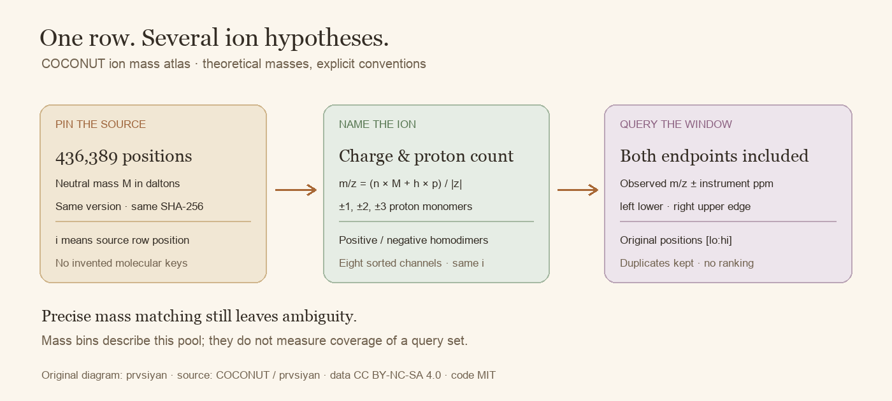
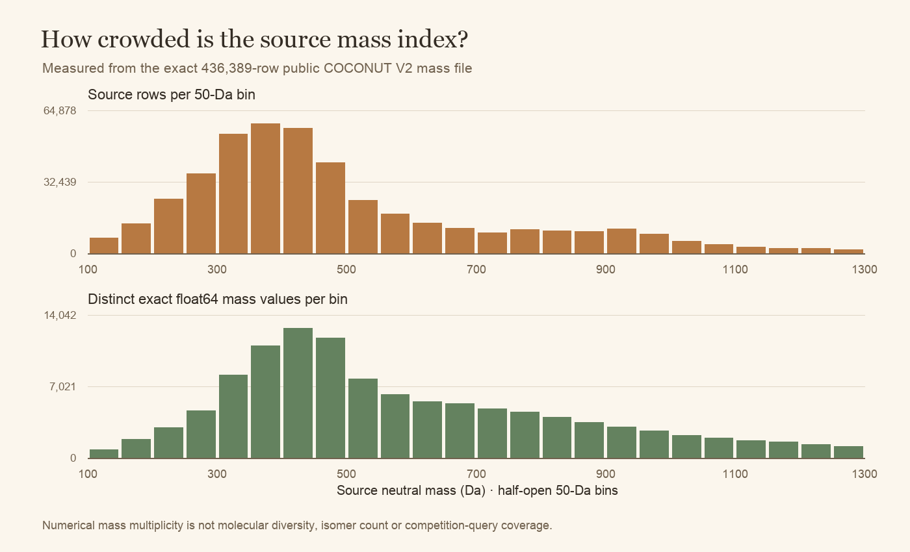

# COCONUT ion mass atlas

**436,389 real source rows. Eight theoretical protonation channels. No pickle, RDKit or model weights.**

This atlas turns the exact public COCONUT candidate mass array into a small, reproducible precursor lookup. Its main use is debugging candidate generation: a peak at *m/z* 301 can imply different neutral masses under a singly charged monomer, a doubly charged monomer or a dimer. Choosing that interpretation belongs in the query, rather than being hidden in a loader.



Each numerical column remains attached to the **same zero-based source row position**. There is no independent sort, deduplication or invented molecule identifier. The position is a join key into the exact source release, not an InChIKey or COCONUT accession.

## What is inside

| File | Contract | Use |
|---|---|---|
| `neutral_mass_da.npy` | `(436389,)`, little-endian float64 | Exact bytes of the public version-2 mass file |
| `ion_mz.npy` | `(8, 436389)`, little-endian float64, channel-major | Sorted theoretical precursor *m/z* values; row position preserves the source join |
| `adducts.csv` | Eight explicit channel records | Label, polarity, signed charge, molecule multiplier and proton count |
| `equal_mass_groups.csv` | Contiguous runs with more than one identical float64 mass | Inspect mass ambiguity without pretending rows are the same structure |
| `mass_distribution.csv` | 50-Da source-mass bins | Inspect where the source has many or few candidates |
| `MANIFEST.json` | Source and numerical payload hashes, conventions and measurements | Verify the exact release before combining it with other candidate resources |
| `RELEASE_FILES.json` | Hashes of all other downloadable files | Check documentation and code integrity as well; creation metadata is bound separately |

The two NumPy arrays occupy approximately **31.4 MB** together. `ion_mz.npy` keeps each channel contiguous, so a memory-mapped binary search does not need to decode the other channels. There are no fingerprints, smiles, molecular keys, spectra, competition training rows or checkpoints in the release.

The source file has 111,106 distinct exact float64 mass values across its 436,389 rows. Another 325,283 rows share an already occurring exact mass; the largest run contains 1,757 positions. These are **mass multiplicities**, not molecule counts or an isomer census. They explain why accurate precursor matching can still leave a large ranking task. The generator recalculates these measurements from the actual pinned source.



## Start with one channel

Install NumPy and place the files in one folder. Opening verifies the full numerical hashes and every theoretical channel against the neutral source, then retains read-only memory maps. Do that once per process, not for every spectrum.

```python
from ion_index import open_release, query

atlas = open_release('/kaggle/input/coconut-proton-ion-mass-index')
hit = query(atlas, precursor_mz=301.0072764665789, adduct='[M+H]+',
            ppm=10.0, tolerance_basis='precursor_mz', polarity='positive')
lo, hi = hit['source_row_start'], hit['source_row_stop_exclusive']
print(hit['candidate_count'], lo, hi)
neutral_masses = atlas[1][lo:hi]
```

The 301 value is an illustrative query, not a competition spectrum. The returned half-open positional slice `[lo:hi]` includes **both numerical tolerance boundaries**: lower search uses `side='left'`; upper search uses `side='right'`. Equal masses remain present. This loader applies no candidate cap and supplies no ranking scores.

To check a guaranteed source-row round trip rather than relying on an illustrative precursor:

```bash
PYTHONDONTWRITEBYTECODE=1 python quickstart.py /path/to/atlas
```

The quickstart takes the real numerical mass at source row 123456, constructs its `[M+2H]2+` precursor, and checks that a 10-ppm search includes that row. It is a mechanics example; no molecular identity or model result follows from passing it.

## Charge, dimers and ppm

With neutral mass `M`, molecule multiplier `n`, signed proton count `h` and signed charge `z`, the atlas uses:

```text
theoretical m/z = (n × M + h × proton_mass) / |z|
neutral mass   = (|z| × observed_m/z − h × proton_mass) / n
```

The proton mass is **1.0072764665789 u**, from [NIST's 2022 CODATA proton-mass value](https://physics.nist.gov/cgi-bin/cuu/Value?mpu). It is a declared numerical convention; the atlas does not recompute molecular masses from structures. Both signs of one, two and three proton charges are supported, together with `[2M+H]+` and `[2M-H]-`. Multiple protonation and dimers are hypotheses for lookup. Their presence here does not establish that a particular compound forms that ion or that an observed peak has that assignment.

Instrument ppm normally describes the **observed precursor m/z**. In that mode, the m/z half-width is `observed_mz × ppm / 1e6`; the corresponding neutral half-width is multiplied by `|z|/n`. If you specifically want a ppm window around a converted neutral mass, select `tolerance_basis='neutral_mass'`. These are different conventions because the proton shift affects the center. The query records which was used.

An explicit polarity can reject an inconsistent label. Unknown adducts fail clearly instead of silently becoming `[M+H]+`. Sodium, chloride, neutral losses, isotopes, heterodimers and in-source fragments are outside this release. Add channels only with documented semantics and a new version; changing a query convention can change its candidate set.

## Join other public resources carefully

`source_row_id = i` means exactly position `i` in `prvsiyan/coconut-casmi26-candidates`, data version **2**, `coco_mass.npy`, SHA-256:

```text
2b2af92c3185fa8cd52a4a3e3e7fd7eda4d94e8b9402662a3a4c55ffb13c6e5c
```

The original candidate dataset also contains fingerprints and pickle metadata. Those are not required to query this atlas. We do not deserialize or redistribute them here, and this release does not certify their identity alignment. If you attach the original fingerprints, verify their own version, hashes and descriptor contract. If you attach a separately sorted Parquet candidate bank, construct and check a molecular-key mapping; positional joins across the two datasets are unjustified.

The useful [Morgan/MACCS companion shared by aryanawasthiteykik](https://www.kaggle.com/datasets/aryanawasthiteykik/casmi26-coconut-morgan-maccs-fingerprints) offers a different descriptor contract and a structure table. This atlas complements it with explicit ion interpretation and source-mass ambiguity diagnostics. Its row ordering has not been joined to that companion, so row indices must not be used interchangeably.

## Rebuild and limits

The loader needs NumPy. Rebuilding the PNG figures also needs Pillow.

Obtain the **exact version-2** `coco_mass.npy` from [prvsiyan's COCONUT candidate dataset](https://www.kaggle.com/datasets/prvsiyan/coconut-casmi26-candidates). The original build accepts only its pinned SHA-256, byte size and shape. It refuses an existing output directory and keeps partial outputs for inspection if something fails.

```bash
PYTHONDONTWRITEBYTECODE=1 python build_ion_index.py \
  --source-mass /path/to/coco_mass.npy \
  --output /path/to/a-new-atlas-directory
```

The real source spans 100.009519128–1299.7599298120003 Da. This range and its mass-bin counts describe the available pool; they do **not** measure coverage of an unknown query set. The upstream source release date, original chemical normalization, charge standardization and original mass-generation runtime are not established by the public mass file. No structural uniqueness, training disjointness, competition score or fingerprint-model improvement is claimed.

## Attribution and licensing

Credit **prvsiyan** for the source candidate dataset and the **COCONUT team** for the natural-products resource. The numerical source and its ion derivatives retain **CC BY-NC-SA 4.0**, as recorded on the source's current public card. See `DATA_LICENSE.md`. The original loader, generator, quickstart and explanatory diagram are **MIT** licensed; that code license grants no additional rights to source data, third-party fingerprints or model weights. [Sources and provenance](SOURCES.md) distinguish the original upstream resource from this derivative release.

Public experiment records and reproducible tools: [cubres/enveda-casmi-2026](https://github.com/cubres/enveda-casmi-2026). This atlas is a candidate-generation tool. Evaluation and ranking should be measured separately.
