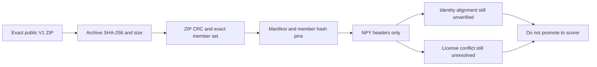

# CASMI PubChemLite V1 payload integrity audit

This small, reproducible audit pins the public Kaggle mirror `franciscoangulo/casmi26-pubchemlite-cc0-candidate-fingerprints`, dataset version 1. It verifies the exact archive, ZIP CRCs, manifest, three payload hashes and the two NumPy headers without extracting files, allocating the arrays, or loading the metadata pickle.

It is an integrity check only. It does **not** establish that the arrays map to the expected chemical rows, that a candidate bank adds structures under the competition's scorer, or that the payload is legally cleared for competition use.

## Reproduce

Download dataset version 1 from the [Kaggle dataset page](https://www.kaggle.com/datasets/franciscoangulo/casmi26-pubchemlite-cc0-candidate-fingerprints/versions/1), then run this script with Python 3.10 or newer:

```sh
python3 verify_payload.py \
  --archive casmi26-pubchemlite-cc0-candidate-fingerprints.zip \
  --output payload-audit.json
```

The verifier uses only the Python standard library. It expects the exact V1 ZIP bytes; a changed archive or dataset version fails closed. The receipt is deterministic and includes the archive hash, member hashes, CRC status, array shape/dtype, and explicit `false` values for row-alignment and competition-use clearance.

## Bound result

The pinned archive is **113,498,418 bytes**, SHA-256 `fb4be2fe5d12d3c5bfb16dcec7bfe4462fb94572a3125d5eb2bde156c3ef0cf7`. Its three data-member sizes and hashes match the V1 manifest, and the ZIP CRC check passes. The FP array has physical shape `(385760, 867)` with `uint8` elements; the mass vector is `(385760,)` with `float64` elements. The manifest declares 6,930 logical fingerprint bits, while 867 stored bytes contain 6,936 physical bit positions; this header-only check does not inspect padding-bit values or semantics.

The metadata pickle's SHA-256 is verified, but its opcodes are **not** executed. As a result, the row order, structure identity, and alignment between metadata, masses, and fingerprints remain unverified. The dataset must not be promoted into the scorer until those properties are independently established on a permitted, exact source snapshot.

## Rights and source freshness

The Kaggle mirror describes its dataset as CC0-1.0 and its embedded manifest says the source is CC0-1.0. The [official PubChemLite publisher repository](https://gitlab.com/uniluxembourg/lcsb/eci/pubchem/-/raw/master/README.md) states that its data are CC BY 4.0; the [publisher's About page](https://pubchemlite.lcsb.uni.lu/about) describes PubChemLite as a dynamic collection, updated weekly and archived monthly, and lists a 2026-09-25 edition. These descriptions do not identify the exact upstream snapshot or resolve the mirror/upstream license discrepancy. This audit therefore does not redistribute the payload or assert permission to use it in a competition submission.



## License scope

`verify_payload.py` alone is offered under Apache-2.0. That grant does not apply to the dataset or third-party content and does not imply permission to redistribute or use either. The report contains no dataset payload.
