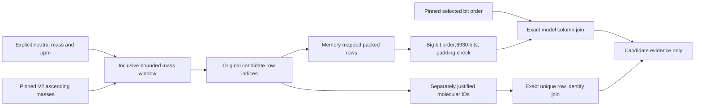

# COCONUT lookup companion

Original numerical tools for a mass window and explicit row/bit-order joins. This packet contains code, diagrams and a proposed description; no candidate structures, spectra, restricted training material, weights or third-party implementation.

Use the existing [prvsiyan COCONUT V2 dataset](https://www.kaggle.com/datasets/prvsiyan/coconut-casmi26-candidates) and preserve its identity. NumPy is required; RDKit and pickle are unnecessary for this quickstart.

```python
from coconut_lookup import load_v2, assert_model_columns, assert_row_join

bank = load_v2('/kaggle/input/coconut-casmi26-candidates')
rows = bank.window(300.0, 10.0)  # illustrative neutral mass in Da, not precursor m/z
fingerprints = bank.decode(rows)

# Only when you possess independently justified producer/model manifests:
# assert_model_columns(bank.bits, model_selected_bits, model_descriptor_order)
# assert_row_join(candidate_row_ids, fingerprint_row_ids)
```

The last two checks are deliberately not supplied with invented real-bank manifests. The tool pins two small V2 files and checks numerical headers/order; it does not establish whole-bank molecular/fingerprint consistency. No model predictions or score are produced.



Read [the dataset-card proposal](DATASET_CARD_PROPOSAL.md) and [the dated retained contract](retained_v2_contract.json) for provenance, limitations and the distinction from the user-linked Morgan/MACCS resource. The numerical example is forkable code, not a new notebook identity or a qualified competition run.

To repeat the invented controls after publication, run `python -I -B qualify_invented.py`. They exercise endpoint duplicates, empty windows, row caps, padding, shuffled/duplicate row IDs and incompatible model maps. They contain no molecular structures or competition examples. A passing synthetic control does not verify the real bank.

Original companion code and diagrams: MIT; see LICENSE. Existing dataset and upstream components retain their own terms.
