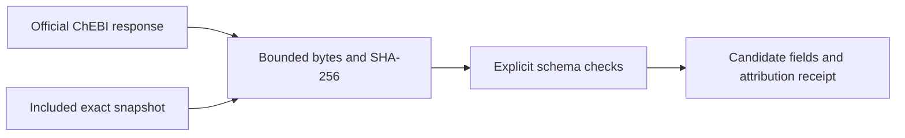

# Public candidate data for CASMI

A versioned catalog and a small, attributed chemical-record example. Use it to check candidate schemas and mass-field handling before loading a large bank.

| Resource | What is bound | Reuse terms |
|---|---|---|
| [COCONUT Kaggle V2](https://www.kaggle.com/datasets/prvsiyan/coconut-casmi26-candidates/versions/2) | Public dataset identity, published schema, two locally inspected array headers | Published CC BY-NC-SA 4.0; upstream artifact mapping remains incomplete |
| [ChEBI caffeine](demo_verified_caffeine_once/candidate.json) | An actual API response, exact SHA-256, selected fields and attribution | CC BY 4.0 |

The complete [dataset card](DATASET_CARD.txt) explains versions, source provenance, schema and limitations. The [machine-readable catalog](catalog.json) links the evidence. This packet contains no COCONUT arrays, competition records or model weights. The mounted COCONUT fingerprint layout is different from the V6 serving model's layout.

## Run the example offline

Python 3.9+ standard library is sufficient. Choose a new output directory.

```sh
python3 chebi_candidate_demo.py \
  --input demo_verified_caffeine_once/source.json \
  --expected-sha256 d7d96d4aaac053f52b78b4ddf52fb295d0b54edaaf00fc7510b4ee26c227c753 \
  --output caffeine_offline_check
```



The example distinguishes average mass from monoisotopic mass and preserves source decimal strings. It validates software contracts; it does not measure prediction quality. The [13 offline checks](OFFLINE_DEMO_CHECKS.json) cover the small demo. ChEBI's monthly release is not established for the included API snapshot; its response bytes and retrieval time are pinned separately.

Data attribution: **ChEBI, EMBL-EBI**, [CC BY 4.0](https://creativecommons.org/licenses/by/4.0/). Original code has its own [MIT license](LICENSE-CODE.txt). See the card for the full source and transformation description.

[Analog Propagation on Kaggle](https://www.kaggle.com/code/prvsiyan/analog-propagation-casmi-2026-baseline) · [CASMI repository](https://github.com/cubres/enveda-casmi-2026)
