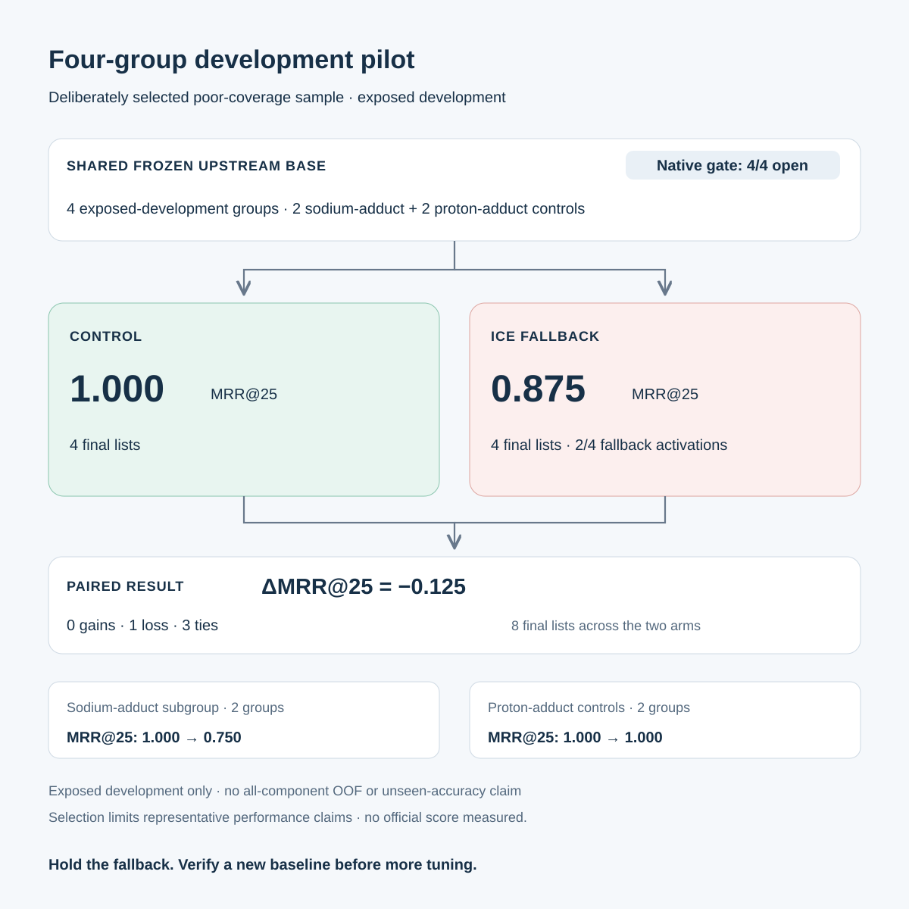

# Four-group ICE fallback development pilot

The fallback reduced MRR@25 from **1.000 to 0.875** on four exposed-development groups deliberately selected for poor native library coverage: **0 gains, 1 loss, 3 ties**. The paired change was **−0.125**. This negative result does not support promoting the fallback.

| Aggregate | Control | ICE fallback |
|---|---:|---:|
| All four groups: MRR@25 | 1.000 | 0.875 |
| Two sodium-adduct groups: MRR@25 | 1.000 | 0.750 |
| Two proton-adduct controls: MRR@25 | 1.000 | 1.000 |

All four native gates opened; fallback activated in two groups. Control and treatment final lists were executed separately for each group, giving eight final lists. Both arms shared a frozen upstream candidate, feature and model pipeline.

This small panel was deliberately selected for poor native library coverage and has known or unresolved prior fingerprint/ranker exposure. Selection limits any representative performance claim, including the perfect control score. It cannot establish all-component out-of-fold performance or unseen accuracy. No official score was measured. MRR@25 is the mean reciprocal rank of the target in each final top-25 list.

**Next step:** establish and verify a new baseline before further tuning. Hold the current fallback.

This source packet contains only authorized aggregates and original presentation assets. It has not been published. The presentation code and files are licensed under MIT; this license grants no rights to the underlying competition data.
