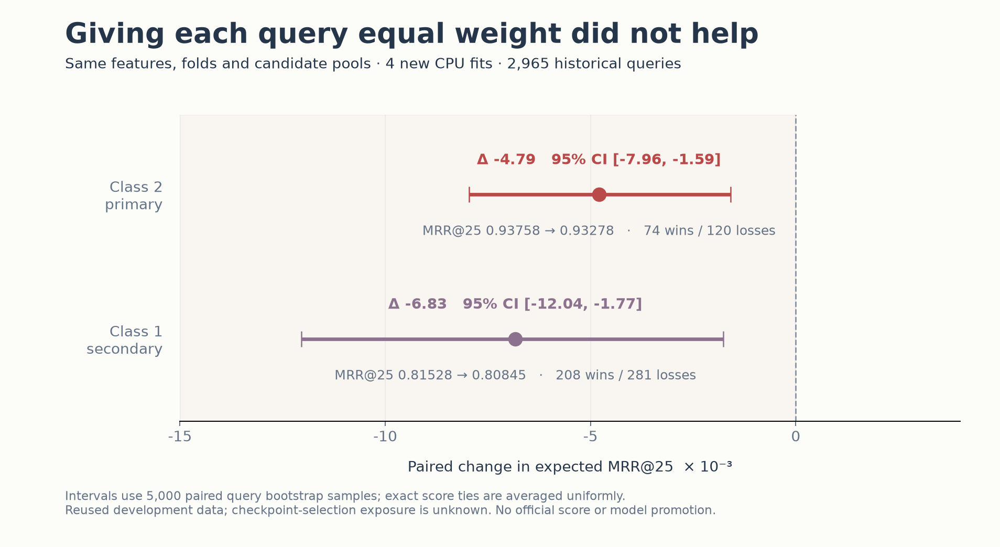
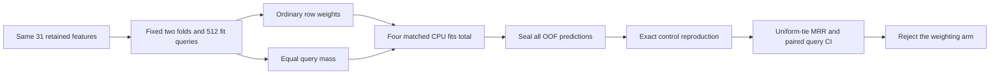

# Equal-query weighting made this CASMI screen worse

An appealing objective change failed our first controlled screen. With the same candidate pools, original 31 features, two folds, 512-query fitting roster and four new CPU models, inverse candidate-count weighting reduced the primary Class2 expected MRR@25 by **0.00479**. Its paired 95% query-bootstrap interval was **[−0.00796, −0.00159]**. We kept the original weighting and did not submit this arm.



| Historical simulation | Original MRR@25 | Query-balanced MRR@25 | Paired change | 95% query CI |
|---|---:|---:|---:|---:|
| Class2 — primary | 0.93758 | 0.93278 | −0.00479 | [−0.00796, −0.00159] |
| Class1 — secondary | 0.81528 | 0.80845 | −0.00683 | [−0.01204, −0.00177] |

These are conditional metrics on 2,965 reused historical queries, **not Kaggle leaderboard scores**. Exact prediction ties use expected reciprocal rank under uniform tie order, including zero contributions beyond rank 25. Every OOF prediction was sealed before held-query rank metrics; a separate worker independently recomputed the results. The new original-arm predictions also exactly matched the previously sealed original control.

## Why try it?

The [public 31-feature ranking dataset](https://www.kaggle.com/datasets/prvsiyan/casmi-2026-second-list-ranker-rows) already combines library similarity, analog propagation, spectrum-to-fingerprint scores and fragment evidence. Its candidate pools range from 1 to 689, with a median of 93. Ordinary candidate-row training assigns more loss to large pools, while MRR averages queries equally.

We changed only training weights. Baseline rows retain weights 0.30 and 0.70 for the two simulations. The treatment divides each row's weight by the complete query/simulation candidate count, then rescales once per fold to match the baseline's total weight. Features, candidates, labels, ordering, folds and hyperparameters remain unchanged. No class-balancing arm, fingerprint model substitution, top1 lock or score blend was added.



Equal query mass also changes the weighted positive prevalence. Across the two fitting folds it rose from **0.85%→3.69%** and **0.76%→2.76%**. A singleton is always trivially ranked first but still receives a full query's training weight. Relative leaf regularization changes too. These observations explain why intuitive metric alignment is not enough; this experiment does not isolate which consequence caused the loss. Global rescaling preserved the reference total weight, not every leaf's optimization.

## The matched screen

Both arms use `HistGradientBoostingClassifier`, seed 0, 128 iterations, depth 6, learning rate 0.03, minimum leaf 80, L2=1 and no early stopping. There are two newly fitted models per arm. Both simulations of each query share a fold; the actual native-identity bridge confirms the two query-alias pairs are same-fold and this fixed fit roster has no cross-fold positive native alias exposure.

The run completed in **11.915 seconds before writing its result**, consuming **10.481 process CPU seconds** and a measured peak RSS of **548,634,624 bytes**. It used one math thread and no child process. The original caps were 240s wall, 180s CPU and sampled 2GiB RSS; no GPU or TPU was used.

Class2 was the preregistered primary endpoint; Class1 could not substitute for it. The 5,000-repetition bootstrap resamples paired anonymous queries with a fixed seed. There was no hyperparameter sweep, fitted-model export, native run or official submission.

## Reuse the useful parts

`query_balanced_metrics.py` is a small NumPy-only module for testing these ideas on your own split. It performs no fitting or I/O:

```python
import numpy as np
from query_balanced_metrics import query_balanced_weights, expected_rank_metrics

# Two queries, each represented by both simulations; pools have 2 and 3 candidates.
query = np.repeat([0, 0, 1, 1], [2, 2, 3, 3])
simulation = np.repeat([0, 1, 0, 1], [2, 2, 3, 3])
ordinary, equal_query, group = query_balanced_weights(query, simulation)

# A positive tied at ranks 25–26 has expected RR@25=.02 and top25=.5.
scores = np.r_[np.full(24, 2.0), 1.0, 1.0]
labels = np.r_[np.zeros(25, dtype=int), 1]
rr25, top1, top25, tie_size = expected_rank_metrics(scores, labels)
```

The original `paired_query_balanced_refit.py` preserves the exact bounded execution recipe for inspection. Its identity bridge, prior prediction seal and registration are private and are not bundled here, so the exact historical run cannot be reproduced from this public folder alone. You can apply the reusable functions to the public numeric dataset with your own explicitly registered identity split; doing so creates a new development experiment.

To regenerate this chart from the public aggregate summary, use fresh output paths:

```bash
python render_result_chart.py --summary measured_result_summary.json \
  --png my-query-weighting-chart.png --svg my-query-weighting-chart.svg
```

## What this does and does not establish

The weighting arm failed this reused historical screen and is not a promoted model. Historical fingerprint checkpoint-selection exposure remains **UNKNOWN**. Anonymous pool-position metrics do not deduplicate native candidate identities, and the query bootstrap is not a native-class interval. The 2,965 queries include 2,963 native classes. The 35 original omissions are 34 retrieval failures and 1 missing-mass failure; the summary's 3,000-denominator columns are count-based zero extension, not a new full-panel prediction join.

The retained fingerprint evidence is unified 10,395-bit scoring. It has no separate Morgan-2048/MACCS-167 channels. Modern descriptor scoring therefore needs a separately qualified producer, packing contract, universe and exposure-controlled validation; this failed weighting test does not answer that question. The saved October 11 audit of [evgendvorkin's CASMI notebook](https://www.kaggle.com/code/evgendvorkin/enveda-casmi-2026) found a called pairwise branch in its exact V24 source, so we make no novelty claim for pairwise ranking.

No structures, raw query keys, identity maps, individual predictions, model weights, credentials or competition training files are redistributed. The original tools and chart renderer are MIT-licensed; this license does not relicense any source dataset or third-party model. Exact source and measured-result hashes are included in the aggregate summary for provenance.
