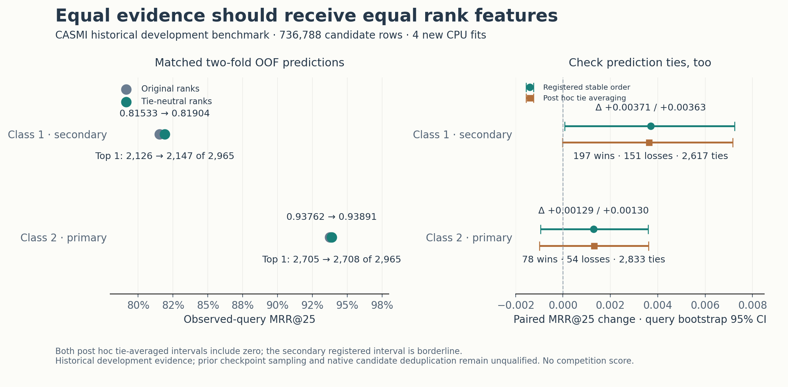
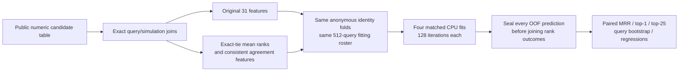

# Equal evidence, equal rank: a small CASMI experiment

Equal library or fragment scores should not gain different feature values simply because the candidate list arrived in a different order. We tested that idea on our public 31-feature CASMI ranking table. This is an original, bounded historical development experiment. It improves a component of our ranking workflow; it does not establish a competition score or reproduce the stronger public V89 pipeline.

The matched local comparison completed four new CPU fits. Our primary Class 2 measurement moved from **0.93762 to 0.93891**, with three additional top-1 hits; its bootstrap interval includes zero, so that difference remains uncertain. The secondary Class 1 measurement moved from **0.81533 to 0.81904**, with 21 additional top-1 hits and a borderline positive registered interval. A separate check that averages exact prediction ties makes **both intervals include zero**. We fixed an order-dependent feature contract, but this small benchmark does not establish a robust ranking gain. An independent numeric worker reproduced every registered aggregate metric and bootstrap interval exactly from the sealed predictions, without fitting or model inference.





The actual audit found exact library-score ties in **5,812 of 5,930** query/simulation groups, covering 411,267 candidate rows. Fragment-score ties occurred in 5,738 groups. The original ordinal ranking gives tied candidates distinct rank features. Our transformation assigns each exact tie its mean ordinal rank, normalized by the candidate count, then updates the features that depend on that rank. For example, three equal best scores receive the same mean rank rather than first, second and third places.

We preserve every measured score, candidate, label and source row. We also preserve missing-channel zero sentinels. The length-normalized fingerprint rank is unchanged: its unstandardized source scores were not retained, so reconstructing it from a zero z-score could invent evidence. The treatment uses the retained model gap for the other fingerprint rank. No labels or identities enter the transformation.

| Historical simulation | Original MRR@25 | Tie-neutral MRR@25 | Paired change | Query-bootstrap 95% interval | Top-1 hits | Top-25 hits |
|---|---:|---:|---:|---:|---:|---:|
| Class 2, primary: raw-key spectra removed | 0.937624678 | 0.938913020 | +0.001288342 | [−0.000950793, +0.003592202] | 2,705 → 2,708 | 2,937 → 2,942 |
| Class 1, secondary: own source library removed | 0.815330736 | 0.819035801 | +0.003705065 | [+0.000074940, +0.007249472] | 2,126 → 2,147 | 2,923 → 2,926 |

Both simulations of a query share the same fold, keyed by its anonymous positive pool identity. The two arms use the same fixed 512-query fitting roster, two folds, sample weights of 0.30/0.70, HGB depth 6, 128 iterations, learning rate 0.03, minimum leaf size 80, L2 1, and seed 0. Early stopping is disabled; there is no parameter scan. Every one of the 2,965 observed queries receives one OOF prediction per arm and simulation. The fitting rows are disjoint from their evaluation queries by anonymous positive pool identity.

Class 1 produced 197 query wins, 151 losses and 2,617 ties. Class 2 produced 78 wins, 54 losses and 2,833 ties. We keep the losses visible. The final ranking still resolves equal model predictions by original candidate order in both arms; the treatment makes rank *features* invariant to exact-score permutations, not the final tie-breaking rule. The bootstrap uses 5,000 samples of anonymous queries with seed 20261013.

We examined that final tie rule separately after the registered run. In 36 original-arm groups and 61 treatment-arm groups, the correct candidate shared an exact prediction score with another candidate. Instead of choosing one candidate-order position, the post hoc check averages its reciprocal-rank contribution over every equiprobable position in the exact tie block, with the same rank-25 cutoff. It makes no new predictions and uses no epsilon. This is a sensitivity assumption, not the competition's scoring rule or a replacement for our registered measurement.

| Post hoc exact-prediction-tie sensitivity | Original expected MRR@25 | Tie-neutral expected MRR@25 | Paired change | Query-bootstrap 95% interval |
|---|---:|---:|---:|---:|
| Class 2, primary | 0.937575935 | 0.938878711 | +0.001302776 | [−0.000996063, +0.003609774] |
| Class 1, secondary | 0.815284081 | 0.818913664 | +0.003629583 | [−0.000028044, +0.007157804] |

The small change in tie handling removes the secondary interval's borderline exclusion of zero. Both outcomes remain uncertain under this check. We preserve the original registered predictions, results and count denominators. The chart shows both rules side by side; choosing only the more favorable one would misrepresent this experiment.

Coverage also matters. This retained table contains 2,965 of the original 3,000 historical queries. Adding the 35 omitted retrieval/mass failures as zero contributions gives raw-query MRR values of **0.805819 → 0.809480** for Class 1 and **0.926686 → 0.927959** for Class 2. The original run registered this as count-only arithmetic. A subsequent private data-only audit recovered all 35 original identities and statuses: **34 truth-outside-window failures and one missing-mass failure**. Their identities remain private. These values keep the original raw-query denominator visible; they still do not establish a native-candidate-deduplicated full-panel score or new predictions for the omitted queries.

The process completed in 13.268 seconds before its final result receipt, using 11.902 CPU seconds and a sampled peak RSS of 612.39 MiB. That includes imports, data hashing, transformation, all four fits, prediction sealing and rank metrics after the script's first explicit clock read. Interpreter bootstrap precedes that read. The registered caps were 240 seconds wall, 180 seconds process CPU, 2 GiB sampled RSS and one math-library thread. A watchdog is another OS thread, and sampled RSS is not a hard memory reservation.

These are **historical development measurements**. After fitting, a private data-only audit recovered the exact ordered query-to-native-class bridge. It checked all 4,000 original component records and all 736,788 public candidate positions against their original candidate buffers, without unpickling or running a model. The 2,965 raw queried identities map to 2,963 native classes. Both alias pairs share the registered fold and neither counterpart enters the 512-query fitting roster, so that audit finds **zero positive-class crossfold fitting exposure** in this particular ranker comparison. The two preserved candidate-pool files have different whole-file hashes, but all 711,705 ordered raw keys compare byte-for-byte equal. No historical original whole-file pool hash was found; the preserved components provide the candidate-position corroboration.

That recovery closes an identity bookkeeping gap. It does not create fresh predictions or an untouched evaluation. Thirteen queried odd-index structures have even-index aliases eligible for earlier fingerprint checkpoint selection; actual sampling remains unknown. Earlier feature generation and model-selection exposure remain relevant. Raw-key library exclusion does not prove native tautomer/salt exclusion, anonymous candidate MRR does not deduplicate native candidate classes, and the confidence intervals still resample raw queries rather than native classes. The original runner, registration, sealed predictions and result receipt are preserved byte-for-byte; their initially unqualified bridge fields record what was known at registration. The aggregate JSON reports the subsequent identity addendum separately.

The reusable [feature transformation](tie_neutral_features.py) is the measured original source. [paired_tie_neutral_refit.py](paired_tie_neutral_refit.py) preserves the exact measured runner, including its source/data checks and private sidecar contract. It requires a separately verified local ordered identity sidecar; that private workspace artifact and individual predictions are not redistributed here. The experiment's public table, feature glossary, data checksums, full fitting recipe and aggregate measurements are enough to inspect the treatment and build a separately registered local experiment. Do not call a different identity join an exact replay of this run.

You can try the rank function without a model or RDKit:

```python
import numpy as np
from tie_neutral_features import descending_midrank

scores = np.array([0.9, 0.9, 0.4], dtype=np.float32)
print(descending_midrank(scores))  # [0.25, 0.25, 1.0]
```

For the complete treatment, call `transform_query_features` on one exact `float32 [candidate, 31]` query/simulation group. Use the dataset's feature order; preserve candidate joins; never transform an arbitrary minibatch containing fragments of several candidate lists. The caller owns identity exclusion and validation. The function copies its input and does not inspect labels.

The [aggregate JSON](measured_result_summary.json) contains no structures, spectra, per-query pool IDs, local filesystem paths or individual predictions. It retains the full aggregate results for both tie rules and hashes of the private exact-input evidence. The [chart generator](render_result_chart.py) reads only that JSON and refuses incomplete or unreviewed results. To render fresh artifacts:

```sh
python render_result_chart.py --summary measured_result_summary.json \
  --png local-results.png --svg local-results.svg
```

The next useful test is a freshly registered representative native-class-disjoint panel using the recovered ordered bridge, an alias-excluded fingerprint head, native candidate deduplication and retrieval failures joined before outcomes are inspected. Adoption of Morgan-2048 + MACCS-167 should be a separate matched representation comparison, with the dummy MACCS key and padding masked, descriptor versions pinned and exactly the same pretruth-sealed candidate universe. The historical 10,395-bit table used here cannot isolate those new channels.

Credit and provenance: the [prvsiyan 31-feature dataset](https://www.kaggle.com/datasets/prvsiyan/casmi-2026-second-list-ranker-rows) supplies the retained rows and original baseline semantics. [Aryan's COCONUT fingerprint dataset](https://www.kaggle.com/datasets/aryanawasthiteykik/casmi26-coconut-morgan-maccs-fingerprints) and [spectrum-to-fingerprint model](https://www.kaggle.com/datasets/aryanawasthiteykik/casmi26-spectrum-to-fingerprint-mlp) motivate the separate compact descriptor route. The [credited Flexonafft V89 recipe](https://www.kaggle.com/code/flexonafft/casmi26-public-baseline-adaptation-experiments?scriptVersionId=357683876) remains the stronger public pipeline to reproduce; this experiment does not attribute its score to our notebook. The transformation, bounded runner, controls, exposition and chart code here are original MIT work. No competition training structures or spectra are redistributed.
