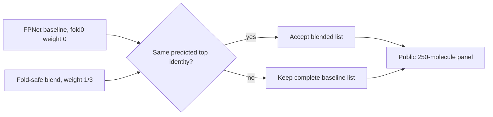

# Fold-safe top-identity gate: cached panel replay

This experiment adds a simple safeguard to the public fold-safe FPNet blend: accept the weight-1/3 ranking only when its predicted top metric identity matches the weight-0 baseline. If the top identity changes, retain the full baseline ranking. The rule uses model outputs only; it does not inspect labels at inference.



## Result

The deterministic 64-query canary passed the predeclared gate: baseline MRR@25 was **0.49602**, gated blend **0.49803**, and top-1 accuracy stayed **0.375**. We then evaluated all 250 panel identities, padding four queries absent from both cached arms with zero.

| Ranking | MRR@25 | Top-1 |
|---|---:|---:|
| Fold0 weight 0 baseline | 0.51198 | 0.400 |
| Static fold0 weight 1/3 | 0.51453 | 0.400 |
| Top-identity-preserving gate | **0.51443** | **0.400** |

The gated change was **+0.00245 MRR@25**, with a paired 20,000-resample molecule bootstrap interval of **[+0.00009, +0.00534]**. The gate accepts 243 of 250 rows; the static blend changed top identity on seven scored rows. These cached panel predictions reproduce all 11 rows of the published panel summary with maximum absolute difference below `1.2e-16`.

This is a small result on a public development panel, not a competition leaderboard score or hidden-test estimate. It does not justify changing the current Kaggle notebook yet: the current notebook’s runtime inputs and the exact fold-safe model-serving path have not been qualified against this replay.

## Reproduction

Use the [exact Kaggle dataset version 7](https://www.kaggle.com/datasets/dmitriigluzdov/casmi26-natural-product-panel-benchmark/versions/7) and verify the two input hashes in [`source_receipt.json`](source_receipt.json). Download `panel.parquet` and `panel_fpnet_per_molecule.csv`, then run:

```bash
python gated_fold0_replay.py \
  --per-query panel_fpnet_per_molecule.csv \
  --panel panel.parquet \
  --out results.json
```

The implementation is Apache-2.0. The source dataset is labeled **Other** and contains competition-derived data; its competition and third-party terms still apply. No spectra, structures, candidate rows, model weights, or panel records are included here. [`source_receipt.json`](source_receipt.json) records input hashes, the v7 file listing, and four mismatches between the embedded date-named manifests and files currently served in version 7.

## Public leaderboard context

The Kaggle public leaderboard snapshot retrieved at **2026-10-20 16:00:20 UTC** had a top score of **0.495**. The `prvsiyan` row was **0.345**, rank **1,954 of 3,670**; that row does not bind the selected submission to this local panel experiment. See the dated [score receipt](leaderboard_snapshot.json) and the [live leaderboard](https://www.kaggle.com/competitions/enveda-CASMI26-molecule-id-mass-spectra/leaderboard).
