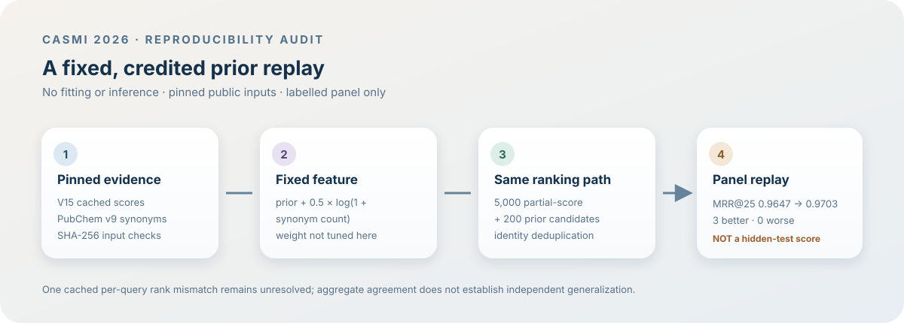

# CASMI V14 PubChem synonym-prior replay

This package replays one fixed feature from Dmitrii Gluzdov's public [CASMI 26 data notebook, version 15](https://www.kaggle.com/code/dmitriigluzdov/casmi-26-the-data-behind-spectra-to-structures?scriptVersionId=360413706). Version 14 adds `0.5 * log1p(PubChem synonym count)` to the existing PubChem prior. The replay below credits that original idea; it is a reproducibility audit, not a new model or an official competition result.



## Result

| Fixed 250-molecule panel | MRR@25 | Top-1 | Hit@25 |
|---|---:|---:|---:|
| Existing cached-score replay | 0.96467 | 0.960 | 0.976 |
| Replay with the published synonym prior | **0.97033** | **0.968** | 0.976 |

Three molecules improve and none regress in this replay. A label-free, deterministic 64-molecule canary changed MRR@25 from 0.94531 to 0.94661, with top-1 unchanged. The 20,000-replicate paired molecule bootstrap gives an MRR delta 95% interval of `[0, 0.01433]` and top-1 interval `[0, 0.020]`.

These numbers are **development-panel metrics only**. This labelled, training-derived natural-product panel is the same panel on which the feature was originally described, so it is not an untouched holdout and says nothing conclusive about hidden-test performance. The public notebook page shows a best official score of 0.456 on V13, the same 0.456 on V14, and no score for V15; this replay creates no new official score.

## Exact replay and discrepancy

The aggregate baseline and synonym-prior results match the V15 notebook's reported panel figures. One of 246 available cached per-molecule baseline rows does not match the replay: the replay ranks the truth at 6 while that cache records rank 3. The affected query contains repeated truth-identity rows and a partial-score tie at the shortlist boundary; tie or duplicate handling is a plausible cause, but it has not been proven. The discrepancy is preserved in `full250.json`. Treat the aggregate result as a faithful reproduction of the published panel summary, not as fully reconciled per-query parity.

All inputs are bound by SHA-256 in `canary64.json` and `full250.json`. The source datasets are public: [natural-product panel benchmark, version 7](https://www.kaggle.com/datasets/dmitriigluzdov/casmi26-natural-product-panel-benchmark/versions/7) and [PubChem popularity prior, version 9](https://www.kaggle.com/datasets/dmitriigluzdov/casmi26-pubchem-popularity-prior/versions/9). Cached score files and the source notebook are also pinned by hash. Raw upstream files are not redistributed here. The script is Apache-2.0 (`SPDX-License-Identifier` in the source); upstream dataset terms remain unchanged, and the reports contain aggregate metrics and hashes only.

## Run it

Use the exact source versions above and place the matching files at local paths. The required paths and their expected hashes are recorded in `full250.json`. The script does not fetch data, fit models, run inference, or require a GPU. It was tested with Python 3.9.6, NumPy 2.0.2, pandas 2.3.3, and PyArrow 21.0.0.

```bash
uv run --python 3.9.6 \
  --with numpy==2.0.2 --with pandas==2.3.3 --with pyarrow==21.0.0 \
  python replay_synonym_prior.py \
  --panel /path/to/panel.parquet \
  --scores /path/to/panel_fpnet_scores.parquet \
  --signals /path/to/pubchem_signals.parquet \
  --candidates /path/to/pubchem_candidates.parquet \
  --synonyms /path/to/pc_lsynonyms.npy \
  --cached-per-query /path/to/panel_fpnet_per_molecule.csv \
  --notebook-source /path/to/casmi-26-the-data-behind-spectra-to-structures.ipynb \
  --n 250 --out result.json
```

Pass `--n 64` for the deterministic canary. The fixed candidate score, shortlist sizes, prior weights, canary selection, panel identity checks, and bootstrap seed are explicit in the script.

## Files

- `replay_synonym_prior.py` — CPU-only, fixed-weight replay; Apache-2.0.
- `canary64.json` — canary metrics and exact input hashes.
- `full250.json` — full-panel metrics, bootstrap interval, limitations, and the unresolved per-query discrepancy.
- `pipeline.svg` — method and evidence-flow diagram.

