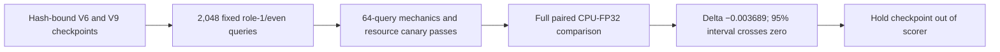

# R3 held-out check of the V9 complementary FPNet checkpoint

**Decision: do not adopt this checkpoint into the CASMI scorer.** On the fixed 2,048-structure held-out comparison, its paired MRR@25 point estimate was lower than the selected V6 baseline. The 95% interval crosses zero, so this run does not establish either a reliable improvement or degradation.

| Arm | Checkpoint | MRR@25 |
| --- | --- | ---: |
| Selected V6 baseline | `9c46ca4fcf19002fecbcded0d0808e8a81e3a25a143e684e259f265c44a5be31` | 0.706274 |
| V9 complementary FPNet, 3,000 updates | `c1c7650411d507f395e3077e90db72a8b1d692493e91c7f13ba6f55e6359b286` | 0.702585 |
| Paired candidate minus baseline | — | **−0.003689** |

The query-resampled 95% percentile bootstrap interval is **[−0.008241, +0.000569]** (5,000 draws, seed 20261020). The baseline reproduces its historical reference within the predeclared 0.002 diagnostic tolerance. The R3 candidate won 123 queries, lost 158, and tied on 1,767; ties are retained in the paired analysis.

## Protocol and limits

R3 evaluated 2,048 distinct role-1/even-structure queries against 63 fixed decoy draws per query. Decoys were sampled with replacement and repeated positions were preserved, matching the pinned sampled-draw scorer. The 64-query canary passed mechanics, finite-value, memory, and projected-runtime gates. It was not an accuracy-improvement gate.

Both arms ran on CPU in FP32. This is a local proxy, **not CUDA-FP16 parity, not the official unique-candidate metric, and not an official competition score**. No Kaggle call or submission occurred. Runtime was 55.149 seconds at 2,961,555,456 bytes peak RSS with two CPU threads. Only aggregate results are published; the per-query file remains in the local evidence packet.

## Reproduction record

- [V9 training notebook version 360180749](https://www.kaggle.com/code/prvsiyan/casmi-fp-trainer-merged-spectra?scriptVersionId=360180749) provides the candidate checkpoint in its exact Output.
- The selected V6 parent is documented in the [checkpoint training release](https://github.com/cubres/enveda-casmi-2026/tree/6987d48bab9e6ea36ce07db322d64e282463c838/reproduction/selected-v6-training/2026-10-18). Its checkpoint SHA-256 is recorded above.
- The public V1 inputs are [casmi26-full-fingerprint-inputs](https://www.kaggle.com/datasets/prvsiyan/casmi26-full-fingerprint-inputs/versions/1) and [casmi26-spec-fp](https://www.kaggle.com/datasets/prvsiyan/casmi26-spec-fp/versions/1). The receipt binds every consumed file, model, source file, and fixed split array by SHA-256.
- [`result.json`](result.json) is the complete aggregate receipt. [`evaluate_complementary_checkpoint.py`](evaluate_complementary_checkpoint.py) is the exact R3 evaluator used; its SHA-256 is `09c0ed92c0bd8bef0f2bc8cede1bfabd2a72cd8c6399edd3f19274cbfc42fa43`.

The archived evaluator binds the original local packet under `/Users/cubres/Documents/Neurogolf/research`; its `--out` path is one-use and the script refuses to reuse an existing output directory. This is the exact source for this run, not a portable clone-and-run package. To rerun elsewhere, first obtain the same public input versions and exact notebook Output artifacts, reconstruct the pinned packet, and make any path adaptation explicit; the run recorded here used the unchanged, hash-pinned script.

The evaluator script is licensed under Apache-2.0 as described in [`LICENSE-SCRIPT.md`](LICENSE-SCRIPT.md). This grant applies to that script alone; it does not relicense the inputs, checkpoint weights, or upstream sources. Their component terms remain in force, and this result makes no prize-eligibility claim.
