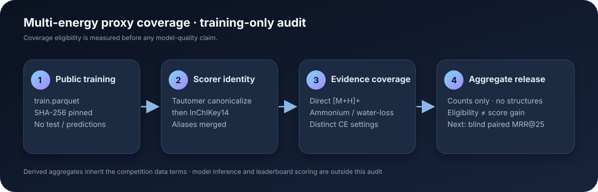

# Multi-energy proxy coverage in CASMI 2026

This package measures whether the public CASMI training set contains enough scorer-canonical molecules with multiple proxy collision-energy settings to justify a small, paired reranking experiment. It is a training-data coverage result only: **no model inference, validation score, or competition score was run or claimed.**

## Public-method context

The public version comparison reviewed on 21 October reports a **0.464 public score** for [Dmitrii Gluzdov’s V16](https://www.kaggle.com/code/dmitriigluzdov/casmi-26-the-data-behind-spectra-to-structures?scriptVersionId=360635689). V16’s described change jointly uses ICEBERG and GLACIER scores when reranking same-formula candidates covered by proxy spectra. His [V17](https://www.kaggle.com/code/dmitriigluzdov/casmi-26-the-data-behind-spectra-to-structures?scriptVersionId=360784035) expands analogue parents from 6 to 20, but that version was unscored in the reviewed table. [Flexonafft V49](https://www.kaggle.com/code/flexonafft/casmi26-closing-the-evidence-gap?scriptVersionId=360740328) describes averaging GLACIER scores over collision-energy buckets and was also unscored. These pages motivate an experiment; none isolates a measured gain for multi-energy averaging.

The independent question here is narrower: how many training identities actually have repeated proxy-energy evidence after applying the scorer’s tautomer canonicalization? A visible small smoke in V49 had no eligible molecules. This full training audit finds substantial eligible training coverage, which shows that the smoke was not representative of the whole training set; it does **not** imply hidden-test coverage or a score gain.

## Reproducible result

The official `train.parquet` contained **2,539,608 rows** and **274,195** unique scorer-canonical identities. Its SHA-256 was `9423f90ec08b941a9646b535bf0606183e86ff0c5a297978f5a70693d41bcd98`. With RDKit 2026.03.3 tautomer canonicalization followed by InChIKey14, the audit found:

| Training coverage | Scorer-canonical identities |
|---|---:|
| Direct `[M+H]+` spectrum present | 242,650 |
| No direct `[M+H]+` | 31,545 |
| No direct `[M+H]+`, at least one supported proxy | 1,663 |
| No direct `[M+H]+`, at least two distinct proxy energy signatures | **1,474** |
| Both ammonium and dehydrated-protonated proxy types | 27 |

Within the 1,474 multi-energy identities, 1,207 have at least two ammonium-proxy settings and 292 have at least two dehydrated-protonated settings; 25 identities are counted in both subgroups. The equivalent raw stored-InChIKey14 grouping reports 1,478 eligible identities. The four-identity difference demonstrates why coverage should be joined using the scorer’s canonical key rather than the supplied prefix.

A 65,536-row canary completed in 15.3 seconds and exactly matched the earlier single-worker scorer-key coverage canary. The full pass completed in 490.0 seconds using six CPU workers. The complete aggregate is in [`coverage.json`](coverage.json); the canary and hash-bound execution receipt are in [`canary.json`](canary.json) and [`run_receipt.json`](run_receipt.json).



## One proposed experiment

On a fixed, structure-disjoint training holdout, freeze the candidate list, formula filter, and every non-proxy feature. Restrict the primary comparison to molecules with no measured `[M+H]+` and at least two distinct proxy-energy signatures. Compare the current single-proxy path against an equal-weight mean of GLACIER similarity scores across distinct collision-energy buckets, then apply the same-formula ICEBERG/GLACIER rerank described in V16. Leave ineligible molecules on the original path.

Use a 64-identity mechanics canary first; if it passes, score the entire preregistered holdout and report paired MRR@25, top-1 accuracy, eligible coverage, and a query-bootstrap interval. Keep candidate generation and all labels split by canonical identity. This would test a new combination of energy-balanced proxy aggregation and same-formula simulator consensus; the present audit supplies only the eligibility count, not the required predictive evidence.

## Run it

Download the competition’s public `train.parquet`, then run:

```bash
python -m pip install -r requirements.txt
python profile_coverage.py \
  --train train.parquet \
  --output coverage.json \
  --workers 6
```

The script refuses any training file whose SHA-256 differs from the pinned input. It reads `normalized_smiles` to recompute scorer identities, but exports aggregate counts only; it does not read test data, spectra, predictions, or submissions. The comma-separated collision-energy text is treated as one acquisition label rather than split into several spectra.

## Rights and limits

The profiler source is licensed **Apache-2.0**. The official competition training file is **CC BY-NC 4.0**; the derived coverage counts retain those source terms. This package does not redistribute the training file or participant-shared model assets. It makes no claim about the hidden public split, private score, or final rank.
