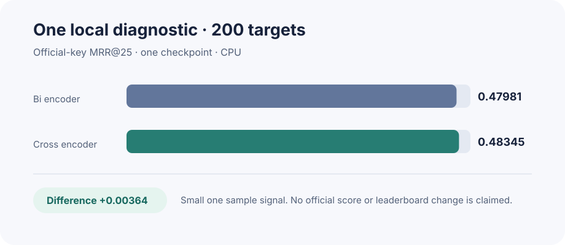

# Official key cross encoder diagnostic

**Result:** the cross encoder was slightly higher on one local diagnostic sample. This is a research lead, not a verified competition improvement.

| Model | MRR@25 on 200 targets |
|---|---:|
| Bi encoder | 0.4798088479 |
| Cross encoder | 0.4834505302 |
| Difference | +0.0036416822 |

The model values are rounded independently; the difference uses the stored unrounded comparison.

## Method

The evaluation used the competition's official structure key: remove stereochemistry, apply RDKit 2026.03.3 tautomer canonicalization, then compare the first 14 InChIKey characters. It did not use stored InChIKey fields as truth.

The original retained 250 target set had 13 targets whose exact candidate window overlapped identities used to train the cross encoder. Those targets were excluded. The remaining 237 targets were sampled without replacement; 200 were selected with NumPy seed `20261025`, then sorted. Both models ranked the same retained candidate windows and used the same official key. All 200 targets were covered.

For 193 same exact mass groups, the bi encoder scored 0.4769685932, the cross encoder scored 0.4842038003, and random ordering scored 0.1772450477. The median group contained 42 candidates.

## Limits

- This is one checkpoint and one sampled subset. It has no repeated seed or uncertainty estimate. The small difference may not generalize.
- This is a local diagnostic. It is not a Kaggle submission score and does not show a leaderboard change.
- The candidate pool was `prvsiyan/coconut-casmi26-candidates`, whose captured Kaggle metadata declares `CC-BY-NC-SA-4.0`. That license is incompatible with the host's stated commercial redistribution requirement for winning solutions. Do not use this experiment as a prize eligible candidate.
- The original transient command was not retained. The result record preserves the selection recipe, environment, hashes and limitations, but this repository does not contain a complete reproduction script.

The bounded run used four CPU threads, took 508.141 seconds, and canonicalized 20,667 unique candidate and target SMILES. It did not use a GPU or TPU. No notebook, dataset or submission was changed by the experiment.

## Provenance

- Competition metric and task: [Enveda CASMI 2026](https://www.kaggle.com/competitions/enveda-CASMI26-molecule-id-mass-spectra/overview)
- Host licensing clarification: [external data and model licensing](https://www.kaggle.com/competitions/enveda-CASMI26-molecule-id-mass-spectra/discussion/741359)
- Candidate pool and license: [COCONUT 2.0 candidates + fingerprints](https://www.kaggle.com/datasets/prvsiyan/coconut-casmi26-candidates)
- Official scorer notebook SHA-256: `bf8535f01bf73268a52819b38e7f6b205e37ec127c268e48081b780a10b609dd`
- Input stream SHA-256: `2a43a7069ae73006335e7d8333185177edacb9ce16e25405edffe6125deef065`
- Cross encoder checkpoint SHA-256: `d859eef9e853d78b4509fbd6fabf0f9c085f5b89a16fda6b5797708746bcb43e`

## Next useful test

Repeat the comparison on a new identity disjoint sample, with a predeclared seed and a paired bootstrap interval. Use only data and models whose licenses permit commercial use and redistribution. Promote the method only if the gain persists and eligible target coverage remains high.
