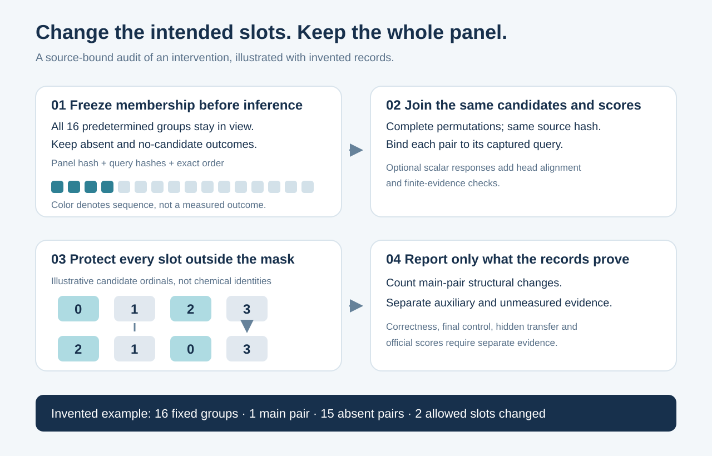

# Did the intervention change only the intended slots?

This small standard-library tool audits a panel chosen before inference and a
source-bound pair of rankings. It is useful when a model adds evidence for only
some candidate groups: keep the entire fixed panel, verify the candidate order,
and count changes inside the declared mask without moving other slots.



The included example is wholly invented. Its 16 panel members include one
captured main pair and 15 explicit absences; the pair changes two allowed slots
and preserves an interleaved protected slot and the tail. These numbers test
software behavior and say nothing about competition performance.

```sh
python3 -m unittest -v test_fixed_panel_audit.py
python3 synthetic_demo.py --destination invented-run-1
python3 fixed_panel_audit.py \
  --manifest invented-run-1/PRIVATE_INPUT_MANIFEST.json \
  --input-dir invented-run-1 \
  --output invented-run-1/PRIVATE_AUDIT_REPLAY.json
```

Each run creates new files. It never edits or removes its inputs or overwrites
an output. Python 3.9 or later is sufficient; there are no model dependencies.

The generic reader verifies file byte lengths and SHA256, the declared first-k
panel members and completion order, complete ranking permutations, paired
candidate and frozen-score hashes, same-group slot membership, changed flags,
and the unchanged protected slots and tail. Its library/manifest interface
accepts a declared count from 1 through 32; the default and invented example
use 16. A missing main pair stays in the denominator
as an explicit absence; it does not prove the intervention was ineligible.
Auxiliary branches have a separate count and do not inflate main-pair effects.

For the motivating 16-member campaign, a separate source-bound consumer must
require exactly 16 and every `PRIVATE_QUERY_000.json` through `_015.json`,
joined to the pre-outcome panel registration. That campaign denominator cannot
be inferred from surviving files or changed after results. The generic reader
does not hardcode this campaign rule or authenticate that the caller supplied
the original registration; those checks belong to the exact native evidence
consumer.

With optional scalar responses, the reader also joins the actual service result
to the reconstructed incoming head, checks its hash and finite-value counts, and
rejects an informative label for exactly constant ICE. Finite GL equal to zero
is still present evidence. Null GL is absence; infinity and nonstandard JSON
NaN are invalid service evidence. Small nonconstant values can fall below the
producer's variance floor; the reader does not replay NumPy's scorer or certify
its floating-point ordering.

| Evidence | What this tool can establish |
|---|---|
| Panel registration and completion | The same predetermined members and order were retained |
| Complete query files | Pair candidate universe, formula membership and fitted base scores |
| Pair records | Source-bound structural changes and protected-slot parity |
| Optional scalar response file | Response-to-head alignment and basic evidence gates |
| Query final lists | Observed treatment output; there is no independent final control rerun here |

`PASS_FIXED_PANEL_STRUCTURAL_AUDIT_ONLY` is deliberately narrow. It does not
establish labels, correctness, final-list improvement, an independent holdout,
runtime suitability, a completed native run or an official score. Input hashes
bind bytes; they do not authenticate capture chronology or prove that a caller
included every pair file in the original directory. Bind that inventory to a
terminal source/version receipt separately. The generic reader's memory and
file limits are consumer limits, not measured limits of a Kaggle producer.

Actual spectra, structures, task identities, query records and experiment
aggregates must stay private where their source terms require it. The public
packet contains only this original reader, invented controls, an invented
result, and the explanatory diagram. Errors contain fixed codes rather than
query identities. There is no pickle loading, model import, chemistry execution,
remote API or notebook mutation.

The study motivating the contract uses ICE only for complete same-formula head
groups lacking finite GL. Mechanism context is credited to
[canqiang's E006 ICE fallback](https://www.kaggle.com/code/canqiang/casmi26-e006-window-40-ice-fallback-true)
and [samanyu1808's ICEBERG/GLACIER notebook](https://www.kaggle.com/code/samanyu1808/casmi26-iceberg-where-glacier-is-blind-lb-0-438).
This reader is original audit code and contains no third-party notebook code,
checkpoints or competition data. MIT covers these original files, separately
from rights to any real input used with them.
