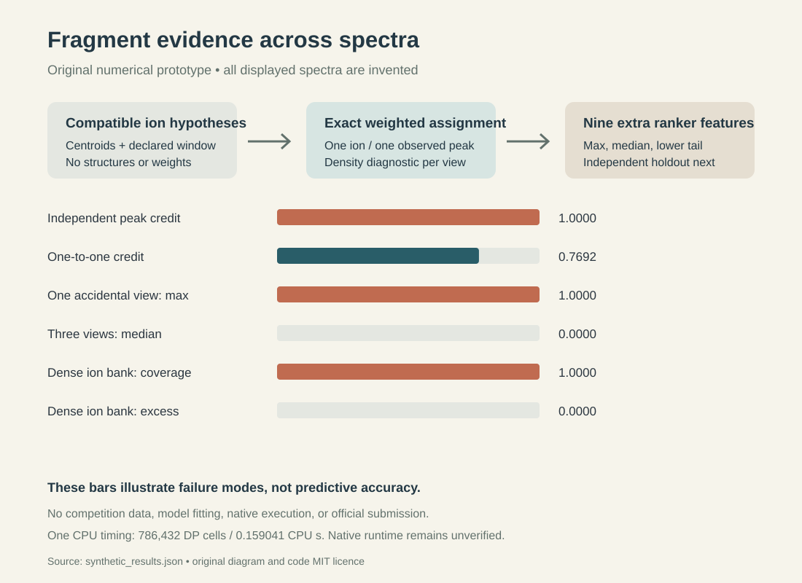

# Fragment evidence that survives a second spectrum

A candidate can look convincing because it offers many fragment-ion hypotheses,
because several observed centroids reuse one hypothesis, or because one spectrum
happens to fit. This small experiment exposes those effects as separate ranker
features. It does not propose a new competition score.

The existing Enveda feature implementation inspected on 11 October 2026 credits
each observed peak independently if any shifted fragment ion is close enough,
and retains the best explained fraction across spectra. Its four fragment
features therefore describe the maximum explain score and its within-query
rank and scale. This module provides nine additional candidate features without
using candidate-pool provenance, train/test identifiers, answers, or embeddings.

All code, examples, and the illustration here are original MIT-licensed work.
Inputs are invented numeric m/z and intensity vectors. No competition spectra,
candidate rows, fingerprints, checkpoints, source notebooks, or third-party
implementation are included.

## How to run

Python 3.9 or later; standard library only.

~~~sh
python3 -B test_fragment_consensus.py
python3 -B -O test_fragment_consensus.py
python3 -B synthetic_demo.py
~~~

The pure API is:

~~~python
from fragment_consensus import candidate_features

out = candidate_features(
    ion_mz=[100.0, 150.0, 200.0],
    spectra=[{
        "mz": [100.0, 100.005, 150.0, 200.0],
        "intensity": [100.0, 81.0, 100.0, 100.0],
        "window": [40.0, 300.0],
    }],
)
~~~

The JSON command reads at most 2 MiB from stdin and prints a result; it does not
modify input files. Only the keys ion_mz and spectra are accepted.

The caller supplies **charged ion m/z hypotheses**, after its own chemistry
adapter handles neutral-fragment mass, hydrogen shifts, adduct, polarity, and
charge. The acquisition window must be declared from instrument/processing
metadata, rather than selected to reward a candidate. A batch of spectra must
share a compatible hypothesis interpretation. Do not pool opposite polarities
or different adducts into one list. Energy heterogeneity also needs a native
ablation; a fragment genuinely visible only at one collision energy can be
penalized by a lower-tail feature.

## What the features measure

For each spectrum, observed weight is sqrt(intensity). An ion and a centroid
can each be used at most once. The feature maximizes the sum of matched observed
weights subject to the absolute/ppm tolerance; its fraction is normalized by
all observed weight.

The exact solver sorts both sides and uses ordered dynamic programming.
Admissibility interval endpoints increase with observed m/z. Any crossing
matching can therefore be uncrossed without losing feasibility. Because weights
belong only to observed peaks, uncrossing leaves the objective unchanged.
This establishes exactness for this objective. It does not extend to an
arbitrary mass-error reward or fragment-dependent weight.

A second feature measures the fraction of the declared acquisition window
covered by the union of the candidate's tolerance windows. Subtracting this
coverage from the assignment fraction creates uniform-mass excess. This is a
density diagnostic, not a calibrated noise probability: real spectral peaks
are neither uniformly distributed nor independent, and the one-to-one
capacity constraint makes coverage an upper baseline for that simplified null.

| Column | Meaning |
|---|---|
| assignment_max | Best per-spectrum exact explained fraction |
| assignment_median | Median support across spectra |
| assignment_q25 | Linearly interpolated 25th-percentile support |
| uniform_excess_mean | Mean assigned fraction minus uniform mass coverage |
| uniform_excess_q25 | Lower-tail uniform excess |
| reuse_gap_max | Largest difference between independent and one-to-one credit |
| coverage_mean | Mean fraction of the window covered by ion hypotheses |
| hypothesis_count_log1p | log(1 + exact unique ion m/z count) |
| view_count | Number of supplied spectra |

Exact duplicate ion masses are collapsed. Distinct H-shift hypotheses stay
distinct; the program does not prove they are chemically justified. The
assignment is per spectrum, so an ion may explain a peak in several spectra.
The features are invariant to candidate-pool membership and vector ordering.

## Measured controls

These are deliberately invented counterexamples, not molecules or held-out
Enveda predictions. The complete numbers are in synthetic_results.json.

| Control | Independent/best evidence | Additional feature |
|---|---:|---:|
| Two nearby centroids reuse a sparse ion hypothesis | Independent explained fraction 1.0000 | Exact fraction 0.7692 |
| A dense grid explains everything in a narrow window | Exact fraction 1.0000 | Uniform excess 0.0000 |
| A candidate fits one of three incompatible spectra | Maximum exact fraction 1.0000 | Median exact fraction 0.0000 |

Fourteen tests pass in ordinary and optimized Python, including 200 small
random cases compared with an independent exhaustive **unordered** matching
oracle. Tests also cover interval overlap, ppm geometry, higher-intensity
selection, reassignment, invalid inputs, exact duplicates, and permutation
invariance.

One nice-priority CPU run evaluated 32 candidates × 4 spectra × 64 peaks × 96
hypotheses: 786,432 dynamic-program cells in 0.159041 CPU seconds and 0.1592065
wall seconds on the local host. RSS was not measured. This is a single small
synthetic timing, not a native runtime guarantee.

The implementation bounds each candidate at 16 spectra, 256 peaks per spectrum,
2,048 explicit ion hypotheses, and 8,388,608 DP cells. Its work is O(ions ×
peaks × views) and its DP memory O(ions). Oversized, missing, or invalid
inputs fail rather than being silently truncated. A full 400-query pool with
many large candidates still needs native profiling.

## The next experiment

NEXT_EXPERIMENT.md proposes one fixed ablation: keep the incumbent candidate
generation, base scoring, forward stages, and fusion unchanged; refit its
ranker with these nine columns appended to the current 31. This is a proposal
for registration before execution. No parameter sweep or competition
submission has been performed.

The expensive work is learning whether the diagnostics distinguish genuine
fragment evidence from broad hypothesis coverage without suppressing useful
single-energy peaks. Synthetic correctness cannot answer that question.

The matcher is related to the general weighted assignment problem described
in the [SciPy documentation](https://docs.scipy.org/doc/scipy/reference/generated/scipy.optimize.linear_sum_assignment.html).
It is not SciPy code and imports no SciPy dependency.
[SIRIUS 4](https://www.nature.com/articles/s41592-019-0344-8) is relevant
background on fragmentation-based interpretation. This prototype neither
implements fragmentation trees nor reproduces SIRIUS.

