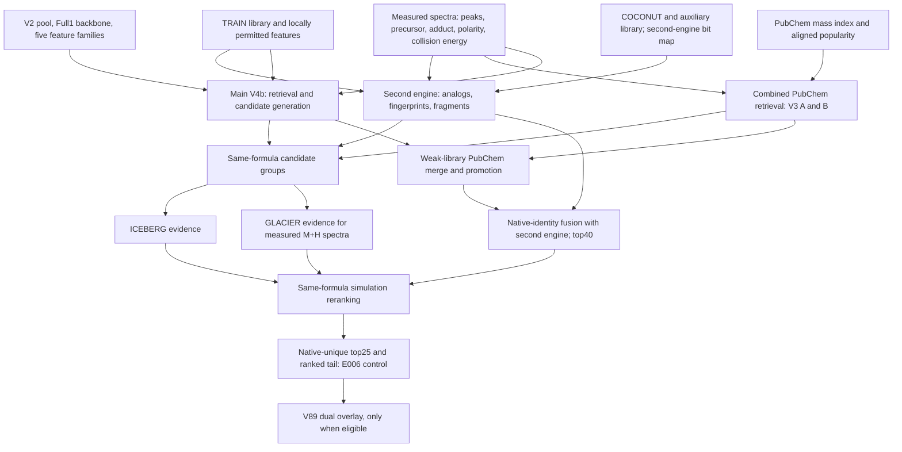
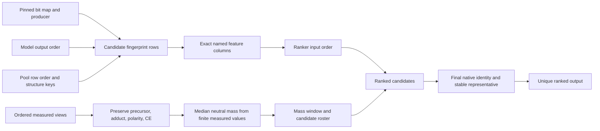
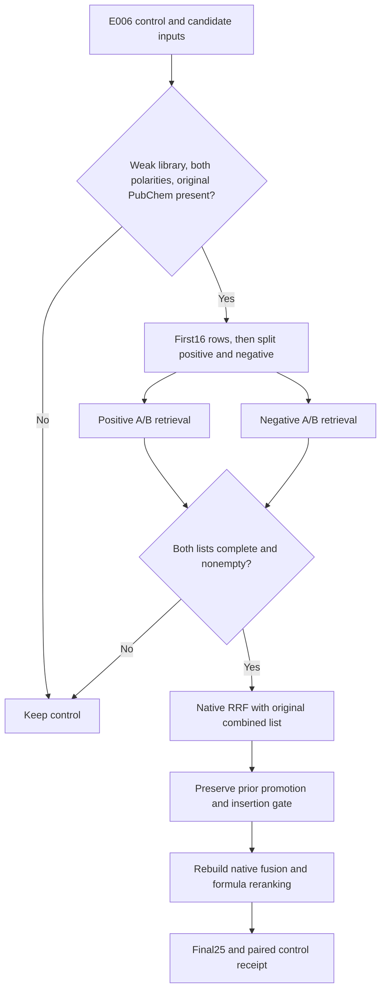
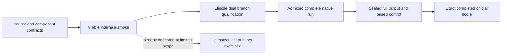

# Reproducing the CASMI public baseline before optimizing it

**Research update: 13 October 2026.** This is an original explanation of a source-readable public recipe, its data contracts, and the experiments needed to reproduce it faithfully. It contains no upstream implementation, weights, molecular structures, or new score claim. The existing notebook artwork and history remain preserved.

The immediate reference is [flexonafft’s exact V89 notebook](https://www.kaggle.com/code/flexonafft/casmi26-public-baseline-adaptation-experiments?scriptVersionId=357683876). Its public card displayed **0.440** when checked on 13 October. The [current V90](https://www.kaggle.com/code/flexonafft/casmi26-public-baseline-adaptation-experiments?scriptVersionId=357684123) displayed **0.415**. These are upstream notebook-card observations, not scores earned by our adaptation, and they do not establish the best result across every public notebook.

| Evidence | Observation | What it establishes |
|---|---|---|
| Upstream V89 public card, checked 13 October | 0.440; explicitly linked as the notebook’s best version | A concrete public recipe to reproduce |
| Upstream V90 public card, checked 13 October | 0.415 | The current joint treatment has a lower displayed result than V89 |
| Our confirmed official baseline, submitted 8 October; completed-row evidence checked 11 October | 0.344 | An existing result; this report does not improve it |
| Retained V89 execution outputs from 12 October | 12 processed molecules; 18.2 minutes; zero eligible dual queries | Limited interface evidence, without exercising the added dual stage |

## What actually changed between versions

We compared every code-cell source as exact UTF-8 bytes, without normalizing whitespace. Cell indices below are zero-based. V83 has 34 code cells; V89 and V90 have 35.

| Comparison | Unchanged computational prefix | Difference |
|---|---|---|
| V83 → V89 | Cells 1–33 are identical | The opening explanation changes and cell 34 adds a dual-polarity PubChem overlay |
| V89 → V90 | Cells 1–33 are identical | The explanation changes; the sole operational switch selects `joint` instead of `dual` |
| Added worker and ranking helpers | Identical between V89 and V90 | Both mode branches already exist in the shared worker |

All 17 declared native input references also match across the three sources. Reference equality is weaker than proving the files mounted for execution: version joins, file hashes, row alignment, model dimensions, and fingerprint bit maps still require an execution manifest.

The historical V83 observation was also 0.440. Equal displayed V83/V89 scores do not demonstrate a gain from dual retrieval. Likewise, the 0.025 difference between V89 and V90 is an observed card difference; a matched, complete evaluation is needed to attribute that difference to the mode switch.

## The complete baseline is more than a fingerprint model

The data graph below describes evidence flow. GPU execution is sequential: second engine, combined PubChem retrieval, main engine, ICEBERG, then GLACIER. The final dual overlay runs after that baseline. Branches in the diagram do not imply concurrent GPU execution.

**Main V4b engine.** The intended backbone is Full1; replacing it with the smaller fallback model changes the recipe. A TRAIN spectrum library and a TRAIN/COCONUT candidate pool support retrieval, analog evidence, and bounded candidate generation. The ranker consumes **94 backbone features plus 66 added features**, in an exact named order, and averages four LightGBM boosters. The five added families are derivation (19), fragment features (13), analog structure (13), model views (7), and fragment network (14). Their A, B, and D models are separate resources; the D branch is DreaMS-derived. A missing family silently filled with zeros cannot qualify as the complete baseline. The [V4b dataset and manifest](https://www.kaggle.com/datasets/ahmedberatozer/casmi26-v4b-models) are the primary contract.

The main search uses a 10 ppm pool window, widening to 30 ppm only if empty; at most 16 observed views; and 100 merged-view analogs. Generation uses at most six sufficiently similar parents, 60 products per parent, 150 total products, and two steps. Pool candidates are reranked with model evidence and popularity; generated candidates retain their established positions. The main shortlist retains 60 unique engine keys. These caps are part of the reference treatment, not spare parameters to change during reproduction.

**Second engine.** This is a distinct pipeline, not a second copy of the main feature matrix. It combines library entropy, polarity-aware analog evidence, our earlier fingerprint-model contribution, and adduct-aware fragment evidence. Its candidate bank includes COCONUT, ChEBI/LIPID MAPS, and locally fingerprinted TRAIN structures. Its 6,930 selected bits and training-row block layout are distinct from the main engine’s declared 10,226-bit bank. Four no-fingerprint and eight fingerprint-enabled histogram-gradient-boosting models are fitted from their respective row tables. Their within-query rank blend is 0.88 fingerprint-enabled evidence and 0.12 second-ranker evidence, with the existing small tie term. The output retains up to 40 canonical keys from the first 80 ranked rows.

**Combined PubChem channel.** Exactly two [V3 A/B fingerprint models](https://www.kaggle.com/datasets/ahmedberatozer/casmi26-v3-models) combine individual-view and merged-view logits. The inherited PubChem window is inclusive ±10 ppm, with no widening fallback. A partial fingerprint pass selects 5,000 candidates, joined with 200 popular candidates; full selected-bit fitting then adds a popularity prior. Candidate keys already in the main pool are removed and at most 25 remain. Preserve the raw best non-pool fingerprint evidence separately from standardized and popularity-adjusted scores: the merge gates use different quantities.

**Fusion and simulation.** PubChem enters only for weak-library queries. The original raw-evidence margin chooses fixed insertion slots and can promote a strongly supported head candidate. Main and second-engine lists then receive one vote per native identity, with reciprocal-rank weights 1 and 0.6, offset 3, and a 40-candidate shortlist. Identity follows the competition chemistry convention: remove stereochemistry before tautomer canonicalization and combine the connectivity key with heavy-atom composition. This differs from some earlier engine-local deduplication.

ICEBERG and GLACIER provide evidence within molecular-formula groups. GLACIER uses measured protonated spectra. The final implementation uses GL evidence when both stored simulator mappings are truthy, falls back to ICE when ICE is truthy and GL is empty, and uses neither when only GL is truthy. Those exact gates deserve explicit coverage checks. Reordering all formulas together would be a different algorithm. The output is native-unique top25 plus a ranked tail; a safe-tail guarantee concerns its own input/output, not every preceding reranker. See the [metric implementation](https://www.kaggle.com/code/metric/casmi-mean-reciprocal-rank).

## Data contracts that prevent a plausible but different reproduction

Each join needs a concrete assertion. A correctly shaped matrix can still use the wrong bit order. A sorted list of dataset versions cannot be zipped to a separately sorted list of mount names. A popularity array must align with the candidate index. Main RDKit 2026.03.3 and simulator RDKit 2025.03.6 have separate roles. Model fallbacks, different canonicalization, changed row order, missing features, and partial simulation all need visible receipts rather than being treated as equivalent results.

## Why V89’s dual stage is the next reference treatment

V89 first completes E006 and retains its control. Its extra stage is eligible only when library confidence is below 0.9, the full query group contains both exact positive and negative polarity labels, and the original PubChem list is nonempty.

The worker takes the first 16 observed rows **before** splitting by polarity. A second polarity occurring only after row 16 therefore produces no treatment. Both polarity searches share the neutral-mass median computed from all finite measured rows. Each independently reuses the A/B model recipe and the inherited PubChem search. The original combined list, positive list, and negative list receive native reciprocal-rank weights **1, 0.5, 0.5**, offset 3, retaining 25 identities. V89 preserves the previously promoted PubChem head and the original gate/slot decision before rebuilding the main/second-engine fusion.

It reuses existing simulator predictions; it does not simulate newly retrieved candidates again. Missing simulator coverage for new candidates is therefore a measurable limitation, not new evidence.

V90 selects the alternative joint branch: all weak-library queries, including single-polarity ones, can enter. It assembles up to 150 native identities from E006, main60, second-engine40, and PubChem25, applies common A/B fingerprint evidence to every candidate, and ranks a combination of standardized fit, popularity, and standardized native fusion support. This removes the dual branch’s fixed-slot and promoted-head preservation. Its current lower displayed score makes V89 the immediate reproduction target; V90 remains a useful separately controlled treatment.

## What the retained smoke proves—and what remains untested

The dated 12 October outputs record 12 processed molecules and 388 placeholder rows, with a total of 400 output rows. The main run selected Full1, reported all 160 features and four boosters, and produced nonempty second-engine and PubChem lists for all 12 molecules without recorded base errors. ICEBERG and GLACIER each reported 755 scored candidates over 11 covered molecules with successful status and no recorded prediction failures.

The dual stage recorded **zero eligible queries, zero checkpointed queries, and zero changed outputs**. Its output equalled its control. Thus the 18.2-minute visible run supports base interfaces at that small scope; it neither measures a full hidden-data runtime nor establishes that the dual worker succeeds or improves ranking. A syntactically valid CSV containing placeholders is not a qualified complete competition run.

## A reproducible next experiment

The next experiment is **faithful complete V89 qualification**, with the same-run E006 control preserved. No candidate cap, model architecture, fingerprint space, epoch budget, mass window, polarity ordering, or simulator gate should change in that experiment.

| Gate | Evidence required before promotion |
|---|---|
| Component admission | Exact source versions, component terms, model/file hashes, mount joins, bit maps, row orders, and output dimensions |
| Base fidelity | Full1 selected; all five feature families; exact 160-column ranker input; both complete engine lists; finite evidence and zero derivation-parity mismatches |
| Dual branch qualification | A naturally eligible query; polarity view counts before/after truncation; both complete retrieval lists; stable native identity, promotion, slot, and simulator-coverage receipts |
| Resource admission | Measured cold start, stage time and peak memory; budget for the whole sequential pipeline; all child processes finished |
| Scientific evaluation | Predictions and paired controls sealed before truth; native-class-aware comparisons; no claim of independent TRAIN validation from all-fold Full1 weights |
| Competition result | Complete schema and row checks, then a nonempty score from the exact completed official row |

The source uses four CPU workers for the overlay, an outer timeout, and partial-checkpoint fallbacks. Completion must be demonstrated explicitly; a partial checkpoint is an operational fallback, not evidence of full treatment coverage. Scratch handling in a future adaptation must preserve all notebook artifacts and use fresh run namespaces. These execution changes require their own review while leaving predictive behavior intact.

After reproduction, change one variable at a time. A sensible first diagnostic is candidate reachability: does a permitted PubChem candidate list contain the native truth identity before ranking, and where does the correct identity move after each stage? That analysis requires independently eligible truth and leakage-aware splits. It separates missing candidates from bad ranking without claiming a score improvement or altering the recipe prematurely. Full1 was trained on all TRAIN folds, so those weights cannot certify an untouched TRAIN holdout.

## Use permission, redistribution, and attribution

The observed notebook footer is [Apache 2.0](https://www.apache.org/licenses/LICENSE-2.0). Ahmed Berat Özer’s current [V4b](https://www.kaggle.com/datasets/ahmedberatozer/casmi26-v4b-models) and [V3](https://www.kaggle.com/datasets/ahmedberatozer/casmi26-v3-models) descriptions explicitly release his own source code under MIT, with copyright and licence notices retained. Bundled third-party code keeps its own terms. The DreaMS-derived component has its own attribution and notice. These source-code grants do not automatically relicense model weights, molecular tables, wheels, or other attached assets.

In the [primary organizer clarification](https://www.kaggle.com/competitions/enveda-CASMI26-molecule-id-mass-spectra/discussion/745072), posted 9 October and checked 13 October, competition host David Healey accepts development with the described open/TRAIN-derived assets and explains the intended scope of the noncommercial restriction. PubChem and COCONUT are generally accepted open libraries; proprietary NIST and manufacturer libraries remain a concern. The comment does not settle every redistribution right or the final winner-compliance and training-reproducibility scope. Keep those questions separate from permission to develop a solution.

This document redistributes none of those assets. Future code adaptations should retain notices and link to the original component datasets; any public weights or data release needs its own component-specific terms and provenance review. Do not package restricted training structures into a convenience bank.

Credit follows the actual dependency chain: [flexonafft’s V89 recipe](https://www.kaggle.com/code/flexonafft/casmi26-public-baseline-adaptation-experiments?scriptVersionId=357683876), [Ahmed’s engine and feature models](https://www.kaggle.com/datasets/ahmedberatozer/casmi26-v4b-models), [obstacledeveloper’s metric audit and safe tail](https://www.kaggle.com/code/obstacledeveloper/casmi26-v1-1-metric-audit-and-safe-tail?scriptVersionId=356393001), [bobthebot369’s public adaptation](https://www.kaggle.com/code/bobthebot369/enveda-casmi-2026-v18-sovereign-zenith/notebook), [prvsiyan’s earlier analog propagation](https://www.kaggle.com/code/prvsiyan/analog-propagation-casmi-2026-baseline), [dmitriigluzdov’s PubChem popularity prior](https://www.kaggle.com/datasets/dmitriigluzdov/casmi26-pubchem-popularity-prior), [hengck23’s DreaMS assets](https://www.kaggle.com/datasets/hengck23/hengck23-dreams-enveda-casmi26), [samanyu1808’s ICEBERG/GLACIER work](https://www.kaggle.com/code/samanyu1808/casmi26-iceberg-where-glacier-is-blind-lb-0-438), and the [ms-pred project](https://github.com/coleygroup/ms-pred). COCONUT, PubChem, ChEBI/LIPID MAPS, and DreaMS retain their respective provenance and attribution requirements. The explanations and diagrams here are original; the credited methods are not presented as our invention.
