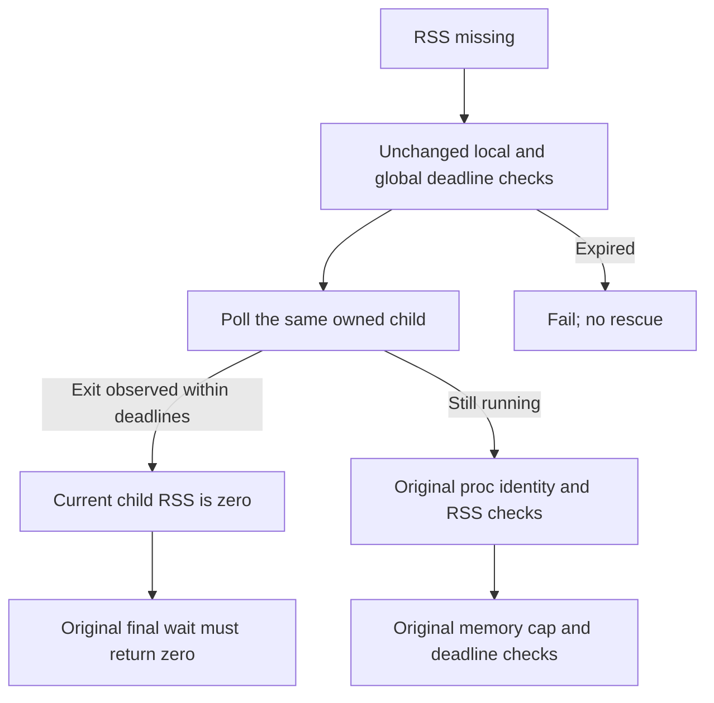

# V37 incident: inference finished, wrapper qualification failed

This incident concerns [Analog Propagation V37, native run 358768787](https://www.kaggle.com/code/prvsiyan/analog-propagation-casmi-2026-baseline?scriptVersionId=358768787). The notebook remains **ERROR**. Its output must not be treated as a completed, submission-qualified notebook version or a new official score.

## Observed outcome

The coordinator inspected the exact native version's Logs and output viewers on 18 October 2026 local time. `CANARY.json` reports `PASS_NATIVE_MECHANICS_ONLY`: exact raw-to-cache preparation, the qualified source-row join, one finite 10,395-logit forward pass and parity for the selected candidate fingerprint. It does **not** establish whole-bank fingerprint parity, agreement with historical MPS numerics or model quality.

`RESULT.json` reports `COMPLETE_PURE_V6_NATIVE_INFERENCE_NO_SCORE`: 400 molecules, 57,541 candidates scored, no empty 10-ppm windows and no spectrum fallbacks. The driver reports 86.68751142 seconds and 2,103,943,168 bytes peak RSS. Its root CSV is 389,203 bytes, SHA256 `c6a373fd1dcfdf0bbe7f685638872b638f4e8dfaa2e8a75544c2026857d9edd6`. These are native receipt observations; the CSV itself has not been independently accepted for submission by this source patch.

The wrapper then raised `NATIVE_RSS_EVIDENCE_REQUIRED` when its **100 ms missing-RSS reobservation window** expired. This is separate from the 300-second canary and 1,800-second total budgets. `WRAPPER_FAILURE.json` reports a sampled peak of 2,018,177,024 bytes and `child_exit_observed=true`. That flag is written after optional termination and `wait()`, so it does not establish a natural zero exit. The evidence does not prove an out-of-memory event or continuous missing RSS: slow `/proc` I/O can reach the same deadline check.

## Proposed source-only repair

The retained wrapper polls `Popen` at the outer loop boundary, but its missing-RSS helper consults only `/proc`. The proposed patch adds a nonblocking observation of the **same owned child** before each helper sample. PID and process-group identifiers must equal the owned child's PID. Monotonic deadline checks run before and after `poll()`.



An observed nonzero exit still fails the existing final `wait()==0` predicate. `poll()==None` retains all original identity, state, RSS and deadline checks. An exit first observed after the deadline cannot rescue the attempt. There is no blanket conversion of missing RSS to zero, no increased observation window and no changed resource cap.

The patch is deliberately limited to lifecycle observation. It does not change model parameters, peak preparation, candidate ordering, fallback rules, input hashes, scientific code or output validation. The original V37 wrapper and every consumed attempt remain preserved.

## What this establishes

The unified patch and `SOURCE_PATCH_BINDING.json` bind the baseline wrapper `d706e954b7bd551e7662f223c90a12a4081ff686fa23b768b79cc9382c2b5cab` to the proposed wrapper `ccd269209b64155602c333c55532f77af01befcb65e1455ffefd04079c45b126`. **Sixteen synthetic tests passed**, exercising process-state and clock boundaries with invented objects and the actual extracted helper, cap and final-wait expressions. No model, scientific data, notebook, network request or actual subprocess was used.

From this directory, rerun the portable tests with:

```sh
python3 -B test_wrapper_exit_observation_portable.py
```

The adjacent `baseline_v37_launcher.source.py` is an exact retained copy used only for text/AST comparison. The test command does not execute either complete wrapper. It creates a new, uniquely named test receipt and preserves earlier results. The verified portable run is `WRAPPER_EXIT_SYNTHETIC_TEST_RESULT_8aa90b486cd14034a2c8559529e4b212.json`, SHA256 `76a8b39a1fa57f1be5f127b68e5a60af2ccc2c4d53771e4a7cc5807fbd894c87`.

Passing those tests establishes the proposed observer's behavior on the tested cases. It cannot establish whether the actual V37 child exited within the missing-RSS window, because that exit timing was not retained. Consequently this is a source-only repair candidate for a specific missed-observation path, not a claim that the native incident has already been repaired. Any new native attempt needs its own identity-preserving review and completed output qualification. V37 remains consumed and ERROR.

The source is original campaign supervision code. This incident analysis and patch contain no competition records, private row identifiers, labels, model weights or signed download URLs. Input-data and checkpoint licensing remain separate matters documented in the reproducibility release.
