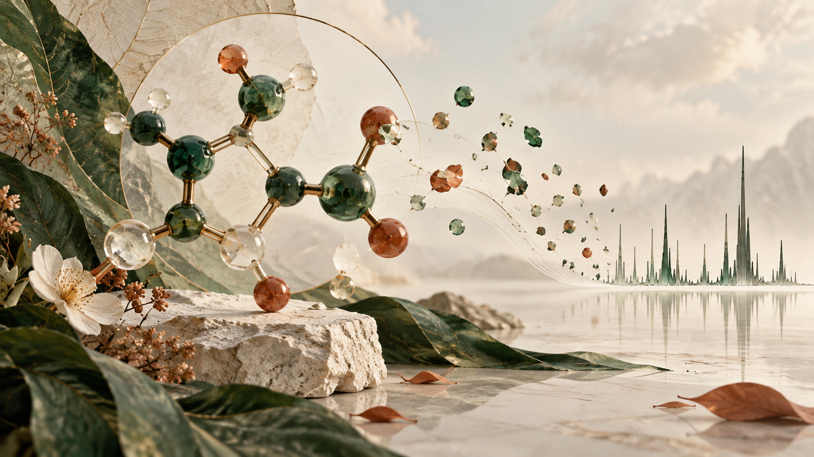
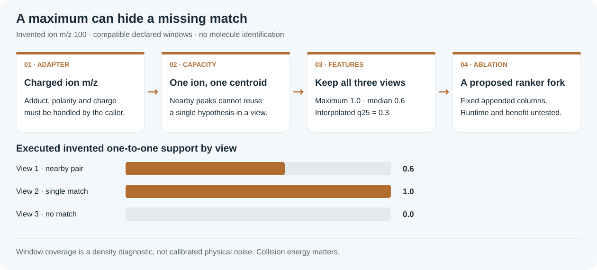

## Before fitting: ask what a fragment feature explains

Three invented spectra reveal what a maximum can hide.


*AI-generated concept art: a botanical molecular sculpture with an imaginary spectral skyline. It is not a validated molecule or measured spectrum.*

A fragment hypothesis can receive convincing credit for the wrong reason: two centroids reuse one ion, or one fortunate spectrum dominates the maximum. Before appending a feature to a ranker, make its behavior visible on an input you fully understand.

### A five-minute learning path

1. Read the notebook’s candidate-generation and fragment-evidence sections before its ranker.
2. Run the invented three-view example. Contrast independent peak credit with a one-to-one assignment, then inspect the median.
3. For a real ablation, freeze the incumbent composition and add a fixed feature set under a provenance-reviewed chemistry adapter. Profile the complete candidate pool before submission.


*The chemistry adapter is an explicit prerequisite; the features alone do not identify molecules.*

### One ion, three invented views

Supply one charged-ion hypothesis at m/z 100. In view 1, centroids at 100 and 100.006 carry intensities 9 and 4. Both are within ±0.01, but one ion can serve only one centroid. Square-root weights are 3 and 2, so exact assigned support is 3/(3+2) = 0.6 instead of independent credit 1.0. View 2 matches completely; view 3, at 110, does not match.

```python
out = tool.candidate_features(
    ion_mz=[100.0],
    spectra=[
        {"mz": [100.0, 100.006], "intensity": [9.0, 4.0], "window": [90.0, 120.0]},
        {"mz": [100.0], "intensity": [9.0], "window": [90.0, 120.0]},
        {"mz": [110.0], "intensity": [9.0], "window": [90.0, 120.0]},
    ], abs_tol=0.01, ppm=0.0,
)
```

| Invented view | Independent explain | Exact assignment |
| --- | --- | --- |
| 1: nearby pair | 1.0 | 0.6 |
| 2: single match | 1.0 | 1.0 |
| 3: no match | 0.0 | 0.0 |

Executed summary: maximum 1.0, median 0.6, interpolated 25th percentile 0.3, largest reuse gap 0.4. The maximum conceals the third view. These are properties of invented numeric inputs, not molecules, held-out spectra or Enveda scores.

### The chemistry and data contract

| Boundary | Required declaration | Failure to avoid |
| --- | --- | --- |
| Hypotheses | Charged-ion m/z after adduct, polarity and charge interpretation | Passing neutral fragment mass as an ion |
| Views | Compatible interpretation and metadata-declared acquisition window | Pooling opposite polarities or choosing a window to favor a candidate |
| Features | Exact one-to-one objective and bounded workload | Calling uniform coverage a calibrated physical noise probability |
| Ablation | Same candidate pool and composition; fixed appended columns | Changing generation, fusion and features together |

### Run and fork locally

Python 3.9+, standard library only. Obtain the pinned helper; the toy creates only numeric lists in memory. No RDKit, spectra download, checkpoint, fitting or competition access is needed.

```sh
python3 -I -B toy_example.py --tool /your/path/fragment_consensus.py
```

Compare the output with EXAMPLE_RESULT.json. The published solver bounds one candidate at 16 spectra, 256 peaks per view, 2,048 explicit ion hypotheses and 8,388,608 DP cells. This toy uses four cells. A full query pool still needs native timing and memory measurements.

### A useful next fork

Test the nine appended columns in one fixed ranker ablation, retaining candidate generation, forward checks and fusion. Some fragments appear at only one collision energy; a lower-tail feature can penalize real evidence. Assess that behavior on a separately qualified paired panel before inferring hidden-domain benefit. The prototype emits features and never refits, promotes a candidate or writes a submission.

### Version, evidence and provenance

Companion revision 1 · 11 October 2026. The reviewed official inventory at 18:27 UTC recorded the account’s best completed public row as 56956461, score 0.344. This scalar snapshot is separate from the toy. It does not establish that this companion or its helper improved the score.

[Existing Kaggle notebook](https://www.kaggle.com/code/prvsiyan/analog-propagation-casmi-2026-baseline) · [Campaign GitHub repository](https://github.com/cubres/enveda-casmi-2026) · [Pinned original helper](https://github.com/cubres/enveda-casmi-2026/blob/86719c8b662b21a9069055311e5b03da344e73b8/fragment-consensus-2026-10-11/fragment_consensus.py) · [Helper guide and limits](https://github.com/cubres/enveda-casmi-2026/blob/86719c8b662b21a9069055311e5b03da344e73b8/fragment-consensus-2026-10-11/README.md)

Helper commit: 86719c8b662b21a9069055311e5b03da344e73b8. Source SHA256: d9a91b2163a9532c26fbe281e4d33537343391c9b0bb92a08153fb5a22767b8c. Dependency details are in DEPENDENCIES.json; the runnable example checks the source digest before loading it. No internet installation occurs in the toy.

Original companion prose, toy code and diagrams are MIT licensed. The license grants no rights to competition data, checkpoints, organizer or competitor implementations, or branding. The generated opening artwork is illustrative and its exact prompt and bytes are recorded in ARTWORK_PROVENANCE.json. Keep the current artwork and all earlier assets unchanged until the user requests a change.
