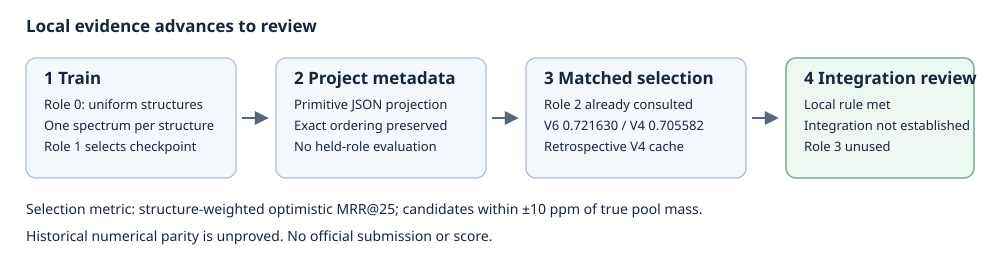

# CASMI V6: advance to integration review

The recorded local comparison favored the structure-uniform V6 candidate over
the cached V4 reference: **0.721630 versus 0.705582 MRR@25** across 4,096 matched
structures. The difference was **+0.016049**, with a 90% bootstrap interval of
**[+0.010197, +0.021864]**. This met the recorded rule for advancing to
integration review. It is not an official competition score or a promotion.

| Selection set | Structures | V6 MRR@25 | Cached V4 MRR@25 |
| --- | ---: | ---: | ---: |
| All | 4,096 | 0.721630 | 0.705582 |
| timsTOF | 2,681 | 0.727183 | 0.721562 |
| Other instruments | 1,415 | 0.711110 | 0.675303 |

MRR@25 averages reciprocal rank within the first 25 candidates; higher is
better. The primary metric weights structures equally and uses optimistic
ranks. Each query used a single spectrum, at most 128 peaks, without
augmentation or merging. Candidates were all original pool rows within
±10 ppm of the **true pool mass**. This conditional candidate protocol is not
a test of unknown-mass retrieval.

The 5,000-replicate structure bootstrap used 90% confidence. Advancement required
an optimistic difference of at least 0.01, a positive interval lower bound, and
a positive pessimistic mean difference. The recorded pessimistic mean
difference was +0.015477 against a historical **unpaired aggregate**; no
per-query pessimistic baseline cache was available.

## What led to this comparison

Training sampled role-0 structures uniformly, then one eligible spectrum per
structure. The training driver exited successfully. A separate role-1 screen
selected the step-28,000 checkpoint using 2,048 structures and 63 sampled decoys
per query (MRR@25 0.707475). That checkpoint metric uses a different candidate
protocol and should not be compared directly with the table above.

A bounded metadata projection preserved the exact structure and candidate-pool
order across the full and clean representations, without normalization,
sorting or deduplication. Projection alone did not evaluate held roles or load
models or numeric arrays. The subsequent matched selection used that metadata.

## How far the result goes

This is an **already-consulted role-2 selection result**, not a fresh untouched
holdout estimate. V4 predictions came from a retrospectively bound cache;
there was no fresh V4 inference and no original-time cryptographic cache
binding. Historical MPS hardware, fallback and kernel details were not
recorded, so exact numerical parity is unproved. These limits apply to the
comparison and its confidence interval.

**Role 3 remained sealed and unused. No official submission or score resulted.**
The next decision is integration review; integration, final-test performance
and competition performance are not established here.

The adjacent [sanitized result](PUBLIC_RESULT.json) contains the exact recorded
aggregates and evidence hashes. This explanatory packet includes no real
structures, query identifiers, spectra, predictions, weights or private paths.
