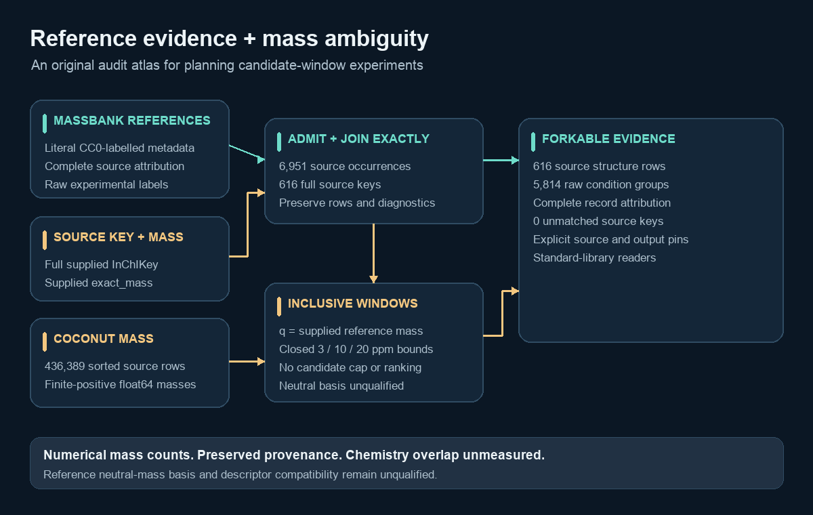

# Reference evidence and mass ambiguity

**6,951 reference-record metadata rows, 616 full source keys, and 5,814 raw condition groups.** This small atlas connects the reference evidence for a supplied molecular key to numerical candidate counts around its reported mass. It is useful for planning candidate-window experiments and inspecting the evidence behind a reference selection.



The reference metadata comes from the records labelled exactly `CC0` in Samar Talwar's public MassBank compilation. The candidate counts use the mass array from prvsiyan's COCONUT V2 bank. **The derivative retains CC BY-NC-SA 4.0 and complete record attribution.** The CC0 filter does not turn the compilation or this derivative into a CC0 release.

## What the numbers mean

Each qualified full source InChIKey has its reference-record count, distinct supplied spectrum IDs, nonempty institution count, raw condition count, and numerical COCONUT row counts at ±3, ±10 and ±20 ppm of the **supplied MassBank `exact_mass`**.

That source value's neutral-mass basis has not been established under its charge/salt processing. The counts are labelled accordingly. They describe numerical windows; molecular matches, chemical coverage, descriptor compatibility and model quality remain unmeasured. The three tolerances are explicit experimental coordinates, with both interval endpoints included and no candidate cap.

Full keys are preserved as supplied. The build validates their 27-character form and does not canonicalize or truncate them. It retains every matching source structure row and reports conflicts. No competition scoring-identity equivalence is asserted.

## Files

| File | Actual contents |
|---|---|
| `record_attribution.jsonl` | 6,951 admitted source occurrences, raw polarity/adduct/collision condition, source row positions, complete licence and attribution fields |
| `reference_molecules.jsonl` | 616 source structure rows with reference multiplicity, supplied mass and three numerical COCONUT window counts |
| `condition_multiplicity.jsonl` | 5,814 groups by exact full key and raw polarity, adduct, collision condition and institution |
| `UNMATCHED_REPORT.json` | Actual unmatched count 0, with the original empty diagnostic's byte/hash identity; no placeholder rows |
| `MANIFEST.json` | Exact source hashes, build scope, counts and runtime versions |
| `PUBLIC_VALIDATION.json` | Actual build time/memory, eight executed boundary controls, 30 real direct-scan window controls and output conservation checks |
| `reference_evidence.py`, `quickstart.py` | Original standard-library readers and a small local/Kaggle inspection example |
| `rebuild_reference_evidence.py` | Separate portable rebuild with the three public input pins and explicit resource limits |
| `DATA_DICTIONARY.md`, `SOURCES.md`, `COMPATIBILITY.md` | Field meanings, source lineage, scientific limits and descriptor-contract notes |

The original five build outputs, including the manifest and empty diagnostic, total 6,566,926 bytes. The clean publication scaffold keeps the nonempty tables unchanged and represents its empty diagnostic in `UNMATCHED_REPORT.json`. No spectra, SMILES, fingerprint vectors or model weights are included.

## Try it locally or on Kaggle

Use Python 3.10+ and point the reader to the downloaded dataset directory. Reading these tables requires neither NumPy nor RDKit.

```bash
python quickstart.py --data-dir .
```

```python
from pathlib import Path
from reference_evidence import read_reference_records, evidence_for_key

data = Path(".")
rows = list(read_reference_records(data))
row = rows[0]  # An actual source row from your downloaded copy
print(row["inchikey"])
print(row["coconut_row_count_at_supplied_mass_10ppm"])
evidence = list(evidence_for_key(data, row["inchikey"]))
print(len(evidence))
```

Keep all source rows for a key if your later bank contains duplicates. `source_row_id` and `source_structure_row_id` are positions in pinned source files, not molecular identifiers across releases. The example makes no prediction and supplies no expected score.

To rebuild the numerical tables, obtain the exact source snapshots listed in `SOURCES.md`. Use Python 3.10+ on Linux or macOS, NumPy 2.2.6 and PyArrow 25.0.0. The portable helper needs no private environment inventory, credentials, RDKit or online service. It refuses an existing output directory, verifies all three input byte pins, reads only the stated columns, and preserves partial outputs if a check fails.

```bash
python -B rebuild_reference_evidence.py \
  --spectra /path/to/spectra.parquet \
  --structures /path/to/structures_with_fingerprints.parquet \
  --mass /path/to/coco_mass.npy \
  --out /path/to/a-new-rebuild-directory
```

The helper uses 90-second wall and 60-second CPU envelopes, a 64-MiB payload cap and a 256-MiB RSS check at checkpoints. The RSS check is not an operating-system hard memory limit. Its own `REBUILD_RECEIPT.json` records the actual implementation and runtime if you run it. The local measured build below used the separately archived controlled builder; **the portable variant has not been run on the real inputs**. Record your own result when changing or rerunning it. The reader and quickstart have been exercised against the actual public tables.

For polarity-aware inspection, compare the literal `ion_mode` values in `record_attribution.jsonl`. This release contains 6,371 `POSITIVE` and 580 `NEGATIVE` occurrences. Raw adduct and collision-energy strings remain uninterpreted; their units and missing values are not silently merged.

## Validation and limits

The admitted build ran once on 2026-10-12: **1.275239 seconds wall time, 1.085542 seconds CPU and 110,641,152 bytes peak RSS**, at process niceness 5. Its original eight boundary controls passed. Thirty real mass-window controls agreed with direct scans. Read-only output checks confirmed the file hashes, literal CC0 admission, unique source row positions, all reference/condition count totals and count monotonicity at the three tolerances.

The actual result has 0 malformed admitted keys, 0 unmatched keys, 0 missing/repeated supplied IDs and 0 invalid/conflicting supplied masses. These are source-table diagnostics, not assertions of chemical validity. The licence-filtered subset is biased by institutions, molecules and experimental conditions; use its measured scope when reporting an experiment.

No competition-2026 files or membership annotations were read. Chemical overlap with training chemistry remains unmeasured. No model ran and no official or model-score improvement is claimed.

## Attribution and related work

Credit [Samar Talwar's harmonized MassBank compilation](https://www.kaggle.com/datasets/samartalwar/casmi-2026-spectral-library-massbankharmonized), the [MassBank contributors](https://github.com/MassBank/MassBank-data), [prvsiyan's COCONUT candidates](https://www.kaggle.com/datasets/prvsiyan/coconut-casmi26-candidates), and the [COCONUT team](https://coconut.naturalproducts.net/). Each admitted record retains its original authors, institution, publication, copyright and licence strings.

Related original tools: [CASMI candidate interoperability kit](https://www.kaggle.com/datasets/prvsiyan/casmi-candidate-interop-kit) and [COCONUT Proton Ion Atlas](https://www.kaggle.com/datasets/prvsiyan/coconut-proton-ion-mass-index).

Aryan Awasthi's [COCONUT Morgan/MACCS bank](https://www.kaggle.com/datasets/aryanawasthiteykik/casmi26-coconut-morgan-maccs-fingerprints) and [spectrum-to-fingerprint MLP](https://www.kaggle.com/datasets/aryanawasthiteykik/casmi26-spectrum-to-fingerprint-mlp) motivated clearer candidate contracts. Their data and weights were not used to derive this atlas. Read `COMPATIBILITY.md` before combining descriptor outputs.

See `DATA_LICENSE.md` for derivative scope and `LICENSE-CODE-MIT.txt` for original readers, rebuild code, prose and schematic. This documentation describes the measured local build; publication readiness belongs to its separately verified server receipt.
