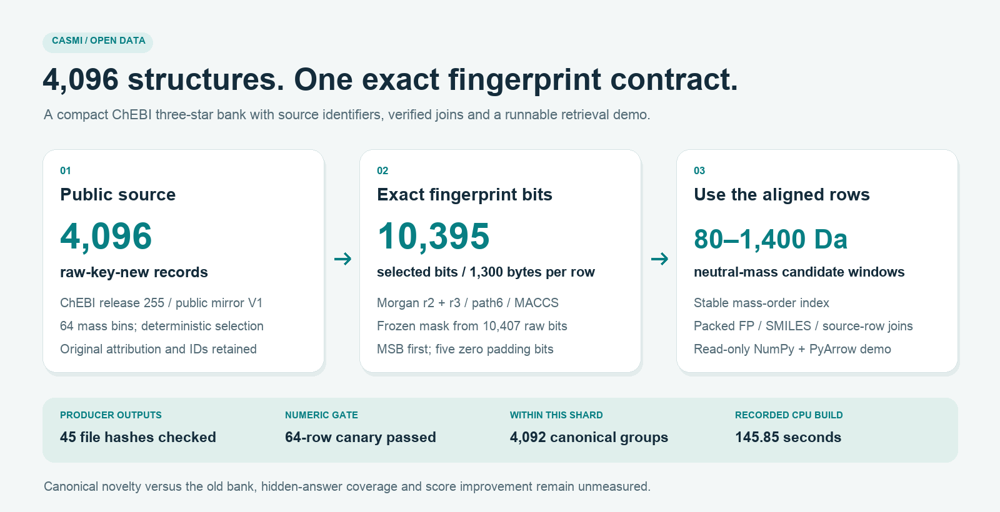

# CASMI: source-linked ChEBI fingerprint shard



Reproducible producer code and a small retrieval demo for 4,096 public ChEBI
three-star structures. Each record has source identifiers, SMILES, neutral mass,
a packed 10,395-bit fingerprint and an explicit source-row join. This contains
no newly trained model or verified leaderboard gain.

The exact data artifacts and hashes are described by `DATASET_FILES_MANIFEST.json`.
The source collections are public: [ChEBI + LIPID MAPS V1](https://www.kaggle.com/datasets/sergiomalv/casmi-chebi-lmsd-structures/versions/1)
and [full-fingerprint inputs V1](https://www.kaggle.com/datasets/prvsiyan/casmi26-full-fingerprint-inputs/versions/1).
`producer/PUBLIC_SOURCE_BINDINGS.json` pins the fingerprint definition, mask and
metric/group helpers. See `producer/README.md` for the recorded Mac CPU producer
and `verification/` for the numerical proof and its limits. Core array artifacts
are distributed separately from this source directory.

With the data files available locally, the portable demo needs only NumPy and
PyArrow:

```sh
python -m pip install -r requirements-demo.txt
python demo_mass_window.py --data-dir /path/to/data --limit 3
```

Omitting `--mass` uses the first dataset row as an explicitly illustrative query.
The demo performs read-only neutral-mass-window lookup and reports source rows
and on-bit counts; it does not rank spectra, use labels or call RDKit or a model.
The supplied synthetic tests cover its retrieval and schema checks.

All 4,096 raw keys and exact SMILES are absent from the older 711,705-row bank.
They form 4,092 canonical groups within this shard. Canonical novelty versus the
entire old bank, hidden-answer coverage and score improvement remain unmeasured.

Molecular records retain CC BY 4.0 attribution; the frozen training-derived mask
has separate component terms. Code uses Apache 2.0. Read `DATA-LICENSE.md` and
preserve `SOURCE_ATTRIBUTION.md`.
