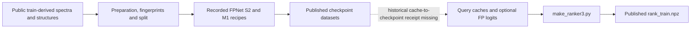

# CASMI checkpoint and ranker reproducibility audit

**Checked 20 October 2026.** The requested preparation code, training recipes, public dataset cards and published checkpoint files are now discoverable. That makes the workflow substantially easier to inspect and rerun. It does **not** establish exact reproduction of the historical weights or ranker feature archive: the checkpoint that produced each saved FP-logit cache, the historical export environment, and some raw-library ingestion details remain unbound.

## What is public

| Item | Public release and contents | Current licence / boundary |
| --- | --- | --- |
| Prepared legacy spectra | [CASMI26 spec-fp V1](https://www.kaggle.com/datasets/prvsiyan/casmi26-spec-fp/versions/1): `spec.npz` (920,788,910 bytes), `fp_meta.pkl`, `split.pkl`, selected fingerprint files. | Kaggle card says **Other**, with the host-permitted training-artifact scope and source-specific conditions described in the card. |
| Full fingerprint inputs | [CASMI26 full fingerprint inputs V1](https://www.kaggle.com/datasets/prvsiyan/casmi26-full-fingerprint-inputs/versions/1): `fp_meta.pkl`, `pool_fp.npy`, `pool_meta.pkl`, `pool_mass.npy`, feature mask, counts and role assignments. | Kaggle card says **Other**; it records the permitted train-derived scope and retains upstream attribution. |
| FP checkpoints | [CASMI26 fingerprint models (single + merged), dataset V1](https://www.kaggle.com/datasets/prvsiyan/casmi26-fp-models-v2/versions/1): `fp_single_s2.pt` and `fp_merged_m1.pt`, 144,110,255 bytes each. | Kaggle dataset label: **CC BY-NC-SA 4.0**. This label does not grant rights to every underlying training record. |
| Ranker archive | [CASMI26 ranker features V6](https://www.kaggle.com/datasets/prvsiyan/casmi26-ranker-features/versions/6): `rank_train.npz`, 9,553,020 bytes. | Kaggle dataset label: **CC BY-NC-SA 4.0**. The historical FP-cache producer is still unknown. |
| ChEBI/LIPID MAPS feature bank | [chebi-lipidmaps-casmi26 V1](https://www.kaggle.com/datasets/prvsiyan/chebi-lipidmaps-casmi26/versions/1): `bio_fp.npy`, `bio_mass.npy`, `bio_meta.pkl`. | Kaggle dataset label: **CC BY-NC-SA 4.0**; upstream ChEBI and LIPID MAPS terms are separate and the exact source releases in this older bundle are not bound. |

The public [training kernel](https://www.kaggle.com/code/prvsiyan/casmi-fp-trainer-merged-spectra), the [legacy preparation guide](https://github.com/cubres/enveda-casmi-2026/blob/f4b645acffa70809885eb14082fbe83af47a903d/reproduction/legacy-v2/public_source/README.txt), and the original source tree are linked from the dataset cards. The preparation source exposes `build_fps.py`, `build_dataset.py`, and `train_fp.py`; its split logic sorts eligible keys, forces the documented Enveda examples into validation, then samples up to 2,500 additional structures with NumPy seed 0. `split.pkl` is the published split artifact. These facts describe the available recipe; this audit did not rebuild the legacy split.

## Recorded checkpoint commands

The immutable [checkpoint binding record](https://github.com/cubres/enveda-casmi-2026/blob/f4b645acffa70809885eb14082fbe83af47a903d/reproduction/legacy-v2/checkpoint_lineage/PUBLIC_CHECKPOINT_BINDINGS.json) records the original configured commands and selected saved steps. The archived S2/M1 recipes are 6,930-output, width-512, six-layer FPNet models:

```bash
python -u train_fp3.py --spec "$CASMI_SPEC/spec.npz" --fpdir "$CASMI_SPEC" --pooldir "$CASMI_POOL" --steps 24000 --bs 256 --lr 2e-4 --K 63 --lam 1.0 --seed 202 --d 512 --layers 6 --val_every 2000 --max_minutes 300 --out "$CASMI_OUT/fp_model_s2.pt"
python -u train_fp4.py --spec "$CASMI_SPEC/spec.npz" --fpdir "$CASMI_SPEC" --pooldir "$CASMI_POOL" --steps 50000 --bs 256 --lr 2e-4 --K 63 --lam 1.0 --seed 404 --d 512 --layers 6 --merge_p 0.60 --val_every 2000 --max_minutes 420 --out "$CASMI_OUT/fp_model_m1.pt"
```

The selected public saves are at steps 20,000 (S2) and 24,000 (M1), below the configured limits of 24,000 and 50,000. These are the published recipes, not runs performed in this audit. The original trainers seed Torch after model construction, so the commands alone do not promise bit-identical checkpoint reproduction.

The original [FPNet](https://github.com/cubres/enveda-casmi-2026/blob/f4b645acffa70809885eb14082fbe83af47a903d/reproduction/legacy-v2/checkpoint_lineage/original_sources/fpmodel.py) source is pinned at SHA256 `69f2656778a08233e22235bf4853f0b3d2420b431390a32d6c8ed453cde85c76`. The original S2 and M1 trainer files are `train_fp3.py` (SHA256 `43bb618dd512def4ccb1119f813aabce2b9f9bcbfa681c9d2db5adfa05e66840`) and `train_fp4.py` (SHA256 `e2eaef630c5f09f157eea3652095b8b9780cbe7fdffa6f0652ae5845d7b18c8a`). The [scoped Apache-2.0 source grant](https://github.com/cubres/enveda-casmi-2026/blob/3b1ba8eb9d064632f6aaed2283e6b7da958e1d1a/reproduction/legacy-v2/LICENSE_SCOPE.md) covers enumerated owned code, not weights, datasets, caches, dependencies or unrelated files.

## Verify the cited source bytes

The public preparation, FPNet, trainer and ranker source files can be checked from a repository clone with the standard-library-only [source pin auditor](audit_source_pins.py):

```bash
python3 reproduction/legacy-v2/public-reproducibility-audit/2026-10-20/audit_source_pins.py
```

It checks eight byte-count/SHA-256 pins against repository commit `7c885861724ba280db9cfee9d96fe8fa56813e80`, without importing or executing code or reading model/data payloads. A mismatch exits nonzero; pins are never refreshed automatically. Passing confirms source bytes only, not historical checkpoint-to-cache lineage, data rights, model quality or score reproducibility. The script is Apache-2.0 under its SPDX header; this grant does not change the terms on datasets, weights or caches.

## The remaining ranker gap

The [public `make_ranker3.py`](https://github.com/cubres/enveda-casmi-2026/blob/f4b645acffa70809885eb14082fbe83af47a903d/reproduction/legacy-v2/ranker_lineage/original_sources/make_ranker3.py) (SHA256 `e94e41a384ee78c027d8c9f3918708aa2d4a94b1eae8fee00c9a7bc5fa427532`) builds `rank_train.npz` from upstream query caches and optional FP logits; it does not export the fitted serving classifier. Its `--model` option reads `val_model_logits_combo.npy` and `hard_model_logits.npy`, but those arrays do not carry a checkpoint hash or producer receipt. If the flag or cache is absent, the corresponding twelve FP-derived feature columns are filled with zeros. Therefore the public FPNet version and trainers are identifiable, but **the exact FPNet/checkpoint used for the published ranker columns is not**.



## Rights and historical limits

The three cited weight/feature databases carry CC BY-NC-SA 4.0 Kaggle dataset labels. The separate source-code grant is Apache-2.0 only for its enumerated files. The input datasets above use Kaggle's **Other** label and explain the host-permitted train-derived scope; retain the competition and upstream source notices. Current ChEBI and LIPID MAPS pages say CC BY 4.0, but that does not identify which historical releases generated the bundled V1 rows. Their raw release checksums, row-source manifest and original combined-ingestion producer remain missing.

We checked public metadata, file inventories, source text, command bindings and the listed hashes. We did not download or execute the weight, pickle, NPY or NPZ payloads, retrain a checkpoint, reproduce `rank_train.npz`, or measure model quality. For that reason this page reports **improved source availability, not full historical reproduction or a new score**.
