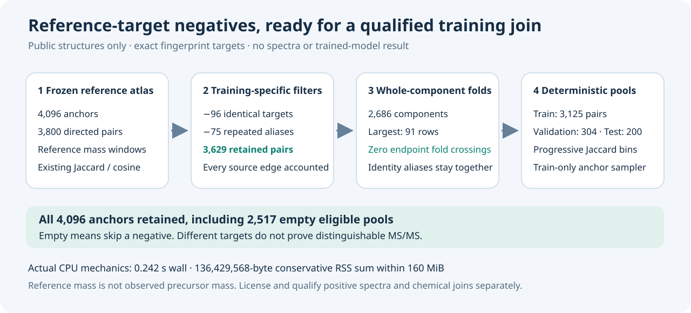

# Reference-target hard-negative curriculum

**4,096 anchors · 3,629 retained candidate pairs · 96 equal-target exclusions · 75 duplicate-alias exclusions.**
This small training utility turns the public reference-mass ambiguity atlas
into deterministic negative pools. It removes contrasts with identical selected
fingerprint targets, prevents repeated candidate aliases from dominating a
pool, and keeps identity/pair components inside one fold. It contains no
spectra, model weights, predictions or evidence of improved model quality.



## What is new

The [original atlas](https://github.com/cubres/enveda-casmi-2026/tree/8f2fd96360ddeb878053bc89298401657fe3e25d/reproduction/reference-mass-ambiguity-atlas/2026-10-20)
already supplies reference windows, canonical-group exclusion and exact binary
Jaccard/cosine. Those features are reused, not newly measured here. The new
training constraints and sampling recipe are:

* Exclude **96 identical selected-fingerprint target pairs**. Such pairs cannot
  teach target-vector separation. This is a target-collision filter, not proof
  that all retained pairs are spectrally distinguishable.
* Deduplicate **75 repeated candidate identity aliases** within anchor pools.
  Equal provided connectivity IDs, canonical groups or exact selected FP
  targets form identity classes; one candidate representative is retained.
* Keep every anchor, including **2,517 empty eligible pools**. The original
  atlas had 2,475 empty anchors. An empty pool supplies no negative.
* Split entire identity-plus-original-pair components: **2,686 components**,
  largest 91 rows. Recorded connectivity/canonical/FP/alias overlap and source
  pair endpoint overlap across folds are all zero.
* Sample train-fold target aliases deterministically from the anchor, stage
  and epoch. Stage 0 uses J < 1/4; stage 1 adds J < 1/2; stage 2 admits all retained
  J < 1 pairs. Thresholds use exact integer intersection/union counts. The
  caller chooses stage boundaries; this release has no optimizer schedule.

| Fold | Reference anchors | Retained candidate pairs |
| --- | ---: | ---: |
| Train | 3,360 | 3,125 |
| Validation | 381 | 304 |
| Test | 355 | 200 |
| **Total** | **4,096** | **3,629** |

These are component-hash folds with nominal 8/1/1 buckets, not exact row ratios.
Connectivity means the qualified source-provided **InChIKey first block**.
It is not a newly recomputed chemical identity, scaffold split, or external
spectrum-join audit. See [the exact split evidence](completed/data/SPLIT_EVIDENCE.json).

## Try the qualified-output consumer

Python 3.10+ and its standard library are sufficient. From this directory:

```sh
python3 -B source/sample_curriculum.py --run-root completed --anchor 0 --stage 2 --epoch 0
```

The consumer first requires the actual owning wrapper PASS, full completion,
source/input identity, resource limits, manifest binding and exact output
hashes. Partial CSVs, failed owning runs, altered files and held-fold optimizer
sampling reject. Its completed-tree checks use relative layout, not private
machine paths. Anchor 0 is a train anchor with one retained candidate, row 192;
[the exact frozen CSV rows](examples/anchor0_frozen_rows.json) illustrate that
case. The release worker did not execute this command or regenerate data.

Read [the short training guide](examples/README.md) before attaching spectra.
The function `curriculum_core.sample_negative` returns `None` for empty current
stage pools. It samples only the train fold and never invents a label.

## Files and exact checks

| File | Use |
| --- | --- |
| `completed/data/anchors.csv` | All 4,096 row/source/connectivity/FP-digest joins, folds and stage pool sizes |
| `completed/data/negative_pairs.csv` | Retained representative pairs, exact counts, Jaccard/cosine and positive Hamming separation |
| `completed/data/excluded_source_pairs.csv` | One reason for every rejected original edge |
| `completed/data/CANARY64.json` | Actual 64-anchor coverage, numerical checks and forecast |
| `completed/data/CURRICULUM_COMPLETE.json` | Actual child completion; owning result is still required |
| `completed/data/SPLIT_EVIDENCE.json` | Components, collisions, folds, empty controls and overlap checks |
| `completed/RESULT.json` | Actual qualifying owning CPU result, with operational bookkeeping omitted |

[`OUTPUT_MANIFEST.json`](completed/data/OUTPUT_MANIFEST.json) binds all six
actual output files by raw length/SHA256. [`RELEASE_FILES.json`](RELEASE_FILES.json)
binds this public package. Compare **all six downloaded actual files** against
those bytes before use. No archive hash or preview substitutes for file hashes.

The four scientific CSV/split outputs are deterministic. A fresh scientific
reproduction can compare those four byte-for-byte. `CANARY64.json` and
`CURRICULUM_COMPLETE.json` include measured timing/RSS; their original bytes
are fixed for this release, but a new run's receipts are not expected to match.
No fresh reproduction or public-copy consumer run was performed by the
release worker.

## Completed CPU scope and reproducibility boundary

The meaningful 64-anchor canary used source rows 0–62 plus 285. Actual target-bit
checks exercised 285→3018 as an equal-target collision, 22 other nonempty anchors
and 41 empty controls, with numeric reference-window reconstruction. It
processed 77 source edges, retained 73, rejected 4 and continued without repeating
the canary. The completed child reports all 4,096 anchors processed exactly once
and all 3,800 source pair counts validated against the pinned packed targets.

The owning CPU run passed in **0.242065 seconds**, using 0.257484 aggregate CPU
seconds. Its **136,429,568-byte conservative RSS sum** was below the admitted
160-MiB ceiling. That sum deliberately includes a repeated aggregate child
high-water charge; it is not true simultaneous whole-tree RSS or a hard kernel
memory limit. [Receipt provenance](verification/PUBLIC_CPU_RESULT_PROVENANCE.json)
discloses the public receipt transformation. No measurement, PASS condition,
source/input identity or output hash was altered.

[`source/`](source/) preserves the exact executed source and manifest. Its
scientific builder/core and consumer are reusable algorithms. Its historical
`run_owned_curriculum.py` is **ROOT-specific orchestration** requiring preserved
local admission/failure records intentionally absent here. It is archival
execution evidence, not an out-of-the-box public full-run command. Do not
manually set the builder's owning-context guard variable. A separate portable
reproduction owner is proposed outside this qualified package; no
portable-owner execution is claimed. [Immutable public input pins](source/INPUT_CONTRACT.json)
give the exact atlas 8f2fd963 and structure 9cb4a4a6 file identities. The consumer
above needs only the completed tree and copied source package.

The [lineage note](lineage/README.md) preserves the earlier 128-MiB resource
failure separately; its failed result was never reclassified. Source-manifest
proposal labels are retained historical source bytes; the actual owning result
records the later execution outcome.

## Terms and scientific limits

Keep [source attribution](SOURCE_ATTRIBUTION.md), [component terms](SOURCE_COMPONENT_LICENSE.md)
and [data terms](DATA-LICENSE.md). ChEBI records/derived representations retain
CC BY 4.0 attribution, including sergiomalv, ChEBI release 255 and Hastings et al.
The selected-mask component retains its separate existing terms. The aggregate
uses **Other/component terms**; new code is Apache 2.0 where marked, with
[`LICENSE-SOURCE`](LICENSE-SOURCE). No blanket data relicensing is implied.

Before optimizer use, independently license positive spectra, qualify their
exact positive connectivity/target join, and keep every spectrum of a
connectivity within its fold. These files do not supply those rights or prove
that join. Historical fingerprint/checkpoint lineage and downstream model
licensing remain unresolved by this release; public availability is not a new
grant over training-derived components or weights.

Reference exact molecular mass is **not an observed precursor**, adduct or
charge conversion. Different targets do not prove distinguishable MS/MS.
High FP similarity is a target proxy for curriculum difficulty, not measured
spectral/model hardness. This release establishes no trained-model gain,
MS2 accuracy, generalization, hidden-answer coverage, eligibility or official
score. No assay, GPU job or model training is part of this CPU utility.
