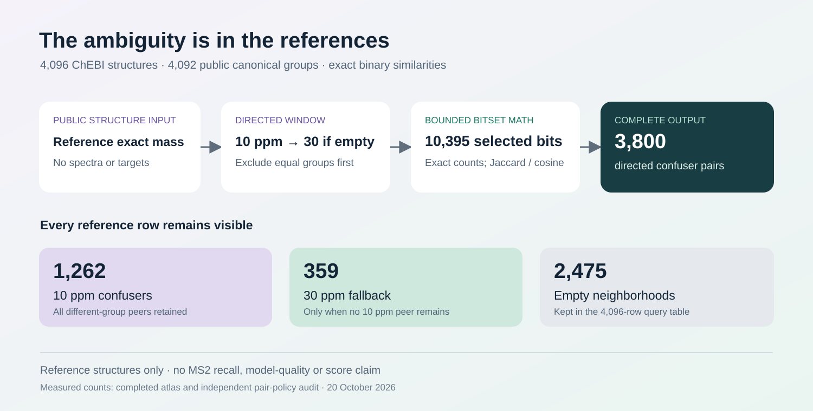

# Reference exact-mass ambiguity atlas

**4,096 public ChEBI reference structures · 4,092 canonical groups · 3,800 directed confuser pairs.** Explore how a tight reference-mass window can contain structurally different molecules, then inspect exact binary-fingerprint similarities. This is a reusable reference dataset, not an MS2 benchmark or a model-quality result.



## What is included

| Reference neighborhood | Query rows |
| --- | ---: |
| Different-group confusers within 10 ppm | 1,262 |
| No 10 ppm confuser; 30 ppm fallback used | 359 |
| No different-group confuser even at 30 ppm | 2,475 |
| **All reference rows retained** | **4,096** |

Thus **1,621 reference rows have a selected confuser and 2,475 remain empty**. Of the 1,621 nonempty rows, 644 have at least two selected confuser groups; the largest selected neighborhood has 12 candidate rows. These counts describe only this fixed, deliberately selected shard. They are not recall or answer coverage on measured spectra.

- [`data/query_rows.csv`](data/query_rows.csv) keeps every reference row, source identifier, public canonical-group digest, reference mass, on-bit count and 10/30 ppm row/group counts.
- [`data/pairs.csv.gz`](data/pairs.csv.gz) contains all 3,800 selected directed pairs, exact intersection/union and on-bit counts, Jaccard and binary cosine. There is no similarity threshold or top-k truncation.
- [`data/ATLAS_COMPLETE.json`](data/ATLAS_COMPLETE.json), [hashes](data/OUTPUT_MANIFEST.json) and [resource result](verification/RESOURCE_RESULT.json) record the completed run. The [independent output review](verification/COMPLETED_OUTPUT_REVIEW.json) reconstructs every window, fallback, count and pair identity from exported metadata.

The compressed pair table is 128,754 bytes; the complete query table is 618,234 bytes. Their SHA256 values are `e4ecce02e55f52aa3d10bd05203728cf2211498581fc9e577e56052e73e58ed0` and `e8f1e2dbce50f5f24e31b640efe8c2f64bc83f17d80bdf88de1430787f6803ef`.

## Try real confusers — no extra packages

From this directory, Python 3.10+ can inspect the completed data using only its standard library:

```bash
python demo_atlas.py --atlas-dir data --query-row 6 --limit 5
python demo_atlas.py --atlas-dir data --query-row 14 --limit 5
```

The examples below are read directly from the frozen tables; [exact expected JSON](examples/real_confusers.expected.json) is supplied. The release worker did not execute the demo.

| Query → reference candidate | Reference mass difference | Jaccard | Binary cosine |
| --- | ---: | ---: | ---: |
| Row 6 (`CHEBI:50645`) → 774 (`CHEBI:50642`) | 0 ppm | 0.585965 | 0.745989 |
| Row 6 (`CHEBI:50645`) → 3999 (`CHEBI:50639`) | 0 ppm | 0.649606 | 0.789483 |
| Row 14 (`CHEBI:52281`) → 3548 (`CHEBI:51673`) | −20.674943 ppm, 30 ppm fallback | 0.260586 | 0.413518 |

Row 6 has two different-group neighbors at the same reference mass, 218.032756672 Da. Row 14 has no different-group 10 ppm neighbor and one 30 ppm neighbor. Row 1 is an empty-neighborhood example, preserved in the table.

A user-provided numeric neutral mass can also enumerate reference rows:

```bash
python demo_atlas.py --atlas-dir data --mass 218.032756672 --ppm 10 --limit 5
```

This last mode has no identified query structure, so it cannot exclude its canonical group or compute query fingerprint similarity. Display limits affect only printed examples, never the stored atlas.

## Exact policy

For each reference row `q`, use the closed float64 interval `mass[q] ± mass[q]*ppm*1e-6`. These are **molecular reference exact masses**, not observed MS2 precursor masses. Exclude every row with the same public `canonical_group`, including self, **before** deciding whether the 10 ppm set is empty. Keep all remaining 10 ppm candidates; only if there are none, use all remaining 30 ppm candidates. Empty queries stay in `query_rows.csv`.

The pair denominator is the query reference mass: `signed_ppm = (mass[c] - mass[q])/mass[q]*1e6`. Pairs are directed; reverse-direction windows or fallback choices can differ. Ordering is ascending reference mass, then original shard row order for ties. Closed-window selection and the displayed ratio can differ by floating-point rounding at an endpoint.

Fingerprints are the source's 10,395 selected bits, packed MSB-first; five low padding bits are zero. Integer set counts are exact. Jaccard is `intersection/union`; binary cosine is `intersection/sqrt(query_on_bits*candidate_on_bits)`, with float64 ratios. Empty union or zero norm is a blank CSV value, never an invented zero or one. This run had no undefined ratios.

## Reproduce the producer

The [original runnable source](source/) and its [manifest](source/SOURCE_MANIFEST.json) are unchanged. The [immutable public input release](https://github.com/cubres/enveda-casmi-2026/tree/9cb4a4a6bc9ce2e97ce7dfcbaca1419bbb5bbb34/reproduction/chebi3-fullfp-shard/2026-10-20) supplies exactly six pinned files; [REFERENCE_INPUTS.json](source/REFERENCE_INPUTS.json) lists their bytes and SHA256 values. No raw spectra, private bank or private canonical map is needed.

Use Python 3.10+ and [the recorded NumPy/PyArrow requirements](source/requirements.txt):

```bash
python -B -u source/run_owned_atlas.py \
  --source-dir /path/to/exact/chebi3-fullfp-shard/2026-10-20 \
  --out /path/to/fresh/reference-atlas-run
```

The wrapper preserves a fixed exclusive attempt marker beside `source/`, requires a new output directory and never retries a consumed run. The retained [`source/README.md`](source/README.md) is the frozen pre-execution protocol; this README and the actual results describe the later completed run. Keep original outputs if a fresh reproduction fails.

The real 64-reference mechanics canary passed before full enumeration. It checked 64 deterministic fingerprint pairs against Python-integer counts and ratios, and processed/formatted 67 selected candidate pairs. The same run then completed all 4,096 queries. The wrapper took **0.752064 seconds**; the producer recorded **0.632831 seconds**. Conservative child-plus-wrapper RSS peaks totalled **151,011,328 bytes (144.0 MiB)**, within the 120-second / 512-MiB / two-thread limits. Actual versions were Python 3.12.14, NumPy 2.2.6 and PyArrow 25.0.0.

The [16 invented mechanics controls](verification/SYNTHETIC_CONTROLS.json) cover endpoints, asymmetric ppm, group exclusion, empty sets, padding, zero vectors, integer overflow and batch parity. Their [runner](independent_test_atlas_core.py) uses invented arrays only. Completed-output review verifies the exact exported pairs and ratio identities; it did not reopen source fingerprints to independently recompute every intersection.

## Attribution, terms and limits

Retain [the original source attribution](SOURCE_ATTRIBUTION.md), [component terms](SOURCE_COMPONENT_LICENSE.md), [atlas data terms](DATA-LICENSE.md) and [provenance](PROVENANCE.json). ChEBI records and derived representations retain CC BY 4.0 attribution, including sergiomalv, ChEBI release 255 and Hastings et al. The frozen-mask component retains its separate training-derived terms. The aggregate uses **Other / component terms**, with no blanket CC0 or Apache data grant. Uploader-authored code is separately Apache 2.0 where marked.

This is a small reference-structure ambiguity atlas. It establishes no MS2 retrieval performance, validation recall, hidden-answer coverage, chemical novelty, trained-model improvement or official score. No historical assay was repeated.
