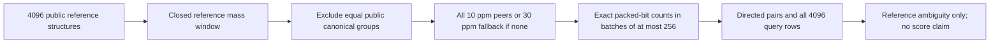

# Reference exact-mass ambiguity atlas — source proposal

This producer enumerates potentially confusable **reference structures** in a
fixed public ChEBI shard. It is not an MS2 benchmark or a trained model. The
producer has not been run on the real reference arrays in this source packet;
coverage, pair counts, runtime and output quality remain unmeasured.

The only real inputs are six hash-bound files from
[the immutable public 4,096-row shard](https://github.com/cubres/enveda-casmi-2026/tree/9cb4a4a6bc9ce2e97ce7dfcbaca1419bbb5bbb34/reproduction/chebi3-fullfp-shard/2026-10-20),
with 4,092 public canonical groups. See `REFERENCE_INPUTS.json`. Existing source
and component attribution are retained. No private canonical map, old candidate
bank, spectra, competition targets, model, prediction, assay or chemistry
recomputation is used.



## Exact window and similarity policy

For each reference row `q`, the closed window is
`[mass[q] - mass[q]*ppm*1e-6, mass[q] + mass[q]*ppm*1e-6]`.
Masses are **molecular reference exact masses**, not observed precursor masses.
Exclude every candidate with the same public `canonical_group` digest,
including the query itself. Keep all remaining 10 ppm rows. Use all remaining
30 ppm rows only when the different-group 10 ppm set is empty. If both sets
are empty, retain the query row and emit no pair. Candidates are ordered by
reference mass, with original shard row order for equal masses.

Pairs are directed. `signed_ppm = (mass[c] - mass[q]) / mass[q] * 1e6`; the
denominator and fallback can make the reverse direction differ. Boundary
selection uses the stated closed float64 window; the displayed signed ratio
may reflect floating-point rounding at an endpoint. No pair symmetrization,
top-k selection or similarity-based threshold changes coverage.

Fingerprints have 10,395 selected bits, packed MSB-first into 1,300 bytes;
the five low padding bits must be zero. Integer intersection/union and on-bit
counts are exact. Jaccard is `intersection/union`; binary cosine is
`intersection/sqrt(query_count*candidate_count)`. Ratios use float64. Empty
union or zero cosine norm produces an empty CSV field, not an invented score.
This is binary-set similarity, not centered model-logit similarity.

## Root-only bounded execution

The coordinator first verifies the source manifest and fresh public input
provenance, dependencies and output path. It then invokes the reviewed wrapper:

```bash
PYTHONDONTWRITEBYTECODE=1 python -B -u source/run_owned_atlas.py \
  --source-dir /path/to/exact/public/chebi3-fullfp-shard/2026-10-20 \
  --out /path/to/fresh/reference-atlas-owned-run
```

This command is shown relative to the packet root, not this `source/` folder.
Use Python 3.10 or newer in an existing environment with NumPy and PyArrow.
The wrapper rejects older Python before consuming the attempt marker. The public reference demo
records NumPy 2.2.6 / PyArrow 25.0.0; this source uses their ordinary array and
Parquet APIs and records actual versions. No package is installed automatically.

`ROOT_REFERENCE_ATLAS_ONCE_CONSUMED.json` is a fixed exclusive marker at this
packet root, written before producer execution. Any failed or ambiguous attempt
remains consumed. Do not copy the wrapper elsewhere to evade it. Source review
is not execution authorization; only the root coordinator runs or publishes.

The child has 100 seconds and 448 MiB RSS; wrapper plus child must fit 120
seconds and a conservative 512 MiB sum of RSS peaks. It limits numerical CPU
thread pools to two, sets PyArrow CPU/I/O pools to one each, and hides GPUs.
There is a 10-second wrapper cleanup reserve. A hard one-million directed-pair
admission fails closed rather than truncating an allegedly complete output.

The real mechanics canary processes the first 64 fixed public reference rows,
without labels or quality-based selection. It compares windows/fallback to a
brute-force oracle, checks 64 deterministic pairs against Python-integer
popcounts and ratio calculations, and times all selected candidate batches and
CSV formatting. Only a PASS with a conservative forecast under 85 seconds may
continue to the full 4,096-row traversal. The forecast is conditional on the
prefix and does not guarantee the remaining density or compression cost; hard
time/RSS/output caps remain binding. No completed historical assay is involved.

## Planned outputs and demo

- `pairs.csv.gz`: directed query/candidate row IDs, signed ppm, selected window,
  exact integer bit counts, Jaccard and binary cosine; streamed, deterministic
  gzip header, with no omitted eligible pairs on a completed run.
- `query_rows.csv`: all 4,096 original reference rows, source ID/raw key/public
  group, reference mass, on-bit count, 10/30 ppm row and group counts, selected
  counts and fallback flag. Empty neighborhoods remain visible.
- `CANARY64_MECHANICS.json`, `ATLAS_COMPLETE.json`, `OUTPUT_MANIFEST.json`:
  actual mechanics, coverage, budgets and byte hashes; no model-quality claim.
- Required provenance, scoped licenses and the standard-library demo.

An output is promotable only after the outer owned `RESULT.json` reports
`PASS_COMPLETE_REFERENCE_ATLAS_NO_QUALITY_CLAIM`, process cleanup is verified
and the exact completed outputs receive review. A partial CSV or child-only
completion from a failed wrapper is not a released atlas.

After a real completed run, these examples inspect only the atlas files:

```bash
python demo_atlas.py --atlas-dir /path/to/completed/data --query-row 0 --limit 5
python demo_atlas.py --atlas-dir /path/to/completed/data --mass 400 --ppm 10 --limit 5
```

The numeric-mass demo is a user-provided illustrative query. It enumerates
reference rows without fingerprint ranking; it cannot exclude a query's
canonical group without knowing that structure. It is not a competition or
measured-spectrum query. Display limits never change the stored pair coverage.

See `DATA-LICENSE.md`, `SOURCE_COMPONENT_LICENSE.md` and
`SOURCE_ATTRIBUTION.md`. The atlas measures reference ambiguity within this
small shard only; it establishes no validation recall, hidden-answer coverage,
MS2 retrieval performance, model improvement or official score.
