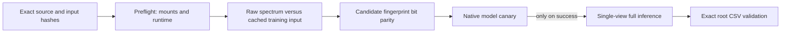

# Selected V6 serving source: exact V37 record

This folder preserves the six exact source payloads used by [Analog Propagation, version 37](https://www.kaggle.com/code/prvsiyan/analog-propagation-casmi-2026-baseline?scriptVersionId=358768787). The fresh source/status capture at **2026-10-17 22:16 UTC** reports **ERROR**. There is no completed full-inference claim or official score for this version. The exact current failure phase is still being inspected in Kaggle's native diagnostics.

This is the selected **10,395-bit, single-spectrum FPNet** route. It is distinct from the older `fp_single_s2` / `fp_merged_m1` checkpoints and the 6,930-bit ranker-feature pipeline documented elsewhere in this release. The earlier local comparison of approximately 0.7216 versus 0.7056 MRR@25 is not an official score and is not rerun by this package.



## A runnable source-integrity check

From this directory, run:

```sh
python3 -B verify_sources.py
```

The check hashes and compiles the source text. It does not import scientific packages, load a model, read competition inputs, execute notebook code, or create a Kaggle job. A PASS establishes byte and syntax consistency with `SERVING_BINDING.json`; it does not authenticate a Kaggle run or establish model quality.

## What each source does

| Source | Role |
|---|---|
| `fpmodel.py` | Exact FPNet architecture and peak featurizer. |
| `v6_single_view_scoring.source.py` | Training-faithful raw preparation, strict prepared-input parity, restricted checkpoint loading and single-view scoring. |
| `project_required_metadata_recovery_once.source.py` | Symbolic metadata parser; it does not execute pickle objects. |
| `native_canary_and_infer.source.py` | Exact input checks, deterministic optimizer-role canaries, conditional inference and final CSV validation. |
| `native_preflight.source.py` | Bounded mount resolution, package observations and same-PID transition into the driver. |
| `preflight_launcher.source.py` | Historical notebook wrapper: one child, continuous deadline/RSS checks and aggregate receipts. |

The wrapper is source intended for a configured notebook cell, not a standalone command. Its required globals and once-only admission are deliberately not fabricated here. The prior V37 attempt remains consumed. Do not run an archived script as a recovery attempt.

## Reproduction contract and current limits

`SERVING_BINDING.json` records exact source digests, the immutable Kaggle image, mount versions, all ten fixed input byte digests and sizes, candidate ordering, fallback rules and budgets. The historical allocation used CUDA device 0, a 300-second canary budget and an 1,800-second total budget, with a 20-GiB sampled RSS ceiling. These limits include preflight; source verification above has no GPU requirement.

Raw m/z and intensity arrays are rounded to float32 before the original `prep_peaks` transform. This matches the original cache preparation; the prepared-input guard remains bitwise exact. The previously completed single-row check confirmed this correction without evaluating held-out labels. The host's separate electron-mass note is not silently incorporated into these historical bytes.

The fixed spectrum/full-bank inputs were historically private, and this folder does not make them public. It contains no spectra, labels, candidate records, private row identifiers, derived private row hashes, checkpoint weights or signed download URLs. The selected checkpoint is 197,739,081 bytes with SHA256 `9c46ca4fcf19002fecbcded0d0808e8a81e3a25a143e684e259f265c44a5be31`. Its retained training-source family is `run_structure_uniform_single_view.py`, `train_full_fingerprint.py`, `structure_uniform_sampler.py`, `train_fp4.py` and `fpmodel.py`; source references alone do not establish the complete permitted-input preparation chain.

Complete public reproducibility still requires the original training code, exact data preparation and split construction, and permitted source data for participant-produced weights. See the release's training lineage and license inventory. Code, dataset records, derived features and weights have separate provenance and licensing questions. No dataset or weight redistribution right is asserted by this source record, and no historical admission is reused.

The exact files are retained for attribution and failure analysis. The next scientific change must follow the actual V37 failure evidence, preserve the strict canary, and receive its own bounded validation. A source-only archive is not a substitute for a successful native run.
