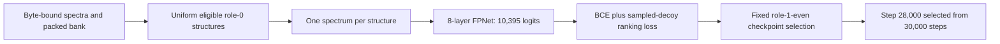

# The exact training recipe behind selected CASMI V6

This folder supplies the **original five source files** that trained the selected
10,395-bit checkpoint in trainer V6 (native `358388543`, 14 October 2026). Every
file matches both the executed notebook payload and the retained native source
binding. It is distinct from the earlier trainer with SHA256 `d844db07…` and
from the legacy 6,930-bit `fp_single_s2` / `fp_merged_m1` route.

The fit completed **30,000 optimizer steps**. Its checkpoint-selection proxy
chose **step 28,000**, producing `best_full_model.pt`, 197,739,081 bytes, SHA256
`9c46ca4fcf19002fecbcded0d0808e8a81e3a25a143e684e259f265c44a5be31`.
The checkpoint's 0.7074749658 proxy MRR@25 uses 2,048 fixed role-1-even
structures and 63 sampled decoys. It is **not an official competition score**.
The later local 0.7216-versus-0.7056 comparison has not been rerun for this release.

## Inspect without a GPU or scientific dependencies

From this folder, run:

```sh
python3 -B verify_sources.py
```

The verifier uses only Python's standard library. It checks exact source bytes,
Python syntax and equality with the original notebook's embedded payloads. It
does not import NumPy or Torch, load weights, read data, start training or create
a notebook. `historical_notebook_training_cell.source.txt` is an archival text
copy; the verifier parses it without executing its historical training flag.



## Source and feature lineage

| File | Role in this exact fit |
|---|---|
| `run_structure_uniform_single_view.py` | Verifies the original input manifest and file hashes; runs one 64-step probe, then the full recipe. |
| `train_full_fingerprint.py` | Full packed targets, explicit structure roles, model, loss, optimizer and checkpoint protocol. |
| `structure_uniform_sampler.py` | Uniformly selects 256 distinct eligible structures, then one eligible spectrum per structure. |
| `train_fp4.py` | Original batch padding, augmentation and negative sampling inherited by `FullData`; exact version `1daa2532…`. |
| `fpmodel.py` | Original peak preparation, vocabulary and FPNet; exact version `69f26567…`. |

FPNet uses width 512, **eight** attention blocks, eight heads, dropout 0.1 and a
2,048-unit output head: 49,424,027 trainable parameters. Each spectrum has at
most 128 cached peaks. Peak m/z and neutral loss receive sinusoidal embeddings;
sqrt-intensity joins the peak embedding. Precursor m/z, collision energy,
ionization mode, adduct and instrument family form the global token. The output
head consumes the global token and masked mean of the peak tokens.

The full route overrides `Data.__init__`; the legacy `spec.npz.is_val` split is
**not** used here. Optimizer eligibility is exactly role 0 with a valid
structure-to-pool join: 219,140 structures / 1,886,521 spectra in this fit.
Checkpoint eligibility is role 1 and an even trainer structure index. The fixed
2,048-structure selection uses seed 20261004; its 63-decoy arrays use 20261005.
Fusion-role and sealed final-role spectra are not selected as optimizer inputs
or validation queries; decoys use the shared candidate pool. `TRAINING_CONTRACT.json` records the exact role-table and selection
artifact hashes, without distributing the arrays.

## Historical command and resources

The original notebook staged these five files together and invoked:

```sh
OMP_NUM_THREADS=2 MKL_NUM_THREADS=2 PYTHONUNBUFFERED=1 PYTHONDONTWRITEBYTECODE=1 \
python -u run_structure_uniform_single_view.py \
  --out /kaggle/working/casmi_structure_uniform_20261014/training
```

This command is documented for an explicitly scheduled reproduction, **not run
by the source verifier**. It expects these original mounts; `--data` and `--spec`
can select equivalent byte-identical local locations:

```text
/kaggle/input/casmi26-full-fingerprint-inputs/
  FULL_FINGERPRINT_MANIFEST.json
  pool_fp.npy, pool_mass.npy, pool_meta.pkl, fp_meta.pkl
  roles_by_structure.b64, fp_bits.npy, optimizer_bit_counts.npy
/kaggle/input/casmi26-spec-fp/spec.npz
```

The manifest SHA256 must equal `5b08ca4b830de1558be4ce568a10f0997b5fa2fe875a872dcd6a216f901fd9ef`;
the spectrum cache must equal `99dbf966d2607e2da8085a6550206a71fc912d2c90b9555a725a2569e4af4500`
(920,788,910 bytes). The complete per-file requirements are in
`TRAINING_CONTRACT.json`. Data availability, provenance and permitted release
are separate from this source binding; do not substitute a newer self-consistent
bank or remap the role table and describe it as the same experiment.

The driver sets `CUDA_VISIBLE_DEVICES=0`. It first launches the exact trainer
with `--probe-only`, then launches it again without that flag:

```text
train_full_fingerprint.py --data <bank> --spec <spec.npz> --out <phase-output>
  --seed 20261003 --merge-probability 0 --steps 30000
  --max-minutes 15 [probe] or 330 [full]
  --batch-size 256 --micro-batch-size 128 --layers 8 --validation-every 2000
```

The full fit starts from a freshly seeded model; it does not continue the probe weights.
The 64-step probe must have zero nonfinite steps and peak allocated GPU memory
below 13 GiB. Full completion requires 30,000 steps and zero nonfinite steps;
the driver rejects a shortened recipe. The original notebook enclosed the
driver in a 375-minute process-group timeout. The provider allocated **two T4s**,
although only one worker/device was used; resource accounting must include the
whole allocation. The full phase took 15,237.6 seconds, with median step time
0.50685 seconds and peak Torch-allocated memory 5,195,437,568 bytes.

The immutable image recorded before and after the native fit was:

```text
gcr.io/kaggle-private-byod/python@sha256:37c64f7dd9c54116ecd1bcc88817c5469b88387388fade02bfa8bf3fc647d461
```

The only non-standard Python packages in the five-file import closure are
**NumPy and PyTorch**, with CUDA required by the trainer. No package installation
occurred in the selected training cell. The retained training receipts did not
log exact Python, NumPy or PyTorch version strings; this release supplies the
image pin instead of inventing a package lock or borrowing later-run versions.
No new fit has been performed, and bit-identical retrained weights are not
promised: the source does not enable deterministic CUDA algorithms.

## Details needed for a faithful reproduction

- Keep the seed order, including the packed-lookup contract before model creation;
  it consumes Torch RNG state. Do not skip that contract as a cosmetic check.
- Preserve BCE plus 64-way ranking cross-entropy, AdamW at 2e-4, weight decay
  0.01, betas (0.9, 0.98), gradient clipping at 1, CUDA float16 autocast and
  GradScaler, and the 2,000-step warmup followed by cosine decay.
- Keep the original negative sampler: draws with replacement in the ±10 ppm
  window, positive-index redirection, and global draws when the window has at
  most one member. Its repeated candidates and fallback behavior are intentional
  preservation, not a new sampler proposal.
- Preserve the original cached float32 peak preparation. The later serving fix
  reproduces that rounding; it does not change the training source. Likewise,
  do not silently apply the host's train-versus-hidden electron-mass note to an
  already cached historical training artifact.

The source and supporting documents use Apache 2.0 **only within the scope
described in [NOTICE.md](NOTICE.md)**. Libraries, data, derived artifacts and
weights retain their own terms. See the [dataset cards](../../dataset-cards/2026-10-18/)
and the [selected serving source](../../selected-v6-serving/) for their separate
contracts. Source availability alone is not submission eligibility.
