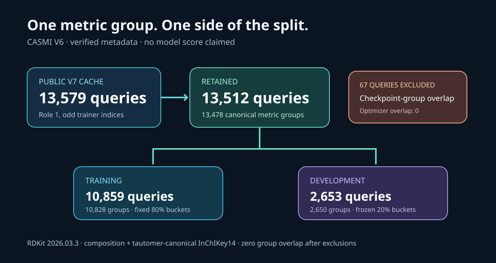

# CASMI V6 checkpoint-disjoint ranker split

A practical training/development split for the public V6 fingerprint-logit cache. It removes **67 queries that overlap checkpoint-selection metric groups**, leaving **13,512 queries in 13,478 canonical groups**. This prevents a future ranker from treating checkpoint-exposed aliases as independent validation examples.

| Partition | Queries | Metric groups |
|---|---:|---:|
| Ranker training | 10,859 | 10,828 |
| New development | 2,653 | 2,650 |
| Total retained | 13,512 | 13,478 |

There is zero metric-group overlap between training and development, with all 219,470 role0 structures, or with all 13,614 role1-even structures. These are conservative exclusion universes: the selected model had 219,140 optimizer-eligible structures and used a fixed 2,048-query subset for checkpoint selection. The audit excludes every canonical group in the broader role sets. No model fit, prediction evaluation, new accuracy metric, or official score is claimed.



## What this dataset contains

Eight exact NumPy arrays preserve the retained cache rows, fixed group split, exclusion reasons, and complete role0/1 canonical-group exclusion universe. Two original V7 cache join arrays are included at the dataset root as `structure_indices.npy` and `structure_keys.npy`. **Logits, spectra, fingerprints, weights, role2/3 queries, and hidden competition data are not redistributed here.** This is a new split artifact, distinct from the proposed raw-logit cache dataset that was not created.

The existing [public trainer V7/native359867655](https://www.kaggle.com/code/prvsiyan/casmi-fp-trainer-merged-spectra?scriptVersionId=359867655) supplies the corresponding 13,579-by-10,395 raw logits. Use `cache_query_rows.npy` to select retained rows from that exact cache. A mutable notebook's current output must not be assumed to be V7: check the native run, schema, source/checkpoint and file hashes in `SOURCE_CONTRACT.json`.

| File | Meaning |
|---|---|
| `cache_query_rows.npy` | int64[13512], retained row indices into the exact V7 cache |
| `trainer_structure_indices.npy` | int64[13512], matching original public metadata rows |
| `canonical_group_ids.npy` | Unicode64[13512], retained metric-group digests |
| `split_buckets.npy` | int16[13512], frozen salted hash buckets |
| `split_train0_development1.npy` | uint8[13512], 0=train, 1=development |
| `all_cache_exclusion_reason.npy` | Unicode40[13579], retained or checkpoint-overlap reason |
| `role01_trainer_structure_indices.npy` | int64[246674], every role0/1 structure in the exclusion universe |
| `role01_canonical_group_ids.npy` | Unicode64[246674], complete corresponding group identities |

## Inspect without a GPU

```bash
python -B inspect_group_split.py /path/to/this/dataset
```

The NumPy-only demo verifies the exact scientific receipt and all eight output hashes, then checks retained-row alignment and group separation. It prints the table counts. It never opens predictions or weights.

```python
from pathlib import Path
import numpy as np
root = Path('/path/to/this/dataset')
rows = np.load(root/'cache_query_rows.npy', allow_pickle=False)
split = np.load(root/'split_train0_development1.npy', allow_pickle=False)
groups = np.load(root/'canonical_group_ids.npy', allow_pickle=False)
assert not set(groups[split == 0]) & set(groups[split == 1])
print(rows[split == 0].shape, rows[split == 1].shape)
# (10859,) (2653,)
# A future feature builder may join exact-V7 logits with rows. Do not tune on development rows.
```

## Rebuild from public inputs

The only external data dependency is the exact [full fingerprint inputs V1](https://www.kaggle.com/datasets/prvsiyan/casmi26-full-fingerprint-inputs/versions/1). Only its `fp_meta.pkl` and `roles_by_structure.b64` are read; their complete SHA256 pins are in `SOURCE_CONTRACT.json`. The two original V7 cache join arrays (`structure_indices.npy` and `structure_keys.npy`) and all needed grouping source are already included at this dataset root. No unpublished historical canonical-map file is needed by the rebuild.

On a POSIX Python 3.12 environment, install `requirements-rebuild.txt`, then run:

```bash
OMP_NUM_THREADS=2 MKL_NUM_THREADS=2 OPENBLAS_NUM_THREADS=2 \
python -B rebuild_canonical_split.py \
  --bank /path/to/public-full-fingerprint-inputs-v1 \
  --cache /path/to/this/dataset \
  --out /path/to/a-new-rebuild-directory
```

The rebuild canonicalizes every role0/1 structure from the public metadata with **RDKit 2026.03.3**. It uses at most two low-priority CPU workers, 1800 seconds, 2 GiB parent RSS and 1 GiB per worker. A 256-string throughput canary must pass a conservative remaining-time forecast before the full workload starts. It refuses to emit a qualified split if any required group is invalid. It creates a new directory and never removes or overwrites an existing artifact.

**The complete public-input rebuild passed and reproduced all eight released arrays byte-for-byte.** It freshly canonicalized all 246,674 role0/1 metadata structures in **954.258 seconds** using two CPU workers, Python 3.12.14, NumPy 2.2.6 and RDKit 2026.03.3. The 256-string canary passed a conservative 1551.013-second forecast under the 1800-second cap. Parent peak RSS was 236,437,504 bytes; maximum worker peak RSS was 327,024,640 bytes. The process exited 0. A separate audit rehashed both the actual rebuilt files and the released files and checked exact numeric equality for every array. `FULL_REBUILD_RECEIPT_PUBLIC.json` and `PORTABLE_REBUILD_OUTPUT_VERIFICATION.json` retain the measured proof.

The arrays were initially produced by an exact reuse audit of the completed original public-data canonicalization, with full index/raw-key/SMILES/group joins, 192 current-RDKit consistency checks and an independent full numeric reconstruction plus 24 additional group checks. Its original scientific receipt is preserved unchanged as `GROUP_AUDIT_RECEIPT_PUBLIC.json`. The subsequent complete portable rebuild reads no historical canonical-map file; those maps are provenance only.

A prior 1200-second full-recomputation proposal stopped before its full workload because its conservative forecast was 1446.5 seconds. That failed metadata attempt remains closed. This dataset does not present it as a successful full recomputation.

Before reporting success, the rebuild enforces every released output array hash and size. You can also compare all eight with `RELEASE_MANIFEST.json`. The scientific receipt will have a different source/runtime binding; the array bytes should match.

The publication layout is entirely flat. The unchanged rebuild accepts any `--cache` directory containing the two exact join arrays, so it uses the dataset root directly. No ZIP, archive extraction, helper, symlink or unpublished directory is required.

## Exact metric and split

Grouping follows the [official CASMI metric specification](https://www.kaggle.com/code/metric/casmi-mean-reciprocal-rank): the heavy-atom composition gate (excluding hydrogen), plus default tautomer canonicalization and InChIKey14 under RDKit 2026.03.3. Group IDs are SHA256 of the compact JSON pair `[composition, canonical_InChIKey14]`. The pure identifier is extracted unchanged from the already-public role builder; original source SHA and exact AST lineage are retained.

A group is excluded if it occurs in any optimizer role0 structure or any role1-even checkpoint-selection structure. Remaining groups use salt `casmi-v6-role1odd-ranker-group-v1-20261019`; the first eight SHA256 bytes of `salt + ':' + group_id`, big-endian modulo10000, assign buckets0–7999 to training and8000–9999 to development. All aliases stay together. The complete previous prediction assay was not rerun and is not part of this dataset.

The intended follow-up is a small, separately reviewed listwise calibration experiment. It is not trained here; the split alone does not demonstrate a score gain or guarantee independence from every historical hyperparameter decision. Candidate generation must be blind to answers, development evaluation must remain frozen, and role2/3 must remain untouched.

## License and attribution

Dataset license: **Other/component terms**, as detailed in `DATA-LICENSE.md`. Uploader-authored grouping, rebuild, inspector and documentation source uses Apache2.0 (`LICENSE-SOURCE`). This software grant does not relicense upstream molecular metadata or grant rights to model weights. No weights are distributed. Preserve the exact public input versions, source hashes and component attribution when reusing the split.

Campaign source and documentation: [cubres/enveda-casmi-2026](https://github.com/cubres/enveda-casmi-2026). Original grouping sources are linked in `SOURCE_CONTRACT.json`; the complete historical ranker producer gap is not claimed solved by this new split.
