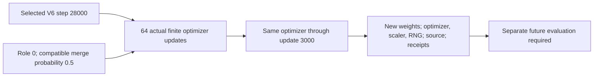

# CASMI complementary FPNet: 3,000 measured continuation updates

This is a **completed, unevaluated training artifact**, not a scored submission. The completed native V9 output contains an FPNet checkpoint and AdamW/scaler/RNG state. This GitHub directory contains the exact original and continuation source, input/source hashes, measured runtime receipts and version-specific download instructions; the large artifacts remain on Kaggle. No accuracy, MRR improvement, leaderboard result or serving/blend qualification is claimed.

The exact public training run is [V9, native run 360180749](https://www.kaggle.com/code/prvsiyan/casmi-fp-trainer-merged-spectra?scriptVersionId=360180749). It starts from the [selected V6 checkpoint](https://www.kaggle.com/datasets/prvsiyan/casmi26-v6-structure-uniform-checkpoint), SHA256 `9c46ca4f...`, selected at step 28,000. A fresh AdamW optimizer performs 3,000 new updates, using batch size 256, microbatch size 64 and seed 20261019. Merging metadata-compatible spectra has probability 0.5. Every anchor and merged peer belongs to role 0. The 64-update finite-loss, gradient, memory and throughput canary continues into that same run. No role 1/2/3 spectrum is queried; no validation or checkpoint-selection assay is run.

The driver took 1,736.957 seconds; the wrapper took 1,742.612875877 seconds and exited with code 0 and a clean process group. An independent CPU review checked 111 model-state entries, 108 AdamW parameter states, finite shapes and dtypes, completed 3,000-update counters, RNG/scaler integrity and all 33 native file hashes before and after inspection. Its report is separately pinned in `TRAINING_RESULT.json`. No model forward pass or new training occurred during that review.

The new checkpoint is 197,740,262 bytes, SHA256 `c1c7650411d507f395e3077e90db72a8b1d692493e91c7f13ba6f55e6359b286`. The 395,501,971-byte optimizer/state file is SHA256 `1d2e957ab715b6de6a8f350586327f48a8050e88feb3938b6fd2c2099387a201`. It includes PCG64, Torch CPU and one visible CUDA RNG state. These support inspection and future continuation work; the current driver has no resume mode and always creates a fresh optimizer. The saved state does not establish a bit-identical CUDA rerun, and the driver does not enable deterministic CUDA algorithms.

Periodic history is written every 16 updates: 187 records end at 2,992. The checkpoint, runtime receipt and all AdamW counters establish completion at 3,000; the final eight updates have no periodic history record. Only two sampler arrays are emitted. Their canonical int64 hashes and statistics were checked, but the third grouped-spectrum hash and full role membership cannot be independently rebuilt from those arrays alone. The sampler arrays are not copied into this GitHub source release.

The earlier 4,000-step V8 treatment stopped at 74 updates because its rolling budget forecast failed and produced no usable checkpoint. This 3,000-step run starts from V6 again; it does not resume failed V8 weights. Its shorter cosine-schedule horizon is a distinct treatment and does not establish better quality.

Reproduction inputs are the exact public base checkpoint, `casmi26-full-fingerprint-inputs` and `casmi26-spec-fp` described by `source/TRAINING_CONTRACT.json`. The three input datasets retain their own terms; code and parameter permissions are scoped separately. Public listing and successful training do not independently certify every future use or competition eligibility. The independent content review does not replace the separate input-provenance and publication-permission review.

Use the preserved source and receipts to audit or reproduce the treatment. A new raw-logit cache, evaluation and reviewed serving mode are required before any 90/10 blend or use in the main scorer. This release has no measured accuracy or official score.
