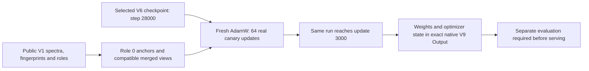

# V9: completed 3,000-update complementary FPNet training

This source release makes one completed training treatment inspectable and runnable. **Its quality has not been evaluated.** No new accuracy, MRR, leaderboard score, ready-to-serve blend or guaranteed GPU determinism is claimed.

[Exact public V9 notebook](https://www.kaggle.com/code/prvsiyan/casmi-fp-trainer-merged-spectra?scriptVersionId=360180749) · [Recipe](REPRODUCE.md) · [Model card](MODEL_CARD.md) · [Artifact hashes](ARTIFACTS.json) · [CPU artifact proof](PUBLIC_ARTIFACT_VERIFICATION.json)



## What completed

| Evidence | Observed result |
| --- | --- |
| Native run | V9 / `360180749`, COMPLETE |
| Optimizer updates | 64 finite canary updates, continued without reset to 3,000 |
| Treatment | Role 0 only; merge probability 0.5; seed 20261019; batch 256 / microbatch 64 |
| Parent | Selected V6 step 28,000; `9c46ca4f...`; a fresh optimizer is created |
| Driver / wrapper | 1,736.957 / 1,742.612875877 seconds; exit 0, process group clean |
| Artifact review | 111 finite model entries; 108 AdamW states at step 3,000; scaler/RNG and all 33 native file hashes checked |
| CPU review | 1.93690175 seconds; 916,062,208 bytes peak RSS; no model forward pass or fitting |

The checkpoint is **197,740,262 bytes**, SHA256 `c1c7650411d507f395e3077e90db72a8b1d692493e91c7f13ba6f55e6359b286`. The optimizer/scaler/RNG artifact is **395,501,971 bytes**, SHA256 `1d2e957ab715b6de6a8f350586327f48a8050e88feb3938b6fd2c2099387a201`.

Periodic history contains 187 records ending at update 2,992. The final eight updates were not periodic log events; the checkpoint, runtime receipt and every AdamW counter establish 3,000 completed updates. Saved optimizer/RNG state supports inspection and future continuation work, but the current training driver has **no resume mode**.

## Run and inspect

First verify the small GitHub files:

```bash
python verify_file_manifest.py --directory .
```

Then follow the [V9-specific download steps](REPRODUCE.md#download-the-exact-completed-v9-artifacts). The large weights and optimizer state remain in **that version's Kaggle Output**; they are not Git blobs. The sampler arrays also remain there. After saving the two `.pt` files into a local directory:

```bash
python verify_v9_artifacts.py --directory /path/to/v9-artifacts
```

Both checkers use only the Python standard library and verify bytes/hashes without loading model code. Use the exact [public V1 reproduction inputs](INPUTS_V1.json), byte contracts and [training command](REPRODUCE.md#reproduce-the-training-treatment) to reproduce the recipe on CUDA hardware. Recorded runtime versions are supplied; the current container is not pinned, and bit-identical CUDA weights are not guaranteed.

## Rights and remaining gaps

Uploader-authored code is scoped Apache 2.0 in `source/LICENSE-SOURCE` and `source/NOTICE.md`; attribution and original bytes are retained. The parent and new parameter permissions are separately scoped in `source/LICENSE-WEIGHTS.md` and `LICENSE-DERIVED-PARAMETERS.md`. Input data retains its component terms. The two sampler arrays are derived data outside the parameter grant; this source release does not redistribute them.

This V9 release does **not** resolve all historical reproducibility questions in the notebook comment. The original S2/M1 initialization was seeded after initialization, and the actual FPNet producer of the retained legacy ranker FP caches remains unresolved. The recovered historical [preparation, trainer and `make_ranker3.py` sources](../../legacy-v2/README.md) and [component terms](../../dataset-cards/2026-10-18/README.md) describe those gaps. The exact selected V6 parent source is [archived separately](https://github.com/cubres/enveda-casmi-2026/tree/6987d48bab9e6ea36ce07db322d64e282463c838/reproduction/selected-v6-training/2026-10-18).

A fresh raw-logit cache and distinct reviewed evaluation are required before using these weights in the main scorer. No old assay was rerun for this release. See the host discussions [745072](https://www.kaggle.com/competitions/enveda-CASMI26-molecule-id-mass-spectra/discussion/745072) and [748882](https://www.kaggle.com/competitions/enveda-CASMI26-molecule-id-mass-spectra/discussion/748882) for original training-code/data requirements; source publication alone does not retroactively establish eligibility for older artifacts.
