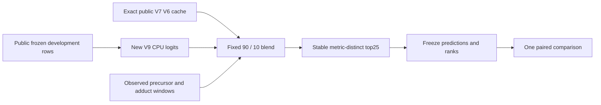

# Fixed 90/10 V6–V9 blend: a small, uncertain local gain

This completed test compares the exact public V6 cache with one predeclared
blend: **90% V6 raw logits + 10% V9 raw logits**. No blend weights were selected
using this development set. All 2,653 frozen queries and 2,650 canonical groups
remain in the denominator.

| Local MRR@25 | Cached V6 | Fixed 90/10 |
|---|---:|---:|
| Query mean | 0.663017145 | 0.663486457 |
| Canonical-group mean | 0.662918674 | 0.663388517 |

The paired group difference is **+0.000469843**. Its predeclared 2,000-replicate
95% group-bootstrap interval is **[−0.000747439, +0.001695832]**. The interval
includes zero: this is an uncertain positive estimate, not an established
improvement. It is **not an official Kaggle score** or native-serving result.
The control came from CUDA FP16 autocast; new V9 inference used Mac CPU FP32.
This comparison therefore does not isolate a training effect.


The display-only plot reads only saved summary values from `PUBLIC_RESULT.json`.
Its plotting dependency and reproduction command are:

```bash
python -m pip install matplotlib==3.11.0
python plot_effect_size.py
```

The run completed in 213.36 seconds using two CPU library threads and a 3.48 GB
maximum aggregate RSS. Its blind 64-query canary passed; all remaining predictions
and ranked group lists were frozen before answer matching. Independent output
review checked all seven artifacts, new-query joins and every saved reciprocal
rank, then reproduced the group means and seeded interval from completed outputs.
Three invalid observed-mass windows retained reciprocal rank zero. The old
4,096-query assay was not repeated.



Both arms use the same observed precursor/adduct windows: 10 ppm, then 30 ppm
only if empty. No true-pool-mass query, truth insertion, truncation or global
fallback is used. Scores are `dot(candidate_bits, raw_logits)/sqrt(10395)` in
float64, with pool-index ties and the pinned canonical metric. The query-constant
Bernoulli term does not change this ranking. A raw-logit blend combines log odds,
not final scores or reciprocal ranks.

`source/v9_cpu_fixedblend_schema_successor.py` is the exact executed scientific
core, SHA256 `0adb6e45dfa947d556c3918192329dd9bd051d0c6bbd02e262da74e14f32b1d8`.
The saved small RR arrays permit verification without inference:

```bash
python verify_saved_result.py
```

See [REPRODUCE.md](REPRODUCE.md) for versioned public inputs and the portable
metadata adapter. It completed once and reproduced all four development arrays
byte-for-byte from public split V1 and the V7 cache. The saved-result verifier
also completed once. These were metadata/output checks, with no new inference
or weight selection. Source-only annotations in the unchanged tools and pin
card record their preparation snapshot; the release manifest records completed
verification. No private historical canonical map is needed to rebuild these
unchanged public rows. No additional alpha search is proposed.

Source is scoped Apache-2.0; data, weights and derived validation outputs retain
their component terms. See [NOTICE.md](NOTICE.md) and
[DATA-AND-WEIGHTS.md](DATA-AND-WEIGHTS.md). No notebook identity or opening art
is changed by this release.
