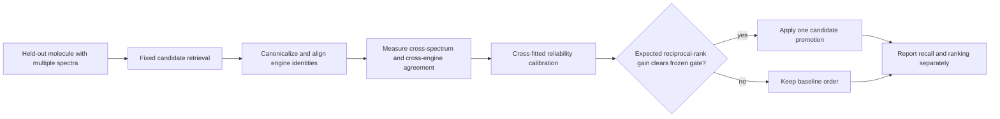

# CASMI public-score strategy audit and next experiment

**Evidence snapshot:** 20 October 2026, 20:14 UTC. This is a source review and experiment proposal, not a model result.

## What the public evidence says

The live public leaderboard showed a tie at **0.495** for CHU1PC and pikachu, with the next team at 0.493. Kaggle states that the public board uses about 31% of the test set; final standings use the other 69%. The prvsiyan row was **0.345**, and its latest submission was still being scored. The 0.495 entries do not expose a matching reproducible public notebook in the sources reviewed here.

The strongest public-code score observed was **0.456**. Two useful source references are:

- [CASMI26 V465/V15 POP015](https://www.kaggle.com/code/guhongbin/casmi26-v465-v15-pop015?scriptVersionId=359783615), whose exact public page shows a 0.456 badge.
- [Dual-Gate Evidence Margin & PubChemLite CC0, V2](https://www.kaggle.com/code/saddamaditya/dual-gate-evidence-margin-pubchemlite-cc0?scriptVersionId=360314907), whose V2 page shows a 0.456 best-score badge and identifies its model inputs.

The visible V2 narrative combines candidate-pool expansion, GLACIER precursor proxies for selected adducts, a popularity prior, a two-condition evidence-margin promotion rule, and a rank-2 consensus hedge. It credits several upstream contributors for retrieval, fingerprints, forward models, popularity, canonical identity, and candidate databases. The notebook also presents an unscored “metric-identity fusion” experiment. That is a hypothesis, not evidence that the overlay improves its 0.456 score.

Our submitted [Analog Propagation V43](https://www.kaggle.com/code/prvsiyan/analog-propagation-casmi-2026-baseline?scriptVersionId=360497306) already contains the broad two-engine retrieval, PubChemLite candidate bank, popularity prior, ICEBERG/GLACIER rescoring, and E2R2 rank-2 overlay. On the fresh native submissions page it remained **Running** at 20:14 UTC. Its 12-row visible smoke showed no E2R2 changes; that does not measure hidden rows. V43 must reach terminal status before a new CASMI run is considered.

The V2 input list includes the competition data, candidate-ranker features, fingerprint models, PubChem prior and PubChemLite fingerprints, simulated ranker rows, forward-model assets, and several chemical candidate collections. The page does not establish exact version pins or complete rights for every attached payload. In particular, a public notebook license does not relicense its inputs; retain component-level attribution and check each asset’s terms before reuse or any prize-eligibility claim.

## Proposed original experiment: query-conditioned evidence reliability

The most actionable extension is to replace a single fixed promotion margin with a small, cross-fitted estimate of how trustworthy the available evidence is for each molecule. This builds on the published use of evidence margins while testing a different question: when do multiple spectra and independent retrieval/model channels provide enough agreement to justify changing rank 1?

Use identity-grouped out-of-fold predictions so spectra from the same canonical structure never cross between training and validation. For each held-out molecule, derive only label-safe features available at inference: agreement across retrieval engines after official metric-identity normalization, the rank and margin of the leading candidates, independent spectra/adduct/energy agreement, instrument/source compatibility, and supported same-formula forward-model evidence. Fit a low-capacity calibrator to out-of-fold expected reciprocal rank, then permit a rank-1 promotion only when its estimated gain exceeds a predeclared threshold. Keep candidate generation fixed so recall and ranking effects remain separate.

A valid comparison should report candidate recall@25, molecule-level MRR@25, top-1, paired molecule-bootstrap intervals, and results by predeclared evidence-quality strata. Use a structure-held-out primary split and a scaffold-held-out sensitivity analysis. Do not tune on hidden-test labels or repeated public leaderboard feedback. If the calibrator is not better than the frozen baseline on the primary split, reject it.

## Execution gate

No new inference, push, or submission is authorized by this note. First wait for V43’s exact native terminal state, then bind the exact mounted inputs, versions, runtime, and rights. A future notebook edit must preserve the existing notebook identity and artwork, pass fresh identity/source/runtime/terminal checks and independent review, and go only through the unchanged approved safe-push tool. Any resulting score claim must name the exact completed version and official submission row.
