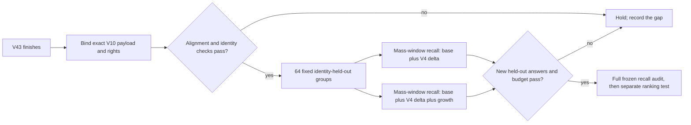

# V43 and the PubChem growth supplement

**Observed 20 October 2026. Read-only source and data-card audit; no inference, output/log inspection, submission, or new score claim.**

## What V43 currently uses

The public [Analog Propagation – CASMI 2026 baseline, version 43](https://www.kaggle.com/code/prvsiyan/analog-propagation-casmi-2026-baseline?scriptVersionId=360497306) is bound to a 35-cell source snapshot with SHA-256 `f254dfbca64c0b332049860d1f6c1dd5f67a80fdaee7e78b8f63597cdf8f57b1`. Its retained push receipt records version 43 and `cells_identical: true`.

A source-only scan of all 35 cell sources found references to the base arrays `pc_lsid.npy`, `pc_lpmid.npy`, `pc_mass.npy`, `pc_off.npy`, and `pc_smiles.npy`. It found no references to `growth_pc_*`, `delta_pc_*`, `GROWTH_MANIFEST`, or `growth_pubchem`. The notebook therefore does not visibly consume the new growth store. The notebook metadata names the popularity dataset slug but does not pin a dataset version, so the currently visible input version cannot establish which data revision the V43 run mounted.

## What the public V10 manifest says

The current [PubChem popularity dataset card](https://www.kaggle.com/datasets/dmitriigluzdov/casmi26-pubchem-popularity-prior/data?select=GROWTH_MANIFEST.json) displays dataset version 10. Its new supplement has 11,177 rows, 11,176 distinct metric identities, and 11,139 publisher-reported “scorer-novel” identities. The manifest does not define the comparator behind that novelty count, and its payload was not independently downloaded or rehashed in this audit. It also reports 13 differences between the source’s official connectivity/CID mapping and an RDKit-derived mapping.

The linked [`GROWTH_README.md`](https://www.kaggle.com/datasets/dmitriigluzdov/casmi26-pubchem-popularity-prior/data?select=GROWTH_README.md) says the rows have official connectivity blocks absent from the original tier plus the V4 delta; alternate PubChem strings for represented connectivities are excluded. `growth_pc_*` is a separate mass-sorted store, so its arrays must retain a common row order. The supplement’s depositor/source masks were not measured: zero is unknown membership, not evidence that a source is absent. The dataset card also retains the component terms for PubChem, COCONUT, LOTUS, and NPAtlas data; this audit does not treat the package as blanket CC0 or Apache-2.0.

The [competition rules](https://www.kaggle.com/competitions/enveda-CASMI26-molecule-id-mass-spectra/rules) allow external data that is public, equally accessible, and free, and specify non-commercial use for competition data. Those provisions do not erase external component terms or make the V10 “scorer-novel” count a validated coverage gain. Recheck source rights before redistributing data or relying on a component in a winning submission.

## A second measured opportunity: synonym prior

The public [data notebook V15](https://www.kaggle.com/code/dmitriigluzdov/casmi-26-the-data-behind-spectra-to-structures?scriptVersionId=360413706) documents an added PubChem-channel term of `0.5 * ln(1 + synonym count)` in version 14. Its author reports a prior-only, answer-formula panel replay changing MRR@25 from 0.9647 to 0.9703 (three molecules improved and none worsened). That is a development-panel result: the 250 panel structures come from the competition training library, and the notebook's displayed public score is still 0.456 for both versions 13 and 14; version 15, which adds the two PubChem supplements and external reference spectra, has no score badge. The panel result is a concrete hypothesis, not evidence of a leaderboard gain.

The exact V43 source only loads `pc_lsid.npy` and `pc_lpmid.npy`; it forms `pop = lsid + lpmid` and ranks with `zf + POP_LAM * pop`. It does not reference `pc_lsynonyms.npy`, `pc_np.npy`, `pc_lotus_refs.npy`, `delta_pc_*`, or `growth_pc_*`. Notebook metadata also does not pin the popularity dataset version, so V43's historical mount remains unknown. This source scan establishes which terms its code uses, not which version of the dataset was mounted.

## Next test, gated on V43 becoming terminal

First bind V10 and its applicable terms, independently verify every growth-file size and SHA-256, check row/offset/string alignment, and resolve the 13 identity discrepancies. If those gates pass after V43 is terminal, run one CPU-only, 64-query identity-held-out canary with four fixed arms: V43 prior alone; V43 plus the V15-specified synonym term; V43 plus growth candidates; and both additions. Freeze the split and retrieval before joining labels, use the official scorer identity, and keep each arm on the same observed precursor/adduct mass windows. Report incremental answer recall and candidate counts over all selected groups, including misses; report MRR@25 secondarily with zero for misses. Treat the synonym coefficient as fixed at 0.5, not tuned on this sample. Continue to the full frozen split only if alignment, provenance, rights, coverage, and runtime checks pass. This is a local held-out proxy, not an official score.

Until those gates pass, the supplement is an untested retrieval opportunity, not a score improvement. V43 remains the only active CASMI scoring job observed in the native submissions page during this audit.
