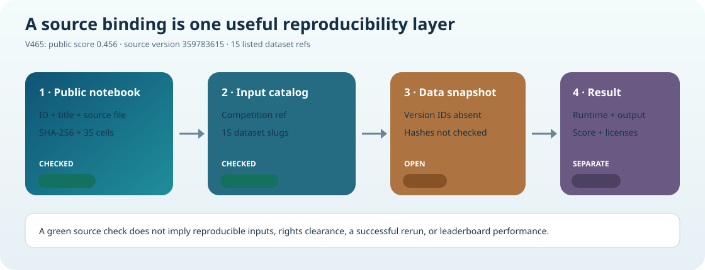

# Audit the public CASMI V465 baseline binding

The fixed binding records the public notebook `guhongbin/casmi26-v465-v15-pop015`, Kaggle version `359783615`, and the source bytes captured by a read-only Kaggle API pull. Its version page displayed public score **0.456**. At the 20 October 2026 16:43 UTC check, the official competition leaderboard top was **0.495** and the `prvsiyan` row showed **0.345**. The notebook source is a credited, multi-source adaptation. This package verifies its source identity and listed input slugs; it is not an implementation of those sources.

The method is useful as a high-scoring public reference: a two-engine candidate pipeline combines analog/library/FP ranking with gated PubChem retrieval, then uses ICEBERG and GLACIER to rerank same-formula candidates. Its authors report the largest jump after adding new candidate evidence and the second engine; the final popularity-weight adjustment was only +0.001 on the public notebook score. See the [version-pinned notebook](https://www.kaggle.com/code/guhongbin/casmi26-v465-v15-pop015?scriptVersionId=359783615), the [13-step score ladder](https://www.kaggle.com/code/varshithakolupuri/casmi26-13-steps-to-0-456-what-each-one-added?scriptVersionId=360037850), and the [official leaderboard](https://www.kaggle.com/competitions/enveda-CASMI26-molecule-id-mass-spectra/leaderboard).



## Run the audit

```bash
python3 audit_v465_public_binding.py --source-dir /path/to/v465-pull
```

To verify the three exact public README captures used for the source-lineage note, place the local files under the names in `source_binding.json` and add:

```bash
python3 audit_v465_public_binding.py \
  --source-dir /path/to/v465-pull \
  --readme-dir /path/to/retained-readmes \
  --require-readmes
```

The script is Python-standard-library only, read-only, and never imports or executes notebook code. A passing check binds the notebook metadata, 35-cell source bytes, competition ref, 15 dataset slugs, and optionally three versioned README byte hashes. Kaggle's pulled metadata has no dataset version identifiers, so this is **not** a full input snapshot reproduction. The script also does not verify license metadata, rights, runtime, output, or score. The source page's score badge is an external observation, not reconstructed here.

The three supporting README pins are simulated ranker rows V4, GLACIER V1, and ICEBERG V1. Only their SHA-256 bindings are published here; the README bodies and all data/model payloads are not copied.

The V465 notebook page declares Apache-2.0 for its source; upstream datasets and components keep their own terms. `audit_v465_public_binding.py` is licensed separately under Apache-2.0 as stated in [`LICENSE-SCRIPT.md`](LICENSE-SCRIPT.md). Neither license statement grants rights to third-party data or components.
