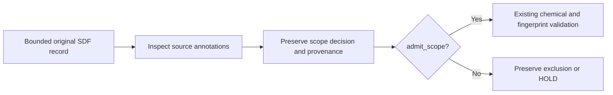

# Inspect source annotations before computing mass

This original, stdlib-only helper checks the **scope** of one bounded SDF record before a mass-candidate extractor canonicalizes it. It preserves the supplied-byte hash, record ordinal, ChEBI ID, raw annotation lines, group types, memberships and repeat labels.

Its three decisions are deliberately narrow:

| Decision | Meaning |
| --- | --- |
| `admit_scope` | No source SubstanceGroup detected within the supported grammar; chemical validation is still required. |
| `exclude_scope` | A recognized source SubstanceGroup lies outside this conservative finite-graph contract. All 15 recognized types are excluded, including non-polymer groups. |
| `hold` | Syntax, framing or annotations are unresolved; retain the evidence and stop. |



## Use

```python
from raw_molblock_sgroup_scope import MAX_BYTES, inspect_sdf_record

with open("one_record.sdf", "rb") as source:
    raw = source.read(MAX_BYTES + 1)
decision = inspect_sdf_record(raw, record_ordinal=1)
print(decision["status"], decision["reason"])
```

Pass one record, optionally ending in `$$$$`; this is not an archive reader. Supported annotation framing covers V2000 and V3000, including continuations and actual membership IDs. Titles, literal atom aliases and SDF property values are kept separate from annotations. Limits are 2 MiB, 100,000 lines and 32 digits per integer token. Unsupported syntax may conservatively stop otherwise valid records.

## Check the contract

From this directory:

```bash
python3 -B test_raw_molblock_sgroup_scope.synthetic.py
```

The first recorded execution passed **23 invented-text test methods**, with zero failures, errors or skips. Cases include metadata false positives, all recognized group types, malformed/orphan references, continuation provenance and oversized integers. These strings test parser decisions; they are not chemically validated molecules. The result supplies no real-bank coverage, descriptor parity, fingerprint or competition-score evidence.

The complete ChEBI bank remains unqualified and unpublished. See the adjacent [observed identity trap](STRUCTURE_IDENTITY_NOTE.md). This helper has not yet been integrated into that extractor; its existing chemistry, isotope/stereo, exact-mass, fingerprint and alignment checks remain necessary.

Original code and tests: cubres contributors, 2026, MIT. The type categories follow the [RDKit 2026.03.3 source declaration](https://github.com/rdkit/rdkit/blob/Release_2026_03_3/Code/GraphMol/SubstanceGroup.h#L220-L226); no RDKit code or ChEBI record is bundled here.
