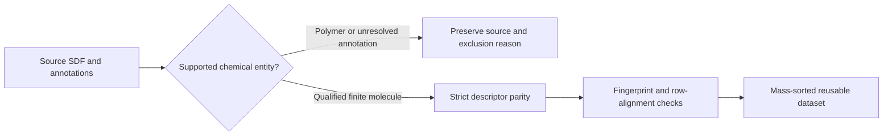

# When matching mass is not enough

Our ChEBI release 255 dataset build stopped at record 130, CHEBI:468. A focused check found that its SDF and first SMILES reparse had the same InChIKey, formula and exact mass (194.04265266 Da), but different SMILES and atom counts: 14 versus 13, with one separate hydrogen atom becoming zero. No fingerprint comparison ran in that check; it does not establish stereochemical equivalence.

The source also contains an `SRU` substance group and a repeat label `n`. Its name describes a polymer and its source formula is `(C6H8O6)n.H2O`; the finite parsed graph gives `C6H10O7`. RDKit's [version-matched source](https://github.com/rdkit/rdkit/blob/Release_2026_03_3/Code/GraphMol/SubstanceGroup.h#L220-L226) classifies `SRU` among polymer groups. A matching finite graph mass therefore does not qualify this record as an individual small-molecule mass candidate.

The proposed extraction contract checks substance-group annotations before canonicalization and retains strict parity for admitted molecules. This is a design under review, not a completed implementation or full-bank result. The earlier 32-molecule fixture passed; the bank itself remains incomplete and unpublished. No competition score improvement is claimed.

Source: [ChEBI release 255 SDF archive](https://ftp.ebi.ac.uk/pub/databases/chebi/archive/rel255/SDF/), whose README gives 9 September 2026 as its last update; ChEBI data are credited under [CC BY 4.0](https://creativecommons.org/licenses/by/4.0/). The observed record is [CHEBI:468](https://www.ebi.ac.uk/chebi/searchId.do?chebiId=CHEBI:468). This note reports our own extraction diagnostic.
