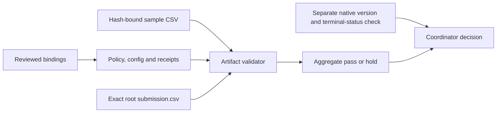

# Check the file you are about to submit

A small, standard-library tool for the CASMI V6 output contract. It checks that the final CSV, sample row order, canary result, resolved configuration and completion receipts agree. It does not run a model or contact Kaggle.

The validator and its bindings are the exact independently reviewed files used to prepare checks for [Analog Propagation](https://www.kaggle.com/code/prvsiyan/analog-propagation-casmi-2026-baseline) V35. This packet belongs in the existing [CASMI repository](https://github.com/cubres/enveda-casmi-2026).

## Try it without competition data

```bash
python3 -B demo_synthetic.py --destination ./synthetic-demo-001
```

Choose a new destination each time. The demo preserves its fixtures and refuses to overwrite an existing destination. It generates two invented molecule IDs and four cases:

| Case | Expected result |
|---|---|
| Internally consistent fixture | Pass artifact checks |
| Changed CSV without updating its receipt | Reject `SUBMISSION_BYTE_HASH` |
| Canary says its logits were not finite | Reject `EXACT_CANARY_RECEIPT` |
| Reordered IDs, with an updated CSV hash | Reject `SUBMISSION_ID_ORDER` |

The last case shows why a matching hash alone is insufficient. The sample CSV must also match its recorded input hash, and the final IDs must follow its exact order.



## Check a completed output directory

```bash
python3 -B validate_completed_output.py \
  --output-dir /path/to/completed-output \
  --sample /path/to/current-sample_submission.csv
```

The output root must contain `submission.csv` and `casmi_v6_native_once/`. That subdirectory must contain `PREFLIGHT_POLICY.json`, `NATIVE_CONFIG.json`, `V6_NATIVE_WRAPPER_ONE_ATTEMPT.json`, `PREFLIGHT_RESULT.json`, `V6_NATIVE_SCIENCE_ONE_ATTEMPT.json`, `CANARY.json`, `RESULT.json` and `WRAPPER_RESULT.json`. Any preflight, driver or wrapper failure receipt rejects the result. Retained source files are hash-checked when present, with the checked count reported.

The program prints aggregate JSON and exits 0 for a pass or 2 for a hold. It checks bounded files, rejects duplicate JSON keys and non-finite constants, and streams the CSV. It prints no molecule IDs or candidate rows. Its local review budget is 120 seconds, checked around I/O; it does not claim a hard I/O timeout or memory isolation.

## What a pass means

A pass establishes consistency of these artifacts with this exact versioned contract. It cannot authenticate fabricated receipts, prove that inference ran, establish model quality, or supply an official score. The positive demo deliberately fabricates internally consistent receipts; every fixture is marked `SYNTHETIC_ONLY.json`.

At the coordinator's last reported check, **2026-10-15 17:17 UTC**, V35 was still RUNNING. This packet makes no native canary, completed-inference, score or improvement claim. Synthetic checks are software tests only. Confirm the exact public notebook version and terminal status separately before considering its native competition submission menu.

The bindings intentionally pin one CASMI run contract. For another pipeline, author and review your own contract instead of treating these pins as generic defaults. This tool never submits, retries a consumed attempt, changes a notebook, or deletes an artifact.

## Provenance and license

Original implementation and synthetic demo by cubres contributors, 2026; MIT license in `CODE_LICENSE.txt`. `PROVENANCE.json` identifies the exact reviewed validator and bindings. Only source, artifact metadata and invented examples are included: no competition records, private canary rows, model weights or scientific assay results. References and permission declarations in the bindings grant no rights to the referenced data or weights.
