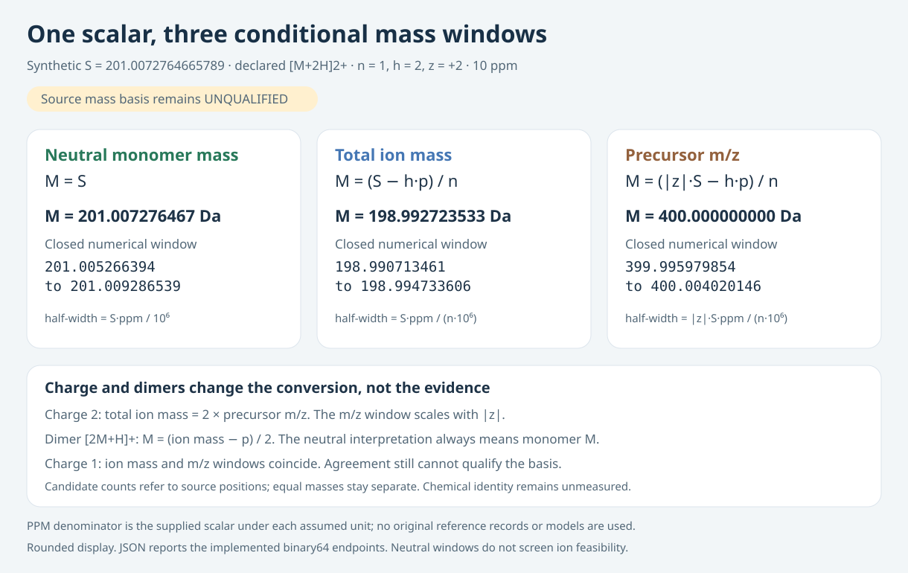

# Mass-basis sensitivity: compare assumptions before candidate retrieval

This original standard-library tool compares three **conditional** numerical
interpretations of one supplied value: neutral monomer mass, total ion mass,
and precursor m/z. It reports closed candidate-row windows and how many source
positions change between assumptions. It never chooses or qualifies the true
mass basis, identifies a molecule, or supplies a ranking score.



The diagram uses an invented scalar and an empty candidate bank. It illustrates
the equations; it is not a reference-record result or measured coverage.

## Quick start

With Python 3.10+, run this beside the bundled invented mass-only CSV:

```sh
python -B mass_basis_sensitivity.py --masses-csv invented-masses.csv \
  --value 201.0072764665789 --channel '[M+2H]2+' --ppm 10 \
  --report fresh-report.json --windows-csv fresh-windows.csv
```

The JSON and CSV show all three conditional windows. Both output paths must be
new. No third-party dependency or chemical dataset is needed for this example.

## Why this complements the existing datasets

The [COCONUT Proton Ion Atlas](https://www.kaggle.com/datasets/prvsiyan/coconut-proton-ion-mass-index)
provides eight explicit theoretical proton channels for 436,389 source mass
rows. The [Reference Evidence and Mass Ambiguity atlas](https://www.kaggle.com/datasets/prvsiyan/casmi-reference-mass-ambiguity)
reports numerical candidate counts at the supplied MassBank `exact_mass`, while
explicitly leaving its neutral-mass basis unqualified under the source's
charge/salt processing. Those counts remain unchanged.

The missing capability is a small reproducible **sensitivity report**, so a
local experiment can show how much its numerical candidate set depends on a
declared interpretation. This companion adds that report to the existing
workflow. It creates no additional molecular database or copied reference
table. It cannot establish which hypothetical interpretation actually applies
to a supplied MassBank value. Source provenance and chemical normalization
still require separate evidence.

The [CASMI Candidate Interop Kit](https://www.kaggle.com/datasets/prvsiyan/casmi-candidate-interop-kit)
supplies complementary invented fingerprint and mass-contract examples.

## The contract

For neutral **monomer** mass `M`, multiplier `n`, signed proton count `h` and
signed charge `z`, the declared channel uses:

```text
total ion mass = n*M + h*p
precursor m/z  = (n*M + h*p) / abs(z)
```

The fixed proton convention is `p = 1.0072764665789 Da`, as documented in the
existing public tools from NIST CODATA 2022. No atomic mass, salt processing,
adduct, charge or polarity is inferred from molecular records here.

For supplied scalar `S` and `e = ppm / 10^6`, the three hypothetical windows are:

| Interpretation of S | Neutral monomer center | Mathematical half-width |
|---|---|---|
| Neutral monomer mass | `S` | `S*e` |
| Total ion mass | `(S - h*p)/n` | `S*e/n` |
| Precursor m/z | `(abs(z)*S - h*p)/n` | `abs(z)*S*e/n` |

PPM is referenced to the **supplied scalar under each assumed unit**. These are
explicit numerical coordinates, not a claim about a record's actual instrument
accuracy. Implemented endpoints first form `S ± S*e`, then apply the stated
affine conversion in a fixed finite-binary64 operation order. Equivalent
algebra can differ by a ULP; the reported endpoints define the actual closed
window. Both boundaries and all duplicate mass rows are included.

Charge 2 distinguishes ion total mass from m/z. With unit charge those two
hypotheses coincide arithmetically; that agreement supplies no basis evidence.
For a dimer, the neutral interpretation still means **monomer M**, not `n*M`.
The neutral numerical window does not apply an ion-feasibility filter. Other
hypotheses can return `HOLD` for a nonpositive inverse center; a positive center
may still have a negative lower bound without invalidating positive candidates.

## Python API

Requires Python 3.10+; no NumPy, RDKit, model, network or chemistry parser is
required. Build an owned immutable index once, then query it repeatedly.

```python
from mass_basis_sensitivity import MassIndex, audit_basis

# Invented numerical masses and duplicate source positions, not molecules.
index = MassIndex([98., 100., 100., 199., 200., 201., 400.])
report = audit_basis(index, 201.0072764665789, '[M+2H]2+', 10.,
                     polarity='positive')
for row in report['hypotheses']:
    print(row['basis'], row.get('source_row_count'), row['mass_basis_qualification'])
```

`MassIndex` accepts a bounded list/tuple of positive finite built-in numbers,
keeps duplicates, copies ownership, and rejects unsorted rows. It never sorts,
deduplicates, or invents molecular identifiers. Lazy iterables are rejected
before consumption; the explicit cap is 1,000,000 source rows. For your own
downloaded atlas, convert its read-only numerical NumPy array with `.tolist()`;
keep its exact release/hash and row alignment separately. This tool does not
verify the truth of a producer's chemical mass convention or join other files.

The only supported channels are the same eight proton channels declared in
the atlas: positive/negative monomers with charges 1, 2 and 3, and positive/
negative singly charged dimers. Unknown channels and polarity conflicts fail.
The immutable channel table cannot be expanded by an input string.

All results retain `mass_basis_qualification='UNQUALIFIED'`. Pairwise reports
contain row intersections, union counts, and ranges added/removed. They count
source **positions**, including equal masses; they are not structural overlap
or chemical coverage. Empty/empty row Jaccard is unavailable (`null`), and a
held hypothesis has no fabricated candidate count or pairwise score.

## CSV interface for local experiments

Create a sorted mass-only CSV with this exact header and consecutive zero-based
positions. No structure, key, spectrum or learned array is required:

```csv
source_row_id,neutral_mass_da
0,98.0
1,100.0
2,100.0
```

```sh
python -B mass_basis_sensitivity.py --masses-csv invented-masses.csv \
  --value 201.0072764665789 --channel '[M+2H]2+' --ppm 10 \
  --polarity positive --report fresh-report.json --windows-csv fresh-windows.csv
```

The CSV reader accepts at most 64 MiB and reads at most one additional sentinel
byte to detect oversize. It checks the row cap before appending. These are
numerical file/row contracts, not an operating-system
memory/CPU sandbox. Existing outputs are preserved. Keep any partial outputs
if a later write fails. The JSON uses full float representations; CSV makes
the three windows easy to compare in an experiment log.

## Reproduce the small controls and diagram

```sh
python -B verify_synthetic.py --out a-new-control-directory
python -B render_mass_basis.py --output a-new-diagram.svg
```

The controls use invented values only: independent high-precision affine
equations, direct closed-interval scans with duplicate endpoints and adjacent
floats, set-based overlap bookkeeping, charge/dimer distinctions, empty unions,
negative channels, malformed inputs, bounded consumption, detached ownership
and exclusive CLI output. Optimized-mode verification is explicitly refused.
Actual receipts and independent review belong in the separately frozen packet;
source-only inspection is not a new chemistry or competition evaluation.

## Scope and attribution

This original code, prose and synthetic schematic are MIT licensed. The source
dataset lineage is credited in `PROVENANCE.json`: prvsiyan's COCONUT candidates,
the COCONUT team, and Samar Talwar's MassBank compilation and its contributors.
The actual source/derivative tables retain their own CC BY-NC-SA 4.0 terms;
literal CC0 admission of individual reference records does not relabel the
compilation. No source masses, keys, structures, record content, spectra,
third-party arrays or weights are bundled or redistributed here.

This is a companion to the existing atlas/reference/interoperability tools,
not a new duplicated dataset. No true-basis qualification, candidate identity,
chemical coverage, model quality, native run or official score is claimed.
