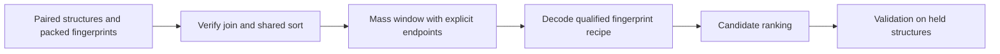

# Before ranking: qualify the packed candidate-bank interface

14 October 2026. This original note records a bounded header/footer inspection of Aryan Awasthi's [COCONUT Morgan/MACCS candidate bank](https://www.kaggle.com/datasets/aryanawasthiteykik/casmi26-coconut-morgan-maccs-fingerprints), observed **version 1**, alongside a private reading of the [spectrum-to-fingerprint model source](https://www.kaggle.com/datasets/aryanawasthiteykik/casmi26-spectrum-to-fingerprint-mlp), observed **version 8**. It offers checks for adapting a candidate bank; it reports no trained model, ranking improvement or competition score.

## What the physical metadata establishes

| File or field | Observed interface |
|---|---|
| `coconut_fp_morgan2048_maccs167.npy` | NPY header declares `uint8`, C order, shape `(436389, 277)`; 128 header bytes and 120,879,881 total file bytes |
| `coconut_structures.parquet` | Ordinary `PAR1` footer declares 436,389 rows and three fields; 2,014 footer bytes and 21,872,382 total file bytes |
| `ik14` | Nullable `BYTE_ARRAY`, annotated UTF8/String |
| `smiles` | Nullable `BYTE_ARRAY`, annotated UTF8/String |
| `mass` | Nullable `DOUBLE`, with no logical-type annotation |

For the physical bank inspection, only the NPY header and Parquet metadata were inspected. No fingerprint rows or Parquet data pages were acquired; row values, statistics and key-value metadata were not accessed or exported. File totals are version-bound acquisition metadata; the complete files were not acquired. Matching declared row counts satisfy only a declared-shape compatibility check. They do not prove row alignment, mass units, finite/sorted masses, identifier uniqueness, valid structures or fingerprint values.

A 277-byte row can hold **2,216 bits**. The familiar 2,048 Morgan plus 167 MACCS positions sum to **2,215**, leaving one storage position. That arithmetic does not identify its value or position, key-zero semantics, block order or bit order. The source describes a combined packing route, but its unexecuted default helper route would produce 256-byte Morgan-only rows. Bind the actual 277-byte producer command and recipe before choosing a decoder or mask; a filename and width are insufficient. This source mismatch does not establish a defect in the bank.

## Checks to make before using the bank

Our [original MIT Packed Window Lab](https://github.com/cubres/enveda-casmi-2026/blob/d97abc1d5f14724e02d65d3f88f327666a22ce1a/tools/packed-window-lab/2026-10-14/README.md) already passed 14 synthetic mechanics controls. Use `row_order_digest`, `aligned_window` and `validate_masses` for the paired-row and mass checks below. Its mass window includes both endpoints; the upstream source excludes the exact upper endpoint. Its decoder requires a declared bit order and zero key-zero/padding positions, so those conditions must be qualified before using it on this bank. Passing synthetic controls does not supply that qualification.

1. **Bind paired rows.** Record a stable producer row-order digest or construct both files from the same keyed table. A small paired sample can detect a mismatch; it cannot prove alignment throughout the bank. Apply any sort or deduplication permutation to both structures and fingerprints, and make the duplicate representative policy explicit.
2. **Bind the mass window.** Establish the mass basis and units, reject missing/nonfinite values, verify sorted order, and choose inclusive or exclusive endpoints deliberately. Compare indexed lookup with an independent filter on synthetic boundary cases before applying it to real candidates.
3. **Bind the fingerprint decoder.** Record generator/library versions, Morgan settings, MACCS conventions, concatenation order, packing bit order and ignored positions. Check a permitted paired sample against regeneration, then bind the model output width and order to that recipe. Keep raw logits and probabilities distinct.
4. **Validate on held structures.** Exclude held structures from model training and reference-spectrum/analog libraries as well as ranker fitting. Freeze candidates and duplicate policies; measure candidate recall and ranking separately. Synthetic mechanics checks establish mechanics only.

This is an interface checklist, not a measured scientific chart. The candidate bank alone does not qualify the model checkpoint, its training exclusions or every dependency of the upstream pipeline.

Both upstream dataset records declare **CC BY-NC-SA 4.0**. Credit belongs to Aryan Awasthi and the upstream COCONUT resource; consult the upstream records for their additional credits. Private source reading does not establish permission to redistribute their payloads or implementation, or authorization for competition use. This note includes original explanatory prose and a diagram, without upstream code, molecular identifiers, model weights or competition rows.
