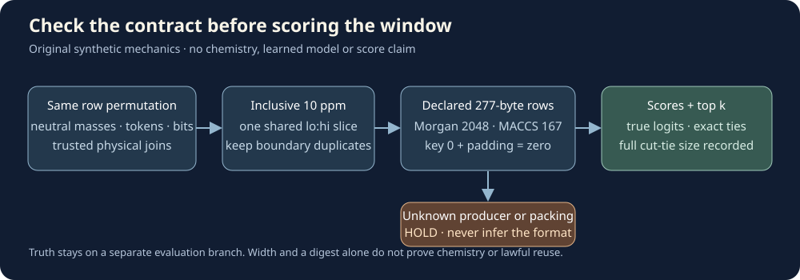

# CASMI Packed Window Lab — synthetic NumPy companion

Find the same candidates in every aligned array, unpack only a small window, score declared bits, and make exact ties visible. This is a small experiment tool for learning and checking interfaces before an expensive CASMI run. It includes **invented masses and bit patterns only**: no molecular structures, spectra, real identifiers, training labels, learned weights, third-party fingerprints, or MACCS definitions.



## Run the invented example

Requires Python 3.10+ and NumPy. No RDKit, pickle, model loading or network access is needed. The source packet has not been executed yet; the registered controls and runtime bounds are listed in `ROOT_CONTROL_RUN_PLAN.json` for root review.

```bash
python -B synthetic_demo.py
python -B synthetic_demo.py --bitorder little --mode balanced_prospective
python -B synthetic_demo.py --mass 175 --ppm 10
python -B -m unittest -v test_window_lab.py
```

The default fixture deliberately puts repeated masses on both 10 ppm endpoints, and one adjacent floating-point value just outside each. Its expected window is the shared half-open row slice `2:9`, containing seven invented rows. `SYN_005` has the largest invented logit score. That expected answer is defined in source, not a model prediction or a measured chemical identification result. The empty-window example should produce no candidates, with no made-up fallback molecule.

The command knobs change only this synthetic experiment. `--mode balanced_prospective` invokes our original fixed-weight `z(Morgan) + 0.30*z(MACCS)` score option; it is **not** a demonstrated ranking improvement. Keep a real model, mass window, candidate universe, view aggregation and priors frozen when comparing score formulas, and register one treatment before inspecting evaluation truth.

## Use the API

```python
from packed_window_lab import aligned_window, row_order_digest, score_window, topk_with_ties
from synthetic_demo import make_synthetic_demo

masses, ids, bits, packed, logits, contract = make_synthetic_demo("big")
interval, window_ids, window_fp = aligned_window(
    masses, ids, packed, contract, neutral_mass_da=100.0,
    expected_row_order_sha256=row_order_digest(ids), ppm=10.0,
)
scores = score_window(window_fp, logits, contract, mode="likelihood_order")
result = topk_with_ties(scores, window_ids, k=5)
```

`masses` must be a finite, positive, sorted `float64` vector. The inclusive query-denominator interval is `[q−q×ppm/10⁶, q+q×ppm/10⁶]`; lower search uses `left`, upper uses `right`. Duplicates at either endpoint stay inside. A precursor m/z is **not** a neutral mass. This helper converts no adduct or charge; establish that convention separately.

One interval slices masses, row tokens and fingerprint rows together. The token digest is length-delimited UTF-8, so it cannot confuse concatenations like `['AB','C']` and `['A','BC']`. It checks a declared row order; an independently trusted manifest must additionally bind the physical mass, metadata and fingerprint files to that order. A digest calculated from a wrong pairing does not repair it. Arrays must stay unchanged between checking and use; the returned fingerprint slice is a view. Complete-axis validation is O(n) on every call, so this transparent small companion is not an optimized repeated-query search service.

For your own plain arrays, use read-only NumPy loads with `allow_pickle=False` and a bounded header, for example `np.load(path, mmap_mode='r', allow_pickle=False, max_header_size=8192)`. There is no arbitrary file loader in this package. The API checks dtype, dimensions and dummy bits; it is not a hostile-file sandbox.

## Packing is explicit

The supported declared layout has 277 bytes = 2,216 positions:

| Positions | Meaning |
|---|---|
| `0:2048` | Declared Morgan block |
| `2048` | Unused MACCS key 0: must be zero |
| `2049:2215` | MACCS keys 1–166 |
| `2215` | Final padding: must be zero |

Both `big` and `little` packing are supported **only when explicitly declared**. `UNKNOWN_PRODUCER_CONTRACT.json` intentionally refuses use. Do not infer bit order, generator radius/options, molecular preprocessing, model target order or producer eligibility from a filename or width. `EXTERNALLY_QUALIFIED` is a caller declaration; the library cannot independently verify its truth. A real producer needs reviewed code/version/options, actual arrays and row joins, consumer-target parity, normalized identities and current use/redistribution eligibility. Those remain **UNKNOWN** for the linked real resources in this package.

The ordinary score is valid binary bits dotted with **true logits**, equal to independent-Bernoulli log likelihood up to a candidate-independent query constant. Sigmoid probabilities are a different input; shape and range cannot prove logits. Dummy-position logits never contribute. The prospective balanced mode uses whole-window population standardization after bounded chunk scoring, keeps constant/singleton windows finite, and scales before squaring to avoid tiny-score underflow. It requires no fit, yet still needs a separate eligible paired evaluation before any quality claim.

## Ties and evaluation

`topk_with_ties` sorts descending `float64` scores and breaks exact ties by ascending unique row token. It also records the full tie size when only part of a tied group fits in top k. Real tokens must already reflect unique competition-normalized identities; this helper does not perform chemical canonicalization. Invented `SYN_…` tokens are not InChIKeys.

`evaluation_only_expected_rr` is separate from inference. With an independently eligible truth index, it averages reciprocal rank over uniform permutations inside its exact-score tie group, counting ranks past k as zero. An absent truth contributes zero. Do not expose truth to candidate generation, score selection or native submission code. Any real panel's optimizer, model-selection, prior-tuning, reference and pool exposure must be documented; the publisher's already reported comparison panel is development evidence, not an untouched holdout.

## Files and bounds

`packed_window_lab.py` is the public API; `block_balance_r2.py` is our preserved, independently reviewed original scoring core; `synthetic_demo.py` builds only invented arrays; `test_window_lab.py` defines registered mechanics controls. The SVG is original explanatory artwork. `SOURCES.md` records credit and terms. No current campaign notebook or opening picture is changed.

The API admits at most 1,000,000 bank rows and 32,768 rows in a complete window, 128 characters per row token, positive finite ppm up to 1,000, and top k from 1 to 25. These are interface limits, not scientific recommendations. Oversized windows fail rather than truncate. A root-run controller must separately enforce the registered 60-second wall/30-second CPU/512 MiB RSS/one-math-thread test limits. Passing synthetic controls would qualify mechanics only; it would not establish real producer parity, speed on 436k candidates, model quality, competition eligibility, or a leaderboard score.
