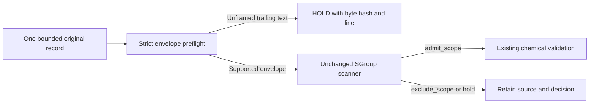

# Catch unframed trailing SDF text before scope inspection

This small, stdlib-only preflight closes a concrete partial-input problem in the adjacent scope scanner. That scanner finds the first `M  END` and looks for selected metadata afterward. Without a stricter envelope, an accidentally concatenated second CTAB, or an annotation outside any property field, can be ignored while the first CTAB receives `admit_scope`.

`strict_sdf_envelope.py` first checks that the remaining text fits a deliberately narrow single-record envelope. Unexpected text outside a property value produces `hold`, retaining the exact supplied-byte SHA-256 and the offending line. The bundled `raw_molblock_sgroup_scope.py` is an unchanged snapshot of the earlier MIT helper.



## Run the invented-text examples

Python 3.9 or later; no installation, RDKit, model, network, or data download is needed. From this directory:

```bash
python3 -B example_synthetic.py
python3 -B -m unittest -v test_strict_sdf_envelope test_v3000_envelope
```

The demo prints two JSON lines: a single invented empty CTAB returns `admit_scope`; appending an unframed `M  STY` annotation returns `hold`. Empty CTABs make the examples' lack of chemical evidence explicit. No generated or downloaded molecule is included.

The recorded validation passed **20 new invented-text test methods**, with no failures, errors, or skips: 0.126 seconds wall time and 18,874,368 bytes peak child RSS on Python 3.9.6/macOS. The execution had a 15-second subprocess timeout; measured peak RSS stayed below the declared 128 MiB review budget. The RSS threshold was checked after execution, not enforced as an operating-system memory cap. See `SYNTHETIC_VALIDATION_RESULT.json` for exact source hashes and output.

A separate review-driven V3000 fixture checks exact old/new scope-result equality for an empty graph and a recognized group, plus rejection of an undelimited appended CTAB. Its three methods were run separately; see `V3000_VALIDATION_RESULT.json`. This small sample is not exhaustive grammar coverage.

## Integrate without changing the existing scanner

```python
from strict_sdf_envelope import inspect_scoped_record

# raw_record is ONE already-bounded record supplied by the caller.
decision = inspect_scoped_record(raw_record, record_ordinal=17)
if decision['status'] == 'admit_scope':
    # Only now continue the existing chemical/mass/stereo/fingerprint gates.
    pass
else:
    # Preserve the original input and decision for review.
    pass
```

The helper does no file IO. It does not split archives, process a bank, canonicalize a molecule, compute a fingerprint, or change any dataset. No bank/controller run or consumed assay was repeated. This package has not been integrated into, or qualified on, the ChEBI extractor. It provides neither a usable molecule bank nor competition-score evidence.

The wrapper has a **new result schema**: do not pass it directly to the earlier scanner's `count_decision()`, which expects top-level `groups`. Count the wrapper's `status` and `reason` for every supplied record; inspect `decision['scope']` for group details only when it is non-null. This preserves envelope HOLDs in record totals.

## Supported envelope and conservative exclusions

- The original scanner's limits remain 2 MiB and 100,000 decoded lines per supplied record. The caller should bound acquisition before passing bytes; hashing cannot avoid work already spent constructing an oversized input.
- After the first `M  END`, supported nonblank text starts with a direct `> <FIELD>` property header. This intentionally follows the adjacent scanner's supported header family and may hold valid CTfile variants outside that subset.
- Property values continue until a truly empty line. A whitespace-only line inside a value stays in that value, matching the pinned scanner. Literal `M  END`, CTAB text, and `> <FIELD>` strings inside a properly opened value are not treated as a second molecule or field.
- A line whose stripped content is `$$$$` ends the supplied record, including when it appears in a property value. Only whitespace may follow it. The delimiter is optional.
- Unknown trailing text, malformed property headers, a delimiter before the first `M  END`, content after a delimiter, invalid UTF-8, and size/line-limit breaches produce `hold`. The original scanner can still produce its own `hold` or `exclude_scope` after the envelope passes.

This is a narrow framing guard, not a complete CTfile grammar validator. It cannot infer whether CTAB-looking text intentionally placed inside a valid property value was meant to be another record. It does not establish chemical validity, mass, stereochemical preservation, release rights, or model utility.

Project context: [public CASMI Analog notebook](https://www.kaggle.com/code/prvsiyan/analog-propagation-casmi-2026-baseline). This standalone helper makes no claim about that notebook's score.

## Result contract

`decision.schema.json` describes the wrapper result. Every response includes:

| Field | Meaning |
| --- | --- |
| `record_sha256`, `record_bytes` | Digest and length of exactly the supplied bytes; string inputs are UTF-8 encoded. |
| `record_ordinal` | Caller-supplied ordinal, not a claimed database identifier. |
| `status`, `reason` | Final scope status/reason, or the envelope's HOLD reason. |
| `envelope` | Framing evidence, header names/line numbers, delimiter/end lines, and any offending line. |
| `scope` | Unchanged scanner result if the envelope passes; otherwise `null` because the scanner was not called. |

Representative outcomes:

| Invented input | Final result | `scope` |
| --- | --- | --- |
| Single empty CTAB | `admit_scope` | Original scanner result |
| Two CTABs joined without a delimiter | `hold / unexpected_text_outside_property_value` | `null` |
| `M  STY ... SRU` after `M  END`, outside a field | `hold / unexpected_text_outside_property_value` | `null` |
| The same text inside a `NOTES` value | `admit_scope` | Original scanner result |
| Recognized SRU annotation before `M  END` | `exclude_scope` | Original scanner result |
| Unknown group type before `M  END` | Original scanner `hold` | Original scanner result |

## Rights and provenance

Original wrapper, tests, demo, schema, and documentation: cubres contributors, 2026, MIT; see `CODE_LICENSE.txt`. The unchanged scanner snapshot is credited and bound in `PROVENANCE.json` to its [earlier public source commit](https://github.com/cubres/enveda-casmi-2026/commit/62075aa71bb063a631a20423775ed453c43c347e). No third-party chemical record, competition input, model weight, or dataset content is redistributed. The MIT code license does not grant rights in data a caller later supplies.
