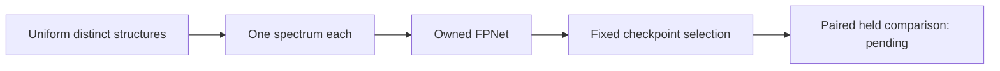

# Giving every structure a turn

Our original structure-uniform, single-spectrum experiment completed its first
native CASMI fit on 14 October 2026. This changes how training examples are
sampled, while keeping the owned encoder and training recipe fixed.

Sampling spectrum rows uniformly gives structures with many recorded spectra
more training weight. Instead, each batch selects distinct eligible structures
uniformly, then selects one eligible spectrum uniformly within each structure.
See the [sampler guide](README.md) for the construction and its limitations.

Kaggle's primary UI reports **Version 6 succeeded in 15,325.1 seconds**, with a
T4 ×2 allocation. The driver used one worker on device 0. Its rendered training
receipt reports:

| Measurement | Result |
|---|---:|
| Full optimizer phase | 30,000 steps; 0 nonfinite steps |
| Initial probe | PASS; 64 steps; 0 nonfinite steps |
| Full-phase elapsed time | 15,237.6 seconds |
| Median step time | 0.50685 seconds |
| Peak Torch-allocated device memory | 5.195 GB |
| Selected-checkpoint proxy MRR@25 | 0.707475 |

These timings describe this run. The memory figure measures allocated device
memory; it is not the allocation's total capacity. The receipt reports a
197,739,081-byte checkpoint, but its weights have not been acquired or
independently hash-verified.

**The checkpoint proxy is not an official score, and no held improvement has
been measured.** Next, after artifact and input verification, compare this
single-view model with the matched V4 single-view baseline on identical queries,
using a paired, structure-weighted uncertainty estimate. Role 2 is already-used
fusion-selection evidence; it is not a fresh unbiased holdout. Role 3 remains
sealed. Competition structures, spectra and labels stay private.
