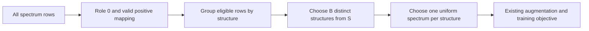

# One structure, one spectrum

A small NumPy sampler for experiments where one structure has many more measured spectra than another. Sampling uniformly from spectrum rows gives structures with more rows more training weight. This sampler chooses **distinct eligible structures uniformly**, then chooses one eligible spectrum uniformly from each selected structure.

For toy groups containing 1, 2 and 5 spectra, uniform row sampling gives structure probabilities **1/8, 2/8 and 5/8** per batch slot. Here each structure has probability **1/3 per slot**. With three structures and batch size two, each structure's probability of appearing anywhere in a batch is **2/3**. Those two probabilities describe different events.



In general, structure inclusion is `B/S`, per-slot structure probability is `1/S`, and a spectrum belonging to a group of size `n` has per-slot probability `1/(S*n)`. Structures are sampled afresh each step. A batch larger than the number of eligible structures is rejected; there is no duplicate-structure fallback. This changes the weighting of the training distribution and is a hypothesis to evaluate, not an established model improvement.

## Try it with invented data

Requires Python and NumPy. Put the following example beside `structure_uniform_sampler.py` and run it with ordinary Python. All indices below are invented; no competition data is included.

```python
import numpy as np
from structure_uniform_sampler import StructureUniformSampler

# Eligible structure IDs 0, 3 and 4 have 1, 2 and 5 spectra.
structure_by_spectrum = np.array([0, 1, 1, 2, 2, 2, 3, 3, 4, 4, 4, 4, 4])
roles = np.array([0, 1, 2, 0, 0])  # Only role 0 may enter optimizer batches.
positive_by_structure = np.array([0, 1, -1, 3, 4])  # Negative means invalid.
eligible = np.flatnonzero(
    (roles[structure_by_spectrum] == 0)
    & (positive_by_structure[structure_by_spectrum] >= 0)
)
sampler = StructureUniformSampler(
    eligible, structure_by_spectrum, roles, positive_by_structure
)
rng = np.random.default_rng(20261014)
ids = sampler.sample(rng, batch_size=2)
assert len(np.unique(structure_by_spectrum[ids])) == 2
assert np.all(roles[structure_by_spectrum[ids]] == 0)
print("Chosen spectrum rows:", ids.tolist())
print("Group sizes:", sampler.counts.tolist())  # [1, 2, 5]
```

The sampler requires the exact ascending list of all rows satisfying the role-0 and valid-positive filters. It rejects inconsistent eligibility instead of silently changing the experiment. Its checks use Python `assert`; keep assertions enabled and validate real inputs before training. `receipt()` returns group statistics and SHA256 bindings of index arrays encoded as little-endian int64. Keep real-data receipts private when their contents or indices cannot be redistributed.

## Keep the comparison interpretable

For a single-variable assay, change only the batch selection rule. Keep the input versions and hashes, positive and negative mappings, model initialization, optimizer, augmentation, loss, batch size, steps and checkpoint selection protocol fixed. Use the same predeclared validation IDs and held-out roles; do not tune on a sealed final holdout. The sampler itself excludes all nonzero roles, but it does not create or verify your scientific split.

Construction consumes no random numbers. Sampling uses the supplied training `Generator`; the changed draw sequence means later augmentation and other consumers of that generator will see a different random stream. The same seed alone does not make later random draws identical. This is part of the treatment and should be recorded.

## What was measured

[SYNTHETIC_QUALIFICATION.json](SYNTHETIC_QUALIFICATION.json) records one completed synthetic qualification of this exact source hash: **24,000 batches of two**, fixed seed `20261014`, five passing checks, and observed runtime **0.4123 seconds** in that environment. Structure inclusion counts were **15,881, 16,015 and 16,104**, against an expectation of **16,000 each**. The predeclared tolerance was six binomial standard deviations; the conditional spectrum counts are also included. Passing these bounds supports these synthetic mechanics; it does not prove unbiasedness or predict runtime or model quality on another machine.

There was **no training fit, model/data access, network access or notebook change** in that qualification. **No official score or score gain is claimed.** This packet includes only original code and invented indices: no competition structures, spectra, targets or weights. Use your own permitted inputs privately and respect their distribution terms. This tool is intended for the [Enveda CASMI campaign](https://www.kaggle.com/competitions/enveda-CASMI26-molecule-id-mass-spectra); it does not contain an inference model or submission artifact.

## License

Original sampler code and this documentation are licensed under MIT. Input data and external models retain their own terms.

Copyright (c) 2026 cubres

Permission is hereby granted, free of charge, to any person obtaining a copy of this software and associated documentation files (the "Software"), to deal in the Software without restriction, including without limitation the rights to use, copy, modify, merge, publish, distribute, sublicense, and/or sell copies of the Software, and to permit persons to whom the Software is furnished to do so, subject to the following conditions:

The above copyright notice and this permission notice shall be included in all copies or substantial portions of the Software.

THE SOFTWARE IS PROVIDED "AS IS", WITHOUT WARRANTY OF ANY KIND, EXPRESS OR IMPLIED, INCLUDING BUT NOT LIMITED TO THE WARRANTIES OF MERCHANTABILITY, FITNESS FOR A PARTICULAR PURPOSE AND NONINFRINGEMENT. IN NO EVENT SHALL THE AUTHORS OR COPYRIGHT HOLDERS BE LIABLE FOR ANY CLAIM, DAMAGES OR OTHER LIABILITY, WHETHER IN AN ACTION OF CONTRACT, TORT OR OTHERWISE, ARISING FROM, OUT OF OR IN CONNECTION WITH THE SOFTWARE OR THE USE OR OTHER DEALINGS IN THE SOFTWARE.
