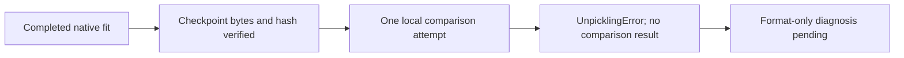

# Where the comparison stopped

The structure-uniform fit completed 30,000 steps. Its selected checkpoint has
now been downloaded privately: 197,739,081 bytes, with the same SHA-256 reported
by the completed native run. This establishes artifact integrity.

The next local assay was meant to compare that checkpoint with the earlier
model on the same 4,096 previously consulted role-2 structures.
It stopped after 2.65 seconds with `UnpicklingError` and produced no comparison
result. The private receipt records the exception type; it does not identify
the precise failing loader. The failed attempt is preserved and consumed.

The diagnosis will inspect serialization opcodes without executing pickle
payloads or running model inference. It has not produced a result yet.

The planned comparison reuses historical predictions whose cache bytes were
bound retrospectively. It can provide conditional selection evidence; it is
not a fresh blinded test. Role 3 remains sealed. The checkpoint-selection proxy
in the fit report is not an official competition score, and this failure
establishes no score improvement.

No structures, spectra, query indices, target masks, models, or credentials are
published with this note. Current notebook artwork is preserved.
